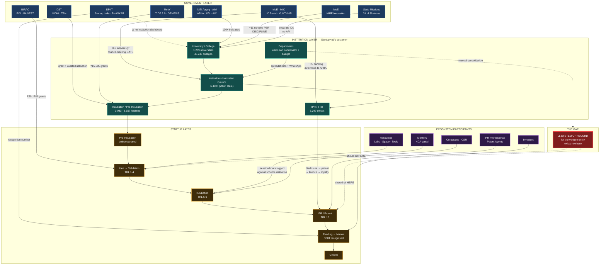
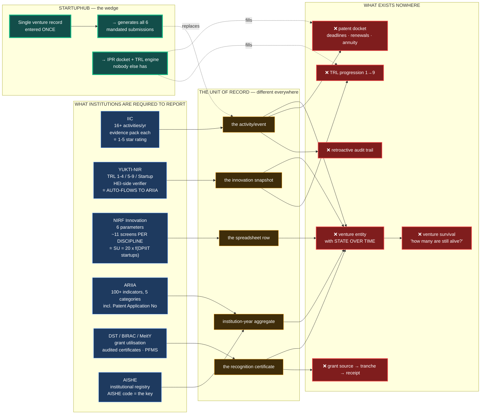
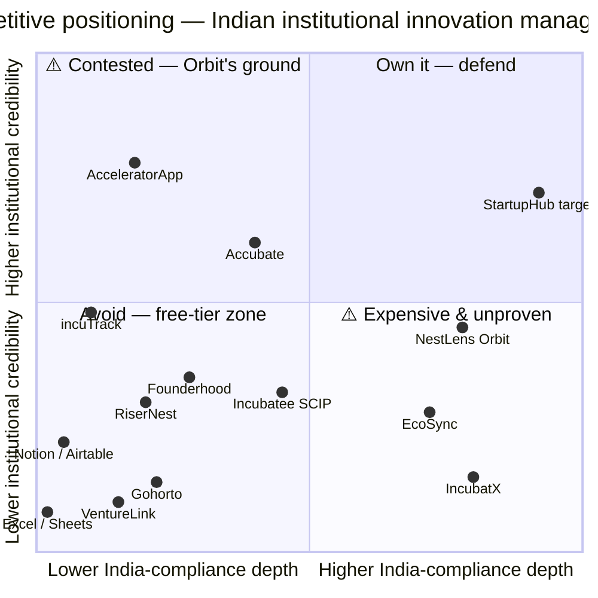
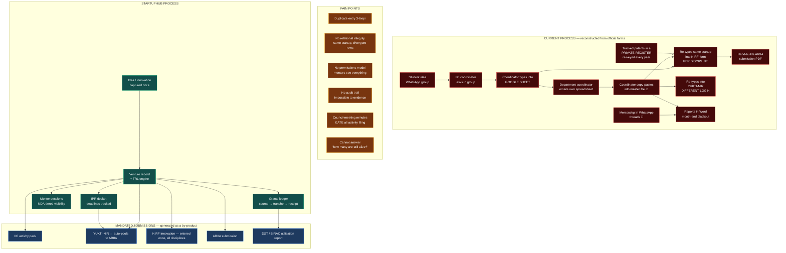

# Diagram 1 — The Indian Innovation Ecosystem

**Mermaid source** for the ecosystem map required by `todo.md` Phase 28.
Render with any Mermaid renderer (GitHub, mermaid.live, VS Code Mermaid preview, or `npx @mermaid-js/mermaid-cli`).

---

# Diagram 2 — The Structural Gap: what is required vs what software exists

This is the core Phase 0 argument, visualised.

---

# Diagram 3 — Competitive Positioning

**Reading the chart.**
- **Top-right is contested.** Orbit and IncubatX already claim the high-India-compliance box. IncubatX is there on marketing claims with zero customers; Orbit is there with a product and a ₹75k price.
- **Top-left holds the credibility.** AcceleratorApp (Yale, MIT, Max Planck) and Accubate (TCS, KPMG, Hero, NSRCEL) have real reference bases — **both with zero Indian institutions and no IPR module.**
- **Bottom-left is the free zone.** Excel, Sheets, WhatsApp, Notion. **Nobody leaves this zone by being cheaper.**
- **The target is unreachable by feature parity.** Orbit and IncubatX already ship "AI + government schemes." StartupHub's position depends entirely on the three things none of them has: **IPR, TRL, and the mandated-portal export.**

---

# Diagram 4 — The Price Band

```mermaid
flowchart LR
    subgraph FREE["FREE INCUMBENTS"]
        A1["Excel / Google Sheets"]
        A2["WhatsApp + Drive"]
        A3["Campus ERP<br/>marginal cost ₹0<br/>(but ₹500-2,000/student/yr)"]
    end

    subgraph FLOOR["THE FLOOR WE CANNOT UNDERCUT"]
        B1["Trello @ 10 users<br/>₹54,000/yr"]
        B2["Notion Plus @ 8 editors<br/>₹86,000/yr"]
        B3["ClickUp @ 10 users<br/>₹76,000/yr"]
    end

    subgraph BAND["✅ THE DEFENSIBLE BAND — ₹75k to ₹5L"]
        C1["⭐ Orbit Launch<br/>₹75,000/yr<br/>COMPETITIVE ANCHOR"]
        C2["Founderhood Starter<br/>university -15%<br/>≈₹1.4L/yr"]
        C3["IncubatX Foundation<br/>₹1.2L/yr"]
        C4["Incubatee year one<br/>₹3,95,200"]
        C5["Orbit Scale<br/>₹2,50,000/yr"]
    end

    subgraph CEIL["THE CEILING"]
        D1["AcceleratorApp core<br/>≈₹5.4L/yr<br/>ISO 27001 · Yale · MIT"]
    end

    subgraph OUT["OUT OF REACH"]
        E1["IdeaScale entry<br/>≈₹5.85L/yr"]
        E2["Elsevier Pure<br/>₹44.6L/yr + ₹43.5L onboarding<br/>'we already own a system'"]
    end

    FREE --> FLOOR --> BAND --> CEIL --> OUT

    classDef free fill:#374151,stroke:#6b7280,color:#fff
    classDef floor fill:#78350f,stroke:#f59e0b,color:#fff
    classDef band fill:#134e4a,stroke:#10b981,color:#fff,stroke-width:2px
    classDef ceil fill:#1e3a5f,stroke:#3b82f6,color:#fff
    classDef out fill:#450a0a,stroke:#ef4444,color:#fff

    class A1,A2,A3 free
    class B1,B2,B3 floor
    class C1,C2,C3,C4,C5 band
    class D1 ceil
    class E1,E2 out
```

---

# Diagram 5 — Today's Workflow vs StartupHub's

The Phase 15 template, pre-populated with Phase 0 evidence.

---

## Rendering these

| Tool | Command |
|---|---|
| **GitHub** | paste into any `.md` file — renders natively |
| **mermaid.live** | paste into the editor, export SVG/PNG |
| **CLI (recommended for assets)** | `npx -y @mermaid-js/mermaid-cli -i diagram.mmd -o diagram.svg -b transparent` |
| **VS Code** | Markdown Preview Mermaid Support extension |

For `14_Assets/Diagrams/`, export each as **SVG** (scales cleanly into slides) and **PNG at 2×** (for PPT insertion).

## ⚠️ Copyright and sourcing note

All five diagrams are **original work** derived from cited public sources. They may be used freely in pitch decks and documents.

For third-party logos referenced in these diagrams (DPIIT, Startup India, MeitY, etc.), **link to official press or branding pages rather than scraping assets** — government emblems have specific usage rules under the Government Emblems (Protection, Use and Infringement) Act, 1950, and logos of private vendors are trademarked. Use wordmarks in diagrams, which is what the Mermaid above does.