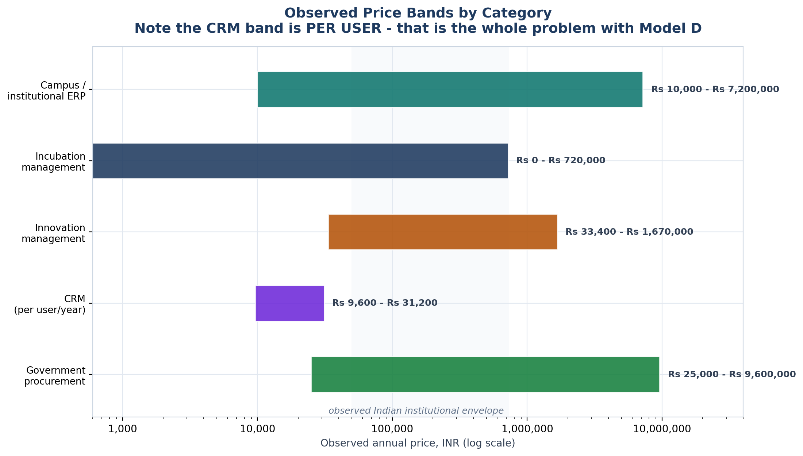
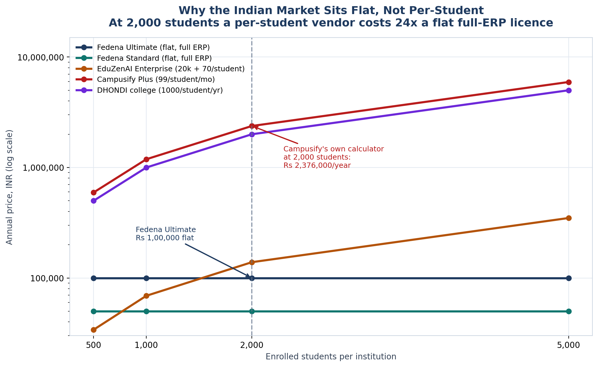

<!-- GENERATED by build/build_phase8.py on 2026-10-19. DO NOT EDIT BY HAND.
     Edit build/data_p8_pricing.py and re-run.
     Every price below was read from a live vendor page or a public document.
     Where two sources disagree, the conflict is recorded, not resolved. -->

> **Primary research status: 0 interviews conducted. 0 buyer quotes. 0 willingness-to-pay responses.**
> The WTP figures in this phase are **DERIVED-FROM-COMPARABLES** — inferred from what buyers demonstrably pay elsewhere, not from asking our buyers. The instrument that would measure it exists in WTP_Instrument.md and has **not** been administered.

# Category Pricing

The seven categories the spec names, each with what was actually found.

## Institutional SaaS

_Fedena, EduZenAI, IncubatX, NestLens Orbit — the core comparison set._

| Vendor | Product | Price | INR/yr | Market | Confidence |
|---|---|---|---|---|---|
| EduZenAI (collegesoftware.in) | Startup (per-student, >300) | INR/student/year | ₹35 | India | VERIFIED_LIVE |
| EduZenAI (collegesoftware.in) | Enterprise (per-student, >300) | INR/student/year | ₹70 | India | VERIFIED_LIVE |
| VidyalayaERP | Professional (schools) | INR/student/year | ₹100 | India | VERIFIED_LIVE |
| CAMPUSDEAN | School modules | INR/student/year | ₹130 | India | VERIFIED_LIVE |
| Campusify | Core | INR/student/month | ₹588 | India | VERIFIED_LIVE |
| DHONDI | College tier | INR/student/year | ₹1,000 | India | VERIFIED_LIVE |
| Campusify | Plus | INR/student/month | ₹1,188 | India | VERIFIED_LIVE |
| DHONDI | University tier | INR/student/year | ₹1,200 | India | VERIFIED_LIVE |
| VidyalayaERP | Basic (schools) | INR/year | ₹7,500 | India | VERIFIED_LIVE |
| EduZenAI (collegesoftware.in) | Startup | INR/year | ₹10,000 | India | VERIFIED_LIVE |
| Accubate | Standard | USD/user/month | ₹12,441 | Global | AGGREGATOR |
| NestLens (LabelNest) | Orbit PM | INR/month | ₹29,988 | India | VERIFIED_LIVE |
| Fedena (Foradian) | Standard | INR/year | ₹50,000 | India | PUBLISHED |
| NestLens (LabelNest) | Orbit Launch | INR/year | ₹75,000 | India | VERIFIED_LIVE |

## Incubation management

_The direct competitor set. Also where our scope is narrowest._

| Vendor | Product | Price | INR/yr | Market | Confidence |
|---|---|---|---|---|---|
| Accubate | Standard | USD/user/month | ₹12,441 | Global | AGGREGATOR |
| NestLens (LabelNest) | Orbit PM | INR/month | ₹29,988 | India | VERIFIED_LIVE |
| NestLens (LabelNest) | Orbit Launch | INR/year | ₹75,000 | India | VERIFIED_LIVE |
| NestLens (LabelNest) | Orbit Starter | INR/year | ₹99,000 | India | VERIFIED_LIVE |
| incuTrack | Starter | USD/month | ₹99,033 | Global | VERIFIED_LIVE |
| IncubatX | Foundation (low) | INR/month | ₹120,000 | India | VERIFIED_LIVE |
| NestLens (LabelNest) | Orbit Growth | INR/year | ₹125,000 | India | VERIFIED_LIVE |
| IncubatX | Foundation | INR/month | ₹180,000 | India | VERIFIED_LIVE |
| IncubatX | Media Kit add-on | INR/month | ₹180,000 | India | VERIFIED_LIVE |
| NestLens (LabelNest) | Orbit Scale | INR/year | ₹250,000 | India | VERIFIED_LIVE |
| Incubatee (SCIP) | Platform subscription | INR/year | ₹300,000 | India | PUBLISHED |
| incuTrack | Premier | USD/month | ₹325,233 | Global | VERIFIED_LIVE |
| Gohorto | Platform | USD/year | ₹350,700 | Global | AGGREGATOR |
| NestLens (LabelNest) | Orbit OS (module page) | INR/month | ₹359,988 | India | CONFLICT |

## Campus management

_The broadest scope, and the set we currently lose to on price._

| Vendor | Product | Price | INR/yr | Market | Confidence |
|---|---|---|---|---|---|
| EduZenAI (collegesoftware.in) | Startup (per-student, >300) | INR/student/year | ₹35 | India | VERIFIED_LIVE |
| EduZenAI (collegesoftware.in) | Enterprise (per-student, >300) | INR/student/year | ₹70 | India | VERIFIED_LIVE |
| VidyalayaERP | Professional (schools) | INR/student/year | ₹100 | India | VERIFIED_LIVE |
| CAMPUSDEAN | School modules | INR/student/year | ₹130 | India | VERIFIED_LIVE |
| Campusify | Core | INR/student/month | ₹588 | India | VERIFIED_LIVE |
| DHONDI | College tier | INR/student/year | ₹1,000 | India | VERIFIED_LIVE |
| Campusify | Plus | INR/student/month | ₹1,188 | India | VERIFIED_LIVE |
| DHONDI | University tier | INR/student/year | ₹1,200 | India | VERIFIED_LIVE |
| VidyalayaERP | Basic (schools) | INR/year | ₹7,500 | India | VERIFIED_LIVE |
| EduZenAI (collegesoftware.in) | Startup | INR/year | ₹10,000 | India | VERIFIED_LIVE |
| Fedena (Foradian) | Standard | INR/year | ₹50,000 | India | PUBLISHED |
| Fedena (Foradian) | Premium | INR/year | ₹75,000 | India | PUBLISHED |
| Codingclave | Cloud monthly | INR/month | ₹95,988 | India | AGGREGATOR |
| Fedena (Foradian) | Ultimate | INR/year | ₹100,000 | India | PUBLISHED |

## CRM

_Zoho and Freshworks. Priced per user — which is why Model D fails._

| Vendor | Product | Price | INR/yr | Market | Confidence |
|---|---|---|---|---|---|
| Zoho CRM | Standard | INR/user/month | ₹9,600 | India | VERIFIED_LIVE |
| Freshworks Freshsales | Growth | INR/user/month | ₹15,588 | India | AGGREGATOR |
| Zoho CRM | Professional | INR/user/month | ₹16,800 | India | VERIFIED_LIVE |
| Freshworks Freshdesk | Growth | INR/agent/month | ₹17,988 | India | AGGREGATOR |
| Zoho CRM | Enterprise | INR/user/month | ₹28,800 | India | VERIFIED_LIVE |
| Zoho CRM | Lite user | INR/user/month | ₹28,800 | India | VERIFIED_LIVE |
| Zoho CRM | Ultimate | INR/user/month | ₹31,200 | India | VERIFIED_LIVE |

## Innovation management

_IdeaScale, Envisio, Throttle. Mostly quote-based; one real contract found._

| Vendor | Product | Price | INR/yr | Market | Confidence |
|---|---|---|---|---|---|
| Throttle (Relic) | Standard | JPY/user/month | ₹19,674 | Japan | PUBLISHED |
| Envisio | Starter (aggregator listing) | USD/year | ₹33,400 | Global | CONFLICT |
| IdeaScale | Per feature tier | USD/year | ₹417,516 | Global | AGGREGATOR |
| Envisio | Starter (selecthub listing) | USD/year | ₹1,670,000 | Global | CONFLICT |

## Enterprise SaaS

_The per-seat benchmarks that set Model D's arithmetic._

| Vendor | Product | Price | INR/yr | Market | Confidence |
|---|---|---|---|---|---|
| Zoho CRM | Standard | INR/user/month | ₹9,600 | India | VERIFIED_LIVE |
| Freshworks Freshsales | Growth | INR/user/month | ₹15,588 | India | AGGREGATOR |
| Zoho CRM | Professional | INR/user/month | ₹16,800 | India | VERIFIED_LIVE |
| Freshworks Freshdesk | Growth | INR/agent/month | ₹17,988 | India | AGGREGATOR |
| Throttle (Relic) | Standard | JPY/user/month | ₹19,674 | Japan | PUBLISHED |
| Zoho CRM | Enterprise | INR/user/month | ₹28,800 | India | VERIFIED_LIVE |
| Zoho CRM | Lite user | INR/user/month | ₹28,800 | India | VERIFIED_LIVE |
| Zoho CRM | Ultimate | INR/user/month | ₹31,200 | India | VERIFIED_LIVE |
| Envisio | Starter (aggregator listing) | USD/year | ₹33,400 | Global | CONFLICT |
| IdeaScale | Per feature tier | USD/year | ₹417,516 | Global | AGGREGATOR |
| Envisio | Starter (selecthub listing) | USD/year | ₹1,670,000 | Global | CONFLICT |

## Government / institutional procurement

_GeM bands and one awarded public contract. Caps realised price._

| Vendor | Product | Price | INR/yr | Market | Confidence |
|---|---|---|---|---|---|
| Envisio | City of La Mesa CA (AWARDED CONTRACT) | USD/year | ₹1,628,250 | US | DOCUMENT |

## The per-student trap

Campusify's own pricing calculator puts a 2,000-student college at **₹23,76,000 a year** on the Plus tier. Fedena Ultimate is ₹1,00,000 flat for a broader product. The Indian institutional market sits **flat, not per-student**, and that is not an accident — it is the only model a college can take to a board without a procurement fight.

Generated 2026-10-19.