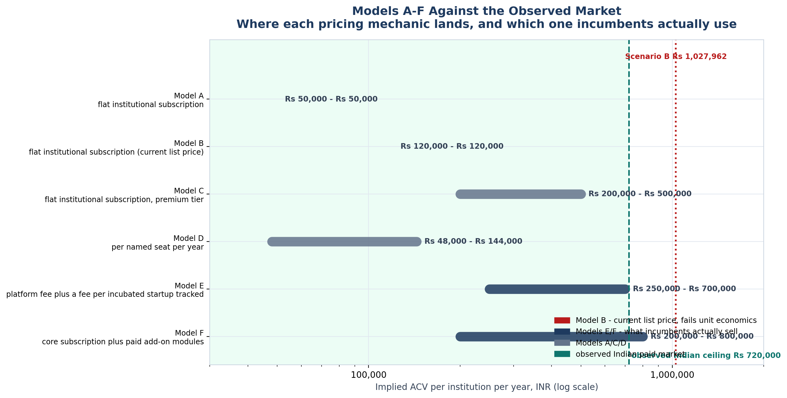
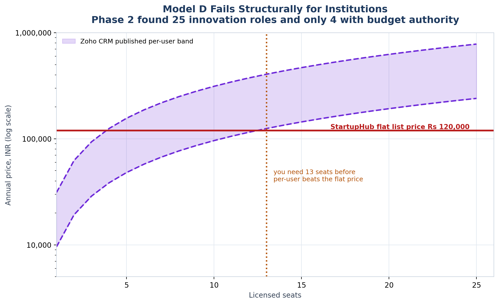

<!-- GENERATED by build/build_phase8.py on 2026-10-19. DO NOT EDIT BY HAND.
     Edit build/data_p8_pricing.py and re-run.
     Every price below was read from a live vendor page or a public document.
     Where two sources disagree, the conflict is recorded, not resolved. -->

> **Primary research status: 0 interviews conducted. 0 buyer quotes. 0 willingness-to-pay responses.**
> The WTP figures in this phase are **DERIVED-FROM-COMPARABLES** — inferred from what buyers demonstrably pay elsewhere, not from asking our buyers. The instrument that would measure it exists in WTP_Instrument.md and has **not** been administered.

# Models A to F

The six pricing models the spec names, each scored against the observed market.

| Model | Mechanic | Where it lands | Comparable it collides with | Verdict |
|---|---|---|---|---|
| **A** Flat Rs 50,000/year | flat institutional subscription | bottom of the observed paid market | Fedena Standard (₹50k, full ERP, unlimited users) | VIABLE but not distinctive |
| **B** Flat Rs 1,20,000/year | flat institutional subscription (current list price) | top of the observed Indian market | IncubatX Foundation (₹1.2L-₹1.8L/yr); above Fedena Ultimate (₹1L) | DEFENSIBLE ONLY AGAINST INCUMBENTS, NOT AGAINST ERP |
| **C** Flat Rs 2-5 lakh/year | flat institutional subscription, premium tier | inside IncubatX Accelerator/Executive AI and NestLens Scale | IncubatX Accelerator ₹3.6-4.8L; NestLens Orbit Scale ₹2.5L | ABOVE THE BRACKET ON MOST EVIDENCE |
| **D** Per-user pricing | per named seat per year | well established - Zoho ₹800-₹2,600/user/mo | Zoho CRM ₹9,600-₹31,200/user/year | STRUCTURALLY WRONG FOR INSTITUTIONS |
| **E** Institution + number of startups | platform fee plus a fee per incubated startup tracked | matches how IncubatX and NestLens actually scale | IncubatX 'up to 4 cohorts'; NestLens 'scales with cohort size' | THE MODEL THE INCUMBENTS USE |
| **F** Base platform + premium modules | core subscription plus paid add-on modules | proven - IncubatX Media Kit ₹15k/mo; incuTrack add-ons | IncubatX Media Kit add-on; incuTrack Mentor Matching/Surveys/Events | PROVEN LAND-AND-EXPAND |

## Model by model

### Model A — Flat Rs 50,000/year

*Spec: ₹50k/year*

- **Mechanic.** flat institutional subscription
- **Lands at.** bottom of the observed paid market
- **Collides with.** Fedena Standard (₹50k, full ERP, unlimited users)
- **Implied ACV.** ₹50,000 – ₹50,000
- **Verdict.** VIABLE but not distinctive

Matches Fedena's entry tier exactly while offering far less scope. Would be priced against a full ERP rather than against a niche tool.

### Model B — Flat Rs 1,20,000/year

*Spec: ₹1.2L/year*

- **Mechanic.** flat institutional subscription (current list price)
- **Lands at.** top of the observed Indian market
- **Collides with.** IncubatX Foundation (₹1.2L-₹1.8L/yr); above Fedena Ultimate (₹1L)
- **Implied ACV.** ₹120,000 – ₹120,000
- **Verdict.** DEFENSIBLE ONLY AGAINST INCUMBENTS, NOT AGAINST ERP

Equal to IncubatX's entry tier and 20% above Fedena's full ERP. Needs a scope argument against ERP vendors that we currently cannot make.

### Model C — Flat Rs 2-5 lakh/year

*Spec: ₹2-5L/year*

- **Mechanic.** flat institutional subscription, premium tier
- **Lands at.** inside IncubatX Accelerator/Executive AI and NestLens Scale
- **Collides with.** IncubatX Accelerator ₹3.6-4.8L; NestLens Orbit Scale ₹2.5L
- **Implied ACV.** ₹200,000 – ₹500,000
- **Verdict.** ABOVE THE BRACKET ON MOST EVIDENCE

Defensible only against direct incubation-platform competitors, and it crosses the GeM ₹5 lakh reverse-auction threshold at the top of the band.

### Model D — Per-user pricing

*Spec: per-user*

- **Mechanic.** per named seat per year
- **Lands at.** well established - Zoho ₹800-₹2,600/user/mo
- **Collides with.** Zoho CRM ₹9,600-₹31,200/user/year
- **Implied ACV.** ₹48,000 – ₹144,000
- **Verdict.** STRUCTURALLY WRONG FOR INSTITUTIONS

Institutions cap the seats that touch innovation data at a handful (Phase 2 found 25 roles, only 4 with documented budget authority). Per-user pricing would collapse ACV to a few thousand rupees. Note Zoho requires a 25-licence minimum for Lite seats - the same trap.

### Model E — Institution + number of startups

*Spec: base + per-startup*

- **Mechanic.** platform fee plus a fee per incubated startup tracked
- **Lands at.** matches how IncubatX and NestLens actually scale
- **Collides with.** IncubatX 'up to 4 cohorts'; NestLens 'scales with cohort size'
- **Implied ACV.** ₹250,000 – ₹700,000
- **Verdict.** THE MODEL THE INCUMBENTS USE

Aligns price with the thing the institution is actually measured on - the cohort. Directly parallels the SISFS scheme, which pays incubators 5% management fee on the grant value they administer.

### Model F — Base platform + premium modules

*Spec: base + modules*

- **Mechanic.** core subscription plus paid add-on modules
- **Lands at.** proven - IncubatX Media Kit ₹15k/mo; incuTrack add-ons
- **Collides with.** IncubatX Media Kit add-on; incuTrack Mentor Matching/Surveys/Events
- **Implied ACV.** ₹200,000 – ₹800,000
- **Verdict.** PROVEN LAND-AND-EXPAND

Lets us enter low (Model A/B) and expand with the buyer instead of front-loading the whole price at the first committee meeting.

## Why Model D fails structurally

Phase 2 found 25 roles touching innovation data and only 4 with documented budget authority. At Zoho's published per-user rates, a 5-10 seat deployment pays Rs 48,000-3,12,000 a year - below the flat list price, and with no floor because Zoho itself imposes a 25-licence minimum on Lite seats.

- At 25 innovation roles, even Zoho's *top* per-user rate (₹31,200/user/yr) yields only ₹780,000 — against a list price of ₹120,000.
- At the 4 roles that actually hold documented budget authority, it is far worse.
- Zoho itself requires a **minimum of 25 regular user licences** before Lite seats can be added. The incumbent per-user vendors hit the same institutional floor.

Generated 2026-10-19.