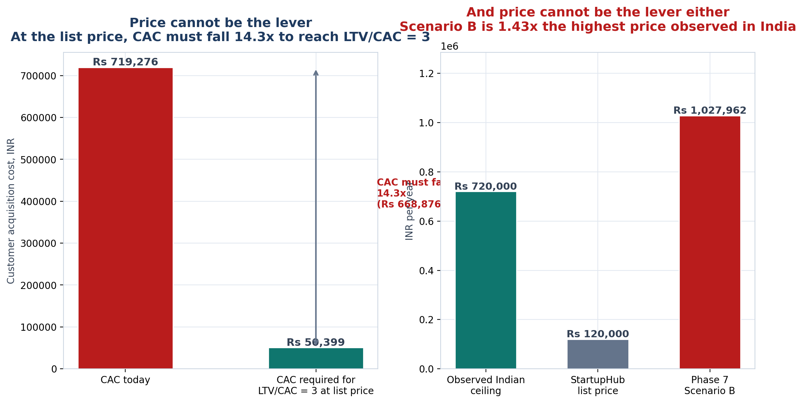

<!-- GENERATED by build/build_phase8.py on 2026-10-19. DO NOT EDIT BY HAND.
     Edit build/data_p8_pricing.py and re-run.
     Every price below was read from a live vendor page or a public document.
     Where two sources disagree, the conflict is recorded, not resolved. -->

> **Primary research status: 0 interviews conducted. 0 buyer quotes. 0 willingness-to-pay responses.**
> The WTP figures in this phase are **DERIVED-FROM-COMPARABLES** — inferred from what buyers demonstrably pay elsewhere, not from asking our buyers. The instrument that would measure it exists in WTP_Instrument.md and has **not** been administered.

# Price Recommendation

## The recommendation

**Do not launch at ₹1.2 lakh flat.**

Not because ₹1.2 lakh is too expensive for the product, but because it is
**1.2× the ceiling** of the frame we currently lose in,
and because at that price the unit economics still do not work
(LTV/CAC = 0.21).

## The arithmetic that forces this

1. **Price cannot be the lever.** Scenario B (₹1,027,962) is
   1.43× the highest price any Indian vendor in
   this dataset charges. No amount of negotiation makes that reachable.
2. **So CAC must be.** At the list price, CAC must fall roughly 14× to reach
   LTV/CAC = 3 — which means the sales motion, not the price list, is the
   problem.
3. **And the sales motion is bounded by procurement.** Phase 2 found committee
   triggers spread from ₹50,000 to ₹10,00,000. Pricing at the top of that range
   invites a committee, a committee invites a long cycle, and a long cycle is
   CAC.

## What to do instead

**Enter at ₹50,000–₹75,000 flat (Model A/B), and expand on Model E + F.**

- **Entry.** Match Fedena Standard at ₹50,000. It is the cheapest credible
  paid position in the market and it avoids the committee threshold entirely.
- **Expansion.** Charge per incubated startup and per module — IncubatX charges
  *"up to 4 cohorts"* and sells a Media Kit add-on at ₹15,000/month; incuTrack
  sells Mentor Matching, Surveys and Events as separate add-ons. The mechanics
  are proven; we would be copying them, not inventing them.
- **This raises realised ACV over time rather than demanding it up front**,
  which is the only way to reach an ARPU the unit economics can live with
  without a price the market has never paid.

## The honest caveat

**No buyer has been asked.** This recommendation is derived from comparable
prices, and the single input that would most change it — what institutions
actually approve — is unmeasured. The first six institutional conversations
would either confirm or destroy it, which is exactly why the Phase 3B shortlist
matters more than this document does.

## Falsifiers

The conclusions here break if any of the six pre-committed conditions in
[Falsification.md](Falsification.md) fires. The most dangerous is **P-04**: if
one institution signs above ₹5 lakh a year, the whole framing changes and
Scenario B deserves another look.

Generated 2026-10-19.
