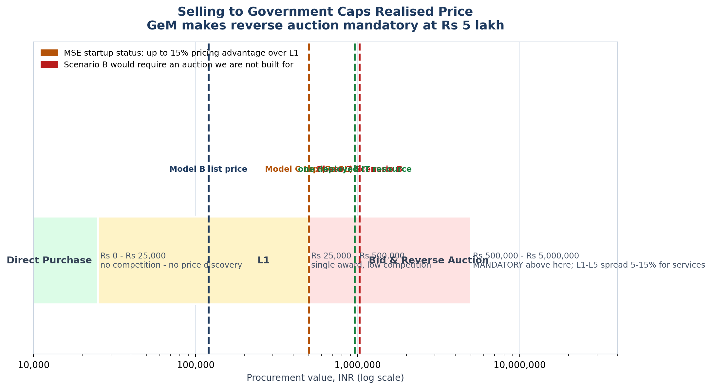

<!-- GENERATED by build/build_phase8.py on 2026-10-19. DO NOT EDIT BY HAND.
     Edit build/data_p8_pricing.py and re-run.
     Every price below was read from a live vendor page or a public document.
     Where two sources disagree, the conflict is recorded, not resolved. -->

> **Primary research status: 0 interviews conducted. 0 buyer quotes. 0 willingness-to-pay responses.**
> The WTP figures in this phase are **DERIVED-FROM-COMPARABLES** — inferred from what buyers demonstrably pay elsewhere, not from asking our buyers. The instrument that would measure it exists in WTP_Instrument.md and has **not** been administered.

# Procurement Context

Published GeM / CPPP bands only. No live tender scraping was attempted, per the decision recorded for this phase.

## The bands

| Band | Rule | Mechanism | Implication |
|---|---|---|---|
| Direct Purchase | amount up to INR 25,000 | no competition | Below this there is no price discovery at all. Free incumbents sit here. |
| L1 | INR 25,000 < amount < INR 5,00,000 | single-award L1 | StartupHub's whole Scenario A range sits inside L1. No reverse-auction pressure. |
| Bid & Reverse Auction | amount >= INR 5,00,000 (mandatory) | L-1 with reverse auction | Crossing Rs 5 lakh puts us into auction territory. Observed L1-L5 spread for services is 5-15%, i.e. price compression. |
| MSE preference | service provider within L1 + 15% | 100% order if MSE | MSE (Startup) status is worth up to a 15% pricing advantage. |
| Price dispersion | L1 vs L5 spread, services/works | observed 5-15%; goods 12-25% | Buyers anchor on estimates; in 60-70% of tenders L1 lands BELOW the buyer's estimate. |
| IT manpower floor | L1 resource not below INR 80,000/month | bid floor, INR 9,60,000/annum | A REAL institutional IT services price floor. Rs 9.6 lakh/yr is what ONE deployed IT resource costs an institution - a useful sanity check against Scenario B. |

## Where our prices land

- **₹120,000 list price** sits inside the L1 band (₹25,000–₹5,00,000). No reverse-auction pressure. Direct sales, no GeM dependency.
- **₹1,027,962 Scenario B** sits above the ₹500,000 reverse-auction threshold. Selling it to government would mean winning an auction we have no bid history for.

## The MSE advantage is the actionable finding

Under MSE rules, a service provider quoting within **L1 + 15%** receives 100% of the order. StartupHub is not currently MSE-registered. This is a concrete, low-cost lever worth more than most pricing arguments.

## One real observed contract

The City of La Mesa, California authorised a three-year agreement with Envisio at **USD 19,500/year subscription + USD 8,775 one-time setup, USD 70,249 total**, for a strategic-plan dashboard with unlimited user licences, in a documented council resolution. This is a *paid* public-sector transaction rather than a list price — and it is roughly ₹16.3 lakh/year, well above anything observed in India.

It is included precisely because it is an outlier: it shows what a public-sector buyer will pay when the product is bought as strategic-planning infrastructure rather than as administrative software.

Generated 2026-10-19.