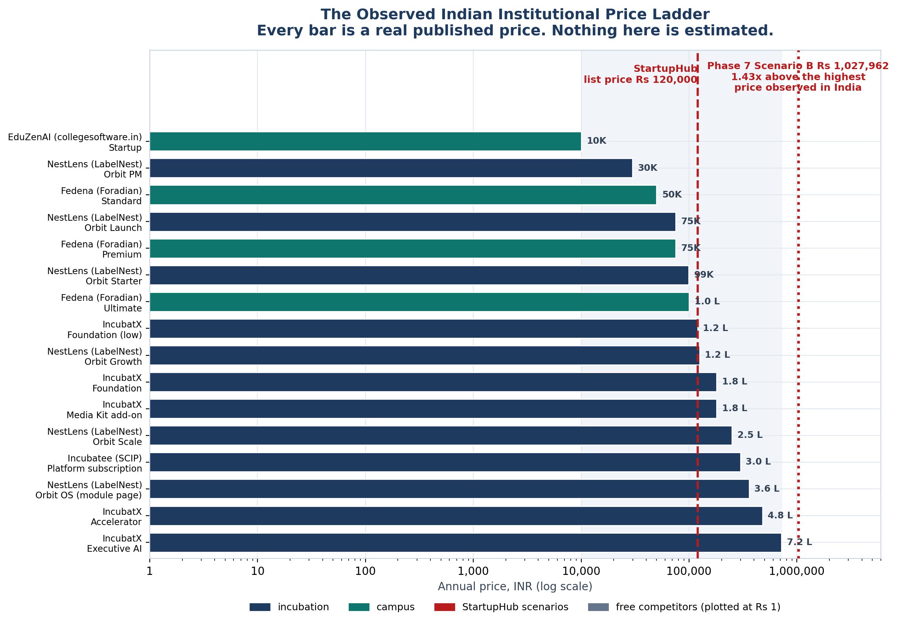
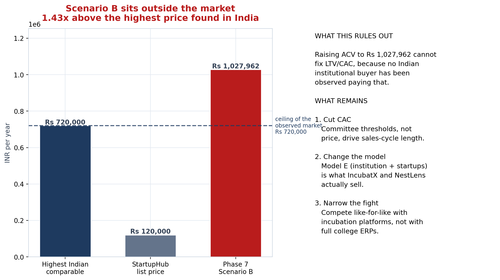
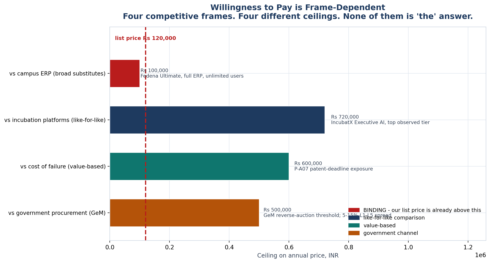

<!-- GENERATED by build/build_phase8.py on 2026-10-19. DO NOT EDIT BY HAND.
     Edit build/data_p8_pricing.py and re-run.
     Every price below was read from a live vendor page or a public document.
     Where two sources disagree, the conflict is recorded, not resolved. -->

> **Primary research status: 0 interviews conducted. 0 buyer quotes. 0 willingness-to-pay responses.**
> The WTP figures in this phase are **DERIVED-FROM-COMPARABLES** — inferred from what buyers demonstrably pay elsewhere, not from asking our buyers. The instrument that would measure it exists in WTP_Instrument.md and has **not** been administered.

# Pricing Research

Phase 8. The spec calls this *"one of your biggest current gaps"* and asks us to
**find willingness to pay rather than simply assuming ₹1.2 lakh.**

We found it. It is not ₹1.2 lakh.

## The finding

| | | |
|---|---|---|
| Observed Indian institutional market | **₹10,000 – ₹720,000** | 16 paid comparables, all read from live vendor pages |
| Highest price found in India | **₹720,000** | IncubatX Executive AI |
| StartupHub list price | ₹120,000 | inside the envelope, but **1.2x the ERP ceiling** |
| Phase 7 Scenario B | ₹1,027,962 | **1.43x above everything observed in India** |

Three conclusions, in order of how much they matter:

1. **The list price is already at the top of the market, and 1.2× above the
   binding ceiling.** Fedena sells a *strictly broader* product — admissions,
   attendance, exams, fees, library, hostel, transport, payroll, parent portal,
   mobile apps — for ₹100,000 per institution per year with unlimited users.
   We propose more than that for a narrower product.
2. **Scenario B is outside the market entirely.** ₹1,027,962 is
   1.43× the highest price any Indian vendor in this
   dataset charges. The unit-economics problem **cannot** be solved by raising
   price.
3. **Therefore the fix is CAC and pricing *model*, not price level.** Model E
   (institution + number of startups) and Model F (base + premium modules) are
   what IncubatX and NestLens actually sell, and both price above our list while
   charging less up front.

## The WTP bracket

`₹50,000` floor. The ceiling is **frame-dependent**, and we refuse to
collapse it:

| Frame | Ceiling | Basis |
|---|---|---|
| vs campus ERP (broad substitutes) | ₹100,000 | Fedena Ultimate, full ERP, unlimited users |
| vs incubation platforms (like-for-like) | ₹720,000 | IncubatX Executive AI, top observed tier |
| vs cost of failure (value-based) | ₹600,000 | P-A07 patent-deadline exposure |
| vs government procurement (GeM) | ₹500,000 | GeM reverse-auction threshold; 5-15% L1-L5 spread |

Floor is Rs 50,000 - below that we are under market and cannot fund CAC. The ceiling is frame-dependent, so it is published per frame rather than collapsed. Against the binding frame (campus ERP) our list price is already 1.2x the ceiling.

## What this is not

This is **DERIVED-FROM-COMPARABLES**, not measured. Willingness to pay is a
property of a buyer; these numbers are inferred from what other buyers
demonstrably pay elsewhere. **Zero interviews have been conducted.**
The instrument that would measure it is in
[WTP_Instrument.md](WTP_Instrument.md) and has not been administered.

## Deliverables

| Spec requirement | Document | Chart |
|---|---|---|
| Seven pricing categories | [Category_Pricing.md](Category_Pricing.md) | `p8_09_categories.png` |
| Real comparable prices | [Comparable_Prices.md](Comparable_Prices.md) | `p8_01_price_ladder.png` |
| Government/institutional procurement | [Procurement_Context.md](Procurement_Context.md) | `p8_07_gem_bands.png` |
| Test Models A–F | [Models_A_to_F.md](Models_A_to_F.md) | `p8_04_models.png` |
| **Find willingness to pay** | [Willingness_To_Pay.md](Willingness_To_Pay.md) | `p8_08_wtp_streams.png` |
| Interview customers | [WTP_Instrument.md](WTP_Instrument.md) — *built, not run* | — |
| What to charge | [Price_Recommendation.md](Price_Recommendation.md) | `p8_10_unit_economics_bind.png` |
| What would break this | [Falsification.md](Falsification.md) | — |

All ten charts are indexed in `_exports/charts/phase8/`.

## Exports

`_exports/phase8/` — comparables, price_ladder, model_matrix, wtp_streams,
wtp_frames, procurement_bands, per_student_normalisation, schema.
`_exports/raw/phase8_pricing_RAW.json` — the full machine layer.

Generated 2026-10-19 by `build/build_phase8.py`.
