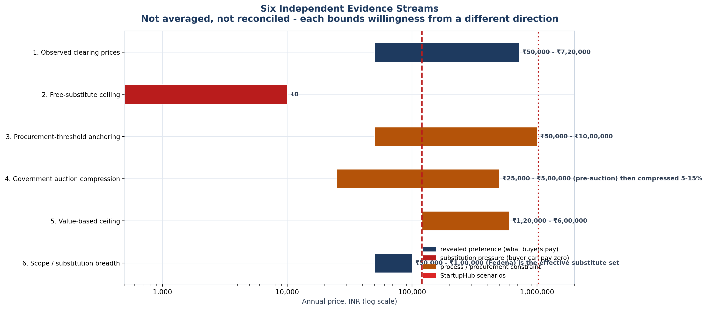

<!-- GENERATED by build/build_phase8.py on 2026-10-19. DO NOT EDIT BY HAND.
     Edit build/data_p8_pricing.py and re-run.
     Every price below was read from a live vendor page or a public document.
     Where two sources disagree, the conflict is recorded, not resolved. -->

> **Primary research status: 0 interviews conducted. 0 buyer quotes. 0 willingness-to-pay responses.**
> The WTP figures in this phase are **DERIVED-FROM-COMPARABLES** — inferred from what buyers demonstrably pay elsewhere, not from asking our buyers. The instrument that would measure it exists in WTP_Instrument.md and has **not** been administered.

# Willingness To Pay

The spec asks us to **find** willingness to pay rather than assume ₹1.2 lakh.

## The honest answer first

**Willingness to pay cannot be found in public data. It can only be bounded by it, and measured by asking.** This document publishes the bounds. It does not publish a point estimate, because no instrument has been administered.

## Six evidence streams

| # | Stream | Bound | Direction |
|---|---|---|---|
| 1 | Observed clearing prices | ₹50,000 - ₹7,20,000 | sets the ceiling |
| 2 | Free-substitute ceiling | ₹0 | sets the floor and destroys margin at the low end |
| 3 | Procurement-threshold anchoring | ₹50,000 - ₹10,00,000 | high ACV is self-defeating on sales-cycle grounds |
| 4 | Government auction compression | ₹25,000 - ₹5,00,000 (pre-auction) then compressed 5-15% | caps realised price when selling to government |
| 5 | Value-based ceiling | ₹1,20,000 - ₹6,00,000 | the only stream that can justify a premium |
| 6 | Scope / substitution breadth | ₹50,000 - ₹1,00,000 (Fedena) is the effective substitute set | the binding constraint on the list price |

### What each stream actually says

**1. Observed clearing prices** — What do Indian institutional buyers actually pay for software like this?

- Method: Read live vendor price pages for Indian incubation and campus software.
- Bound: **₹50,000 - ₹7,20,000**
- Evidence: Fedena ₹50k/₹75k/₹1L for a FULL ERP with unlimited users; NestLens Orbit ₹75k-₹2.5L; IncubatX ₹1.2L-₹7.2L.

**2. Free-substitute ceiling** — What is the cheapest way for a buyer to say no to us?

- Method: Identify zero-cost substitutes a buyer can adopt instead.
- Bound: **₹0**
- Evidence: Univation's Incubators Platform is offered FREE to universities and nonprofits. Founderhood has a free tier. Founderhood also publishes a 15% university/nonprofit discount off list.

**3. Procurement-threshold anchoring** — At what price does the buying process change behaviour?

- Method: Phase 2 committee-trigger analysis across 8 institutional instruments.
- Bound: **₹50,000 - ₹10,00,000**
- Evidence: Committee-trigger spread is Rs 50,000 to Rs 10,00,000 across the instruments reviewed in Phase 2. Below ~Rs 50k a purchase is routine; above it, a committee is convened, which lengthens the cycle and raises CAC - which is exactly the constraint we are trying to relieve.

**4. Government auction compression** — What happens if we sell through GeM or a state tender?

- Method: Published GeM procurement-mode bands and observed bid dispersion.
- Bound: **₹25,000 - ₹5,00,000 (pre-auction) then compressed 5-15%**
- Evidence: GeM L1 band is INR 25,000-5,00,000. Bid and Reverse Auction is MANDATORY at INR 5,00,000+. Observed L1-L5 spread for services is 5-15%, and in 60-70% of tenders L1 lands below the buyer's estimate.

**5. Value-based ceiling** — What is the pain actually worth?

- Method: Cost-of-failure anchor from the Phase 1 problem corpus.
- Bound: **₹1,20,000 - ₹6,00,000**
- Evidence: P-A07 (patent deadline tracking absent) is the only CRITICAL finding in the Phase 1 corpus. A single missed NIRF/NAAC deadline or a lost grant cycle costs far more than an annual subscription, which is why value-based pricing can exceed comparables - but only where the buyer feels the pain directly.

**6. Scope / substitution breadth** — Is our scope bigger or smaller than what buyers can get for less?

- Method: Feature-breadth comparison against the cheapest broad competitor.
- Bound: **₹50,000 - ₹1,00,000 (Fedena) is the effective substitute set**
- Evidence: Fedena sells admissions, attendance, exams, fees, library, hostel, transport, payroll, parent portal and mobile apps - strictly MORE than StartupHub - at Rs 50,000 to Rs 1,00,000 per institution per year with unlimited users. Any price above Rs 1 lakh must be justified on scope, and scope is the one axis where we currently lose.

## The bracket, and why it has four ceilings

**Floor: ₹50,000** — cheapest credible paid position (Fedena Standard, full ERP). Below this we are under market and cannot fund CAC.

**Ceiling: frame-dependent.**

| Frame | Ceiling | Basis | Reading |
|---|---|---|---|
| **BINDING** — vs campus ERP (broad substitutes) | ₹100,000 | Fedena Ultimate, full ERP, unlimited users | Our list price of Rs 1.2L is ALREADY 20% above this ceiling. Competing here at Rs 1.2L means being more expensive than a strictly broader product. |
| vs incubation platforms (like-for-like) | ₹720,000 | IncubatX Executive AI, top observed tier | Under this frame Rs 1.2L is comfortable and Scenario B's Rs 10.28L is still 1.43x above everything observed. |
| vs cost of failure (value-based) | ₹600,000 | P-A07 patent-deadline exposure | Defensible only where the buyer feels the pain directly - i.e. an institution with a real grant or accreditation deadline at stake. |
| vs government procurement (GeM) | ₹500,000 | GeM reverse-auction threshold; 5-15% L1-L5 spread | Above Rs 5 lakh the sale becomes an auction and the realised price compresses. Effective realised ceiling is below Rs 5 lakh. |

### A method error worth recording

An earlier version of this analysis intersected all six streams by taking `max(stream lows)` and `min(stream highs)`. That produced a **crossed bracket** — a floor of ₹1,20,000 above a ceiling of ₹10,000 — which is nonsense.

The error was treating the free-substitute stream as a ceiling on willingness. A free alternative does not cap willingness at zero; it sets a *differential*: the buyer pays only the incremental value over the free option. The bracket is therefore published per competitive frame instead.

> The ceiling depends entirely on WHICH competitor set the buyer accepts. Judged against campus ERPs, we are capped near Rs 1 lakh. Judged against incubation platforms, Rs 7.2 lakh is defensible. Judged on cost-of-failure, Rs 6 lakh is arguable. These are three different answers to three different questions, and averaging them produces a number that answers none.

> The real pricing decision is not 'what is the market willing to pay' but 'which competitor are we actually up against at renewal'. That is a sales-positioning choice, not a research finding, which is why it must be stated rather than modelled.

## What we would still need

Six Van Westendorp questions and one Gabor-Granger ladder, administered to the 12 institutions already shortlisted in Phase 3B. That converts every bound above into a measured interval and a demand curve. The instrument exists ([WTP_Instrument.md](WTP_Instrument.md)); it has not been run.

**Until then, every WTP figure in this repository is DERIVED-FROM-COMPARABLES and OQ-03 remains open.**

Generated 2026-10-19.