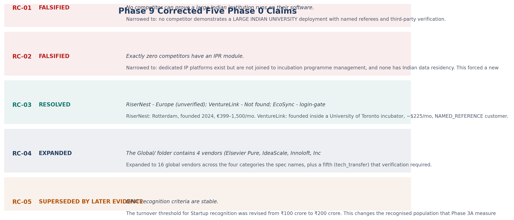
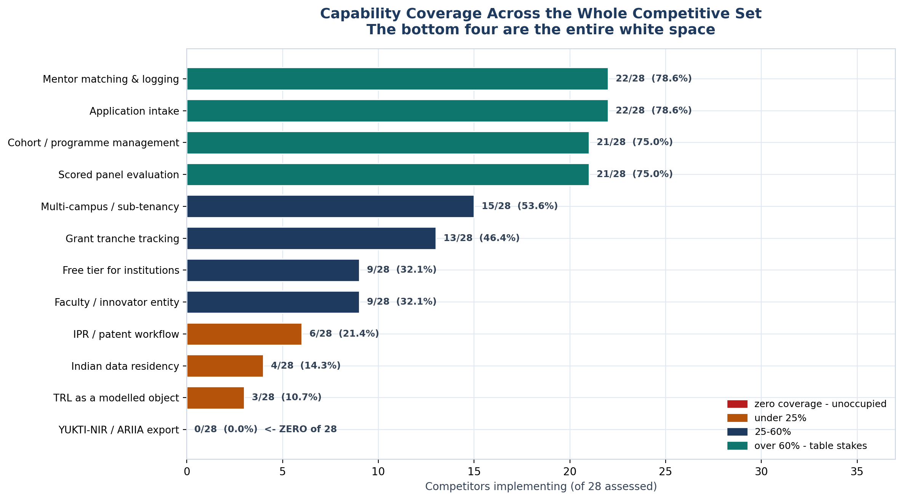
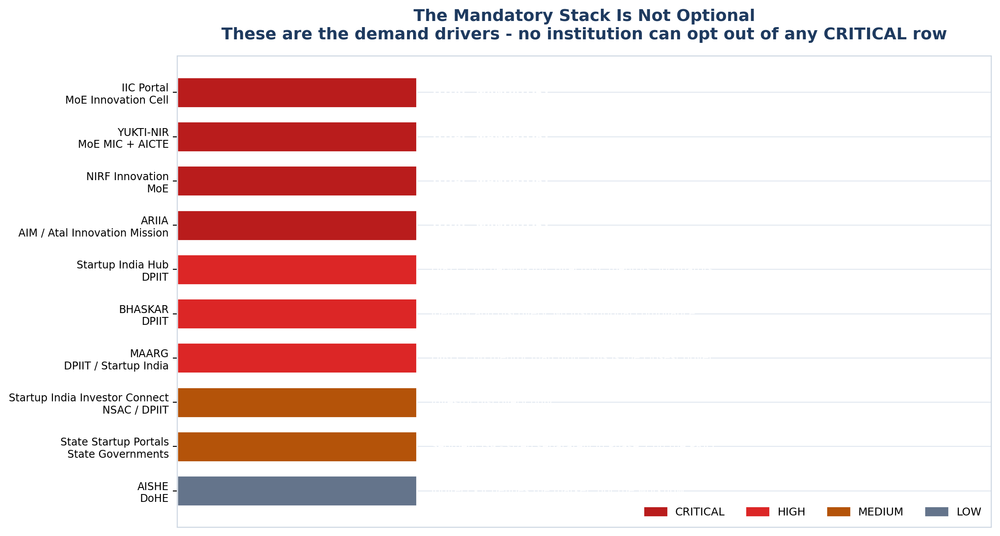
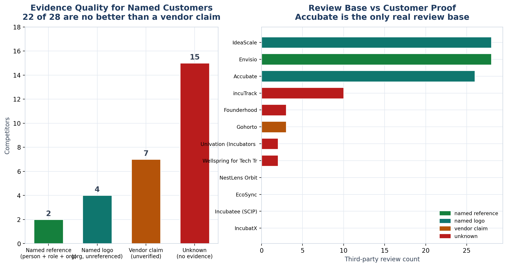

<!-- GENERATED by build/build_phase9.py on 2026-10-19. DO NOT EDIT BY HAND.
     Edit build/data_p9_competitors.py and re-run.
     Supersedes 04_Competitor_DeepDive. Five Phase 0 claims were corrected -
     see 05_Positioning/Revised_Claims.md -- and are NOT silently restored. -->

> **Primary research status: 0 interviews conducted. 0 competitor conversations.**
> Named-customer evidence is graded, not assumed: NAMED_REFERENCE (person + role +
> organisation), NAMED_LOGO (organisation named by the vendor), VENDOR_CLAIM
> (asserted, unverified), UNKNOWN. A VENDOR_CLAIM is not evidence of a deployment.

# Competitor Research

Phase 9. The spec calls this *"where I would spend a lot of effort"* and warns
that **StartupHub already overlaps with existing ecosystem platforms.** Both are
true, and this phase quantifies the overlap rather than asserting it.

**28 vendors · 10 government platforms · 8 indirect alternatives
= 46 entities assessed.**

This folder supersedes `04_Competitor_DeepDive`.

## What Phase 9 corrected

Five Phase 0 claims did not survive verification. **Two were outright false.**

| Phase 0 said | Status | What actually happened |
|---|---|---|
| "No competitor can prove a large Indian institution runs on their software" | **FALSIFIED** | EcoSync names TBI-KIET; Accubate names NSRCOM and NASSCOM; VentureLink publishes a named reference from ICUBE, University of Toronto |
| "Exactly zero competitors have an IPR module" | **FALSIFIED** | Wellspring, Helikon Labs, Commercify and SINT.OTRI all implement patent/licence workflow |
| "RiserNest — Europe (unverified)" | **RESOLVED** | Rotterdam, founded 2024, €399–1,500/month |
| "VentureLink — not found" | **RESOLVED** | Founded inside a University of Toronto incubator; ~$225/month |
| "Global folder contains 4 vendors" | **EXPANDED** | Now 15, across the four categories the spec names, plus a fifth that verification forced |

## The white space, restated honestly

Capability coverage across all 28 vendors:

| Capability | Vendors implementing |
|---|---|
| YUKTI-NIR / ARIIA export | **0/28** |
| TRL as a modelled object | 3/28 |
| Indian data residency | 4/28 |
| IPR / patent workflow | 9/28 |
| … | … |
| Mentor matching & logging | 22/28 |

Intake, cohorts, evaluation and mentor matching are **table stakes** — 75–79%
of the market has them. The bottom of the chart is the entire opportunity, and
it is mandate-shaped, not feature-shaped.

## The overlap the spec warned about

The spec's own example — *"Startup India already offers ecosystem networking,
startup directories, mentors, incubators, investors, resources and programs"* —
is **correct**. Startup India Hub carries 50,000+ startups and a 600K-strong
network. MAARG already does AI mentor matching at national scale.

The resolution is the `takes_back` column in
[02_Ecosystem/Mandatory_Stack.md](02_Ecosystem/Mandatory_Stack.md):

> **None of these platforms returns anything to the institution.** They record
> the startup. They do not record the IIC's year, the ARIIA indicators, the TRL
> progression, or the patent deadline. That is the gap, and it is structural
> rather than a feature somebody forgot.

## The credibility problem

| Evidence grade | Vendors |
|---|---|
| Named reference (person + role + org) | 2 |
| Named logo (unreferenced) | 3 |
| Vendor claim (unverified) | 7 |
| Unknown | 16 |

**23 of 28 competitors are no better proven than a vendor claim.**
Accubate is the only vendor with a real review base (26 Capterra, 4.8).

## Navigating this folder

| Spec category | Document | Count |
|---|---|---|
| Direct competitors | [01_Direct/Direct_Competitors.md](01_Direct/Direct_Competitors.md) | 13 |
| Ecosystem competitors | [02_Ecosystem/Mandatory_Stack.md](02_Ecosystem/Mandatory_Stack.md) | 10 |
| Indirect competitors | [03_Indirect/Indirect_Alternatives.md](03_Indirect/Indirect_Alternatives.md) | 8 |
| Global competitors | [04_Global/Global_Competitors.md](04_Global/Global_Competitors.md) | 15 |
| Positioning gaps | [05_Positioning/Positioning_Gaps.md](05_Positioning/Positioning_Gaps.md) | 13 |
| Falsification record | [05_Positioning/Revised_Claims.md](05_Positioning/Revised_Claims.md) | 5 |
| Regulatory signals | [06_Regulatory_Signals.md](06_Regulatory_Signals.md) | 3 |
| What would break this | [Falsification.md](Falsification.md) | — |

### All twelve charts

| Chart | Shows |
|---|---|
| `p9_01_positioning.png` | Breadth vs India-readiness; nobody in the target quadrant |
| `p9_02_feature_coverage.png` | Capability coverage; the bottom four are the white space |
| `p9_03_heatmap.png` | 28 vendors × 12 capabilities, with the three surviving gaps marked |
| `p9_04_evidence.png` | Evidence quality and review base |
| `p9_05_categories.png` | The four spec categories and five global sub-categories |
| `p9_06_mandatory_stack.png` | The government stack and what it returns to institutions |
| `p9_07_gap_status.png` | All 13 gaps and their post-verification status |
| `p9_08_revised_claims.png` | The five corrected Phase 0 claims |
| `p9_09_price_scope.png` | Price vs capability breadth |
| `p9_10_india_vs_global.png` | India-readiness distribution |
| `p9_11_tech_transfer.png` | The tech-transfer adjacency that narrowed GAP-01 |
| `p9_12_threat_vs_evidence.png` | Threat level against proof quality |

## Exports

`_exports/phase9/` — competitors, feature_matrix, feature_coverage,
ecosystem_platforms, indirect_alternatives, positioning_gaps, revised_claims,
regulatory_signals, schema. `_exports/raw/phase9_competitors_RAW.json`.

Generated 2026-10-19 by `build/build_phase9.py`.
