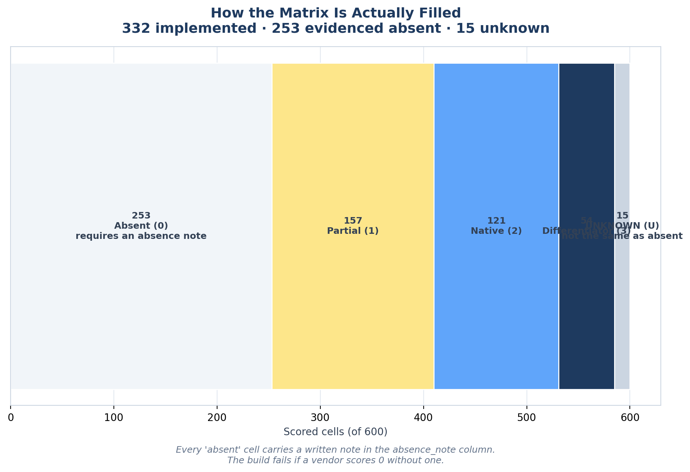
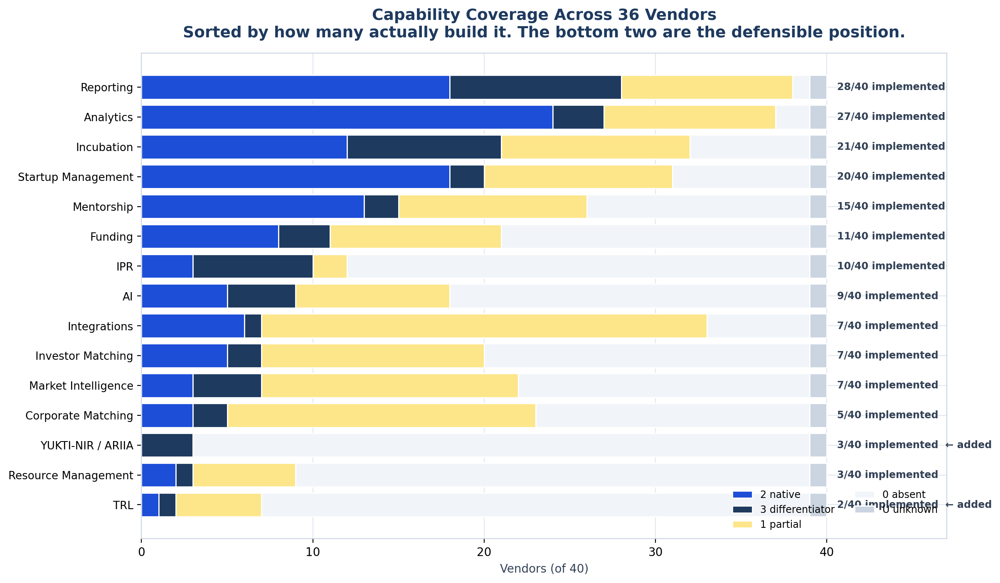
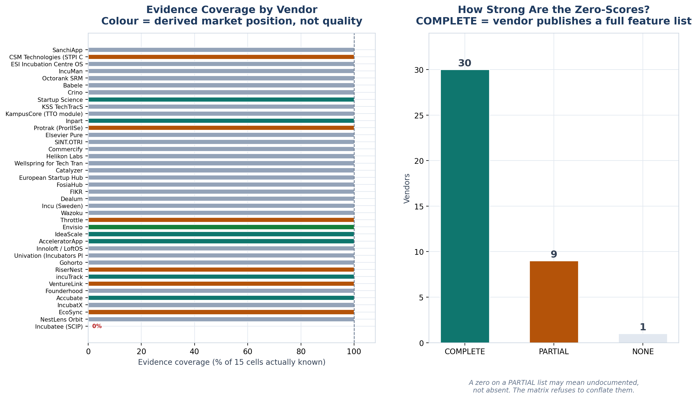
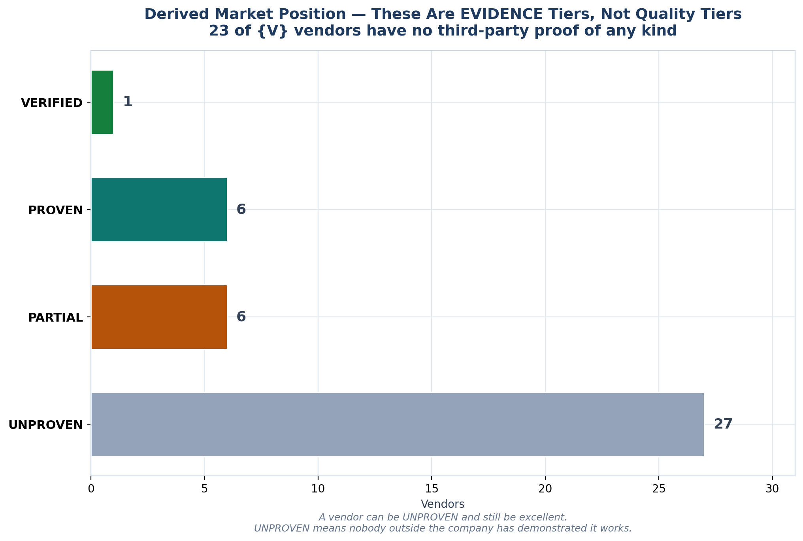

<!-- GENERATED by build/build_phase10.py on 2026-10-19. DO NOT EDIT BY HAND.
     Edit build/data_p10_matrix.py and re-run. -->

> **0 interviews conducted. 0 competitor conversations.**
> Every score is drawn from a vendor's own published material. `U` means
> **not publicly evidenced** — it is **not** the same as absent, and the two
> are never merged.

# Competitor Matrix

Phase 10. **40 vendors × 15 scored capabilities = 600 scored cells**,
across the 27 columns this phase was asked to produce.

**Workbook:** [`_exports/xlsx/08_Competitor_Matrix.xlsx`](../_exports/xlsx/08_Competitor_Matrix.xlsx)
— 9 sheets, frozen panes, autofilter, colour-coded scores.

## The one rule

**`U` is not `0`.**

An unknown is not an absence. A vendor whose site never mentions technology
transfer has **not** been shown to lack it, and this matrix will not pretend
otherwise. Phase 0's claim that *"exactly zero competitors have an IPR module"*
was falsified in Phase 9 because it conflated the two — four dedicated
tech-transfer platforms existed and had simply not been found.

| Score | Meaning |
|---|---|
| **3** | Differentiator — actively marketed as a distinguishing capability |
| **2** | Native — full implementation |
| **1** | Partial — basic or incomplete |
| **0** | **Absent** — positive evidence of absence. **Requires a written note.** |
| **U** | **Unknown** — not publicly evidenced. **Not** the same as absent. |

## What changed at this phase

**12 vendors added beyond Phase 9, including the one that matters most.**

**Protrak (ProrIISe)**, built jointly by **IISc Bengaluru** and Prorigo Software,
is a **named Indian university deployment**: in production 6+ years, 2,500+ users,
600+ corporate licence agreements, ~200 patents filed per year, 50% IP-office
time saved, **0 missed deadlines**. That is the reference GAP-13 was narrowed for —
though for IP management, not incubation. See [GAP13_Correction.md](GAP13_Correction.md).

## Capability coverage

| Capability | Native or better, of 40 |
|---|---|
| TRL *(added by Phase 10)* | 2 |
| Resource Management | 3 |
| YUKTI-NIR / ARIIA *(added by Phase 10)* | 3 |
| Corporate Matching | 5 |
| Market Intelligence | 7 |
| … | … |
| Incubation | 21 |
| Analytics | 27 |
| Reporting | 28 |

**Incubation operations are saturated. Technology transfer and mandate compliance
are not.** That is the entire competitive read.

## How much of this is actually proven

| Derived tier | Vendors |
|---|---|
| VERIFIED — 20+ reviews AND a named institutional reference | 1 |
| PROVEN — 10+ reviews, or a named institutional logo | 6 |
| PARTIAL — breadth ≥ 6 and a named customer | 6 |
| UNPROVEN — no third-party proof of any kind | 27 |

**27 of 40 vendors have no third-party proof of any kind.**
These are evidence tiers, not quality tiers — a vendor can be UNPROVEN and still be
excellent. UNPROVEN means nobody outside the company has demonstrated it works.

## The two columns added, and why

The spec listed 27 columns. **TRL** and **YUKTI-NIR / ARIIA** were appended as
scored dimensions because they are the surviving CRITICAL gaps (GAP-02, GAP-03)
and a competitive matrix that omitted the only open capabilities would misrepresent
the competitive position.

## What is not in here

**Ecosystem platforms and indirect alternatives are not scored.** Pricing, customer
size and market position do not apply to the IIC Portal or to Excel. Both appear as
clearly-labelled context sheets so the vendor matrix is not read in isolation.

## All eight charts

| Chart | Shows |
|---|---|
| `p10_01_matrix_heatmap.png` | 36 × 15 grid with UNKNOWN visibly grey |
| `p10_02_dimension_coverage.png` | How many vendors build each capability |
| `p10_03_evidence_honesty.png` | Coverage per vendor + absence-basis strength |
| `p10_04_market_position.png` | Derived evidence tiers |
| `p10_05_breadth_vs_evidence.png` | Breadth is not evidence |
| `p10_06_india_readiness.png` | Indian vendors compete on breadth, not proof |
| `p10_07_scoring_integrity.png` | How the grid is actually filled |
| `p10_08_category_fields.png` | Which fields of the market are empty |

## Exports

`_exports/phase10/` — competitor_matrix, dimension_coverage, market_position,
evidence_register, positioning_gaps, scoring_legend, schema.
`_exports/raw/phase10_matrix_RAW.json`.

Generated 2026-10-19 by `build/build_phase10.py`.
