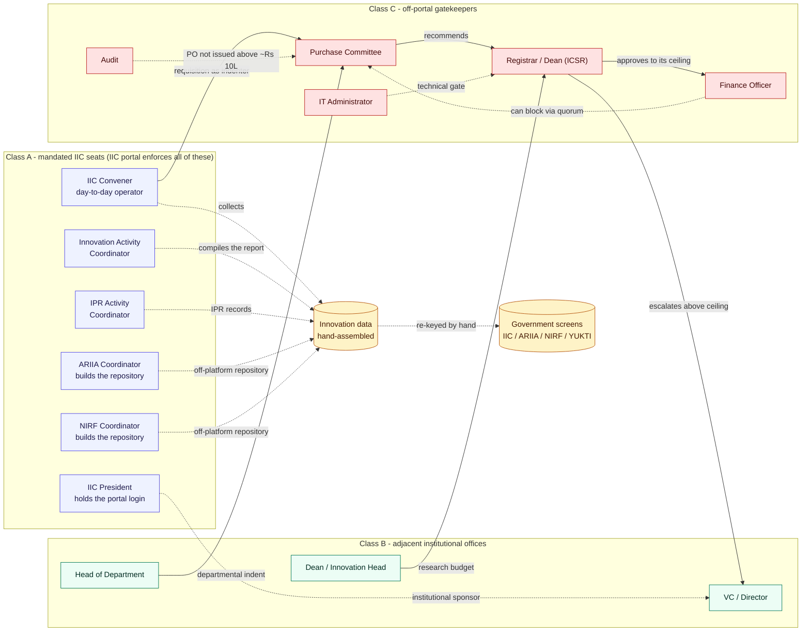

# IIC roles and the approval chain

Class A seats are portal-enforced. The approval chain is off-portal. The gap between them is the commercial problem.

Reading it: the mandated seats on the left run the entire system and **hold no documented budget**. The gatekeepers on the right control the money and **never touch innovation records**. Dashed edges are the work nobody owns.

Source: `build/data_p2_roles.py` and `build/data_p2_procurement.py`, both T1-sourced.
Back to [Phase 2 hub](README.md)
