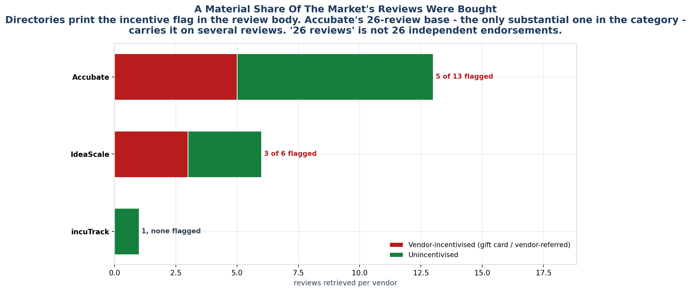

<!-- GENERATED by build/build_phase11.py on 2026-10-19. DO NOT EDIT BY HAND.
     Edit build/data_p11_reviews.py and re-run. -->

> **0 interviews conducted. 0 competitor conversations.**
> Every record below is a public document retrieved on 2026-10-19. Quotes
> are short excerpts exactly as retrieved; nothing is paraphrased or completed.
> Records graded other than USER_* are **excluded** from every claim.

# 01 - Evidence Grading

The instruction was to find what users hate. Doing that honestly required deciding,
in advance, what counts as a user - because a review search returns a great deal of
text that is not one.

## The ladder

| Grade | Family | Meaning | May originate a claim? |
|---|---|---|---|
| `USER_REVIEW` | user | Full review body retrieved with reviewer, date and rating. | **YES** |
| `USER_INSTITUTIONAL` | user | A named institution describes its own operating problem. | **YES** |
| `USER_FORUM` | user | A practitioner describes their own working problem in public. | **YES** |
| `SNIPPET` | corroborating | Only a search-index excerpt was retrievable; page itself 403s. | **CORROBORATE** |
| `VENDOR_TESTIMONIAL` | excluded | A named customer quote published by the vendor. | **NO** |
| `VENDOR_MARKETING` | excluded | Vendor prose asserting what users struggle with. | **NO** |
| `EDITORIAL` | excluded | A directory's own summary of the reviews below it. | **NO** |
| `AGGREGATOR_ECHO` | excluded | Directory serving vendor copy while showing 0 ratings. | **NO** |
| `UNAVAILABLE` | absence | Page exists but is gated, paywalled, deleted or 403. | **N/A - absence** |
| `NOT_APPLICABLE` | absence | Platform is not used for this kind of product. | **N/A - absence** |

Only the first three may originate an opportunity claim. `SNIPPET` may corroborate.
Everything else is recorded and excluded.

## The aggregator echo

The trap worth naming. Several review directories serve a vendor's own marketing
copy under a heading reading **"Verified Customer Reviews"** while simultaneously
displaying **0 Ratings** and attributing nothing to any named reviewer.

Scrape that page as text and you get confident, specific sentences about what
incuTrack does. They are the vendor's homepage.

> `topbusinesssoftware.com/products/incuTrack/reviews/` serves incuTrack's own
> description verbatim under "incuTrack Verified Customer Reviews (2026)" and shows
> no rating. Graded `AGGREGATOR_ECHO`. Excluded.

## The count conflict

incuTrack is the worked example, and it is why the ladder exists:

| Source | Says |
|---|---|
| G2 (via search excerpt) | 10 reviews, 3.8 |
| GetApp | 1 review, 5.0 |
| topbusinesssoftware | 0 ratings |
| SourceForge | 0.0 / 5, no reviews |

Four sources, three answers. The G2 figure is **not** independently verifiable
because G2 returns 403 to automated fetch. Its quotes are kept at `SNIPPET` grade
and the count is **excluded from market-position scoring**, which requires a
verified count. GetApp's single 5.0 review is the only directly verifiable record.

The practical consequence: incuTrack cannot be placed in VERIFIED or PROVEN on
review count alone. Its customer-evidence grade stays UNKNOWN.

## Why the incentive flag matters

Directories print the incentive disclosure inside the review body -
*"Vendor Referred - Incentive Offered"*, *"Reviewer received a nominal reward in
the form of a gift card"*. It is easy to strip it while extracting the quote and
lose the most decision-relevant fact about that quote.

Accubate's 26-review base is the only substantial one in the category, and a
material share of it carries that flag. **"26 reviews" is not 26 independent
endorsements.**

## The rule this phase enforces

A phase that reported only the quotable reviews would be committing the same error
as Phase 0's "exactly zero competitors have an IPR module" - reaching a confident
conclusion about something the evidence does not support, in the opposite
direction. So absence is recorded rather than dropped: 32
searched-but-empty cells are exported to `evidence_exclusions.csv`, and the
`NO_COMPLAINT_RECORDED` category exists so that silence is never read as
satisfaction.
