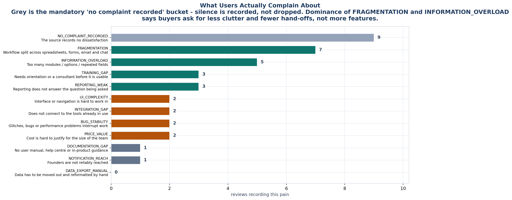
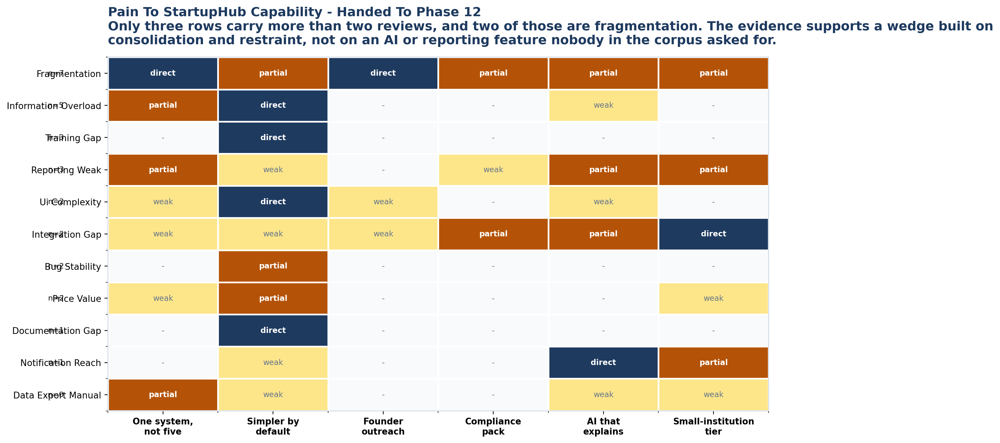

<!-- GENERATED by build/build_phase11.py on 2026-10-19. DO NOT EDIT BY HAND.
     Edit build/data_p11_reviews.py and re-run. -->

> **0 interviews conducted. 0 competitor conversations.**
> Every record below is a public document retrieved on 2026-10-19. Quotes
> are short excerpts exactly as retrieved; nothing is paraphrased or completed.
> Records graded other than USER_* are **excluded** from every claim.

# 02 - Complaint Taxonomy

Twelve categories, built bottom-up from retrieved review text, then checked
against the pain points vendors themselves describe.

A vendor's pain taxonomy is a **hypothesis to test against user text**, never a
substitute for it. Several vendors in this category publish an articulate
spreadsheet-failure argument; those arguments informed the category definitions
and are recorded as `VENDOR_MARKETING`, not counted.

| Category | Meaning | Records | Usable claims | Reads as |
|---|---|---|---|---|
| `NO_COMPLAINT_RECORDED` | The source records no dissatisfaction | 9 | 6 | Mandatory bucket so silence is never read as satisfaction |
| `FRAGMENTATION` | Workflow split across spreadsheets, forms, email and chat | 7 | 2 | Program manager carries state between unconnected systems |
| `INFORMATION_OVERLOAD` | Too many modules / options / repeated fields | 5 | 4 | Capability exceeds the operator's working memory |
| `TRAINING_GAP` | Needs orientation or a consultant before it is usable | 3 | 2 | Time-to-value depends on getting help |
| `REPORTING_WEAK` | Reporting does not answer the question being asked | 3 | 2 | Still assembles the board or ministry deck by hand |
| `UI_COMPLEXITY` | Interface or navigation is hard to work in | 2 | 2 | Cannot find controls; too many screens |
| `INTEGRATION_GAP` | Does not connect to the tools already in use | 2 | 1 | Hand-offs instead of links; no WhatsApp/SMS/LMS/API |
| `BUG_STABILITY` | Glitches, bugs or performance problems interrupt work | 2 | 1 | Trust cost; people keep a shadow copy |
| `PRICE_VALUE` | Cost is hard to justify for the size of the team | 2 | 2 | Right tool, wrong budget; no small-institution tier |
| `DOCUMENTATION_GAP` | No user manual, help centre or in-product guidance | 1 | 1 | Learns by asking support, not by reading |
| `NOTIFICATION_REACH` | Founders are not reliably reached | 1 | 1 | Email to spam; no owned channel |
| `DATA_EXPORT_MANUAL` | Data has to be moved out and reformatted by hand | 0 | 0 | Exports to spreadsheets for every recurring report |

## The three that carry weight

**FRAGMENTATION** - the only category with broad support. Surfaced independently by
a university incubator manager with six years' experience, by ICUBE (University of
Toronto), and by Accubate reviewers who switched *from* Google Forms. Three
independent routes to the same conclusion is the strongest signal in the corpus.

**INFORMATION_OVERLOAD** - the most product-shaped complaint. Accubate reviewers
independently describe too many modules, too many options, repetitive fields. The
incubator software market is failing at *restraint*, which is the opposite of the
usual enterprise pitch.

**DOCUMENTATION_GAP** - small but the sharpest single quote in the corpus:
*"No User manual!! I have been requesting this from more than 18 months now."*
Eighteen months of a paid enterprise customer asking for a manual.

## What is not in the taxonomy

No category for AI. No category for reporting sophistication. No category for
integration breadth beyond what two reviewers raised. Those appear in vendor
marketing constantly and in user review text almost not at all.

The taxonomy is the evidence that the "AI-enabled innovation OS" positioning
several vendors are running is aimed at a demand this corpus does not show.
