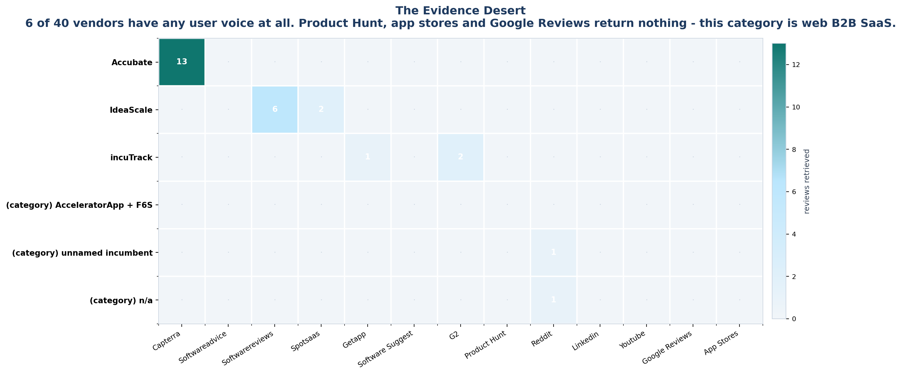
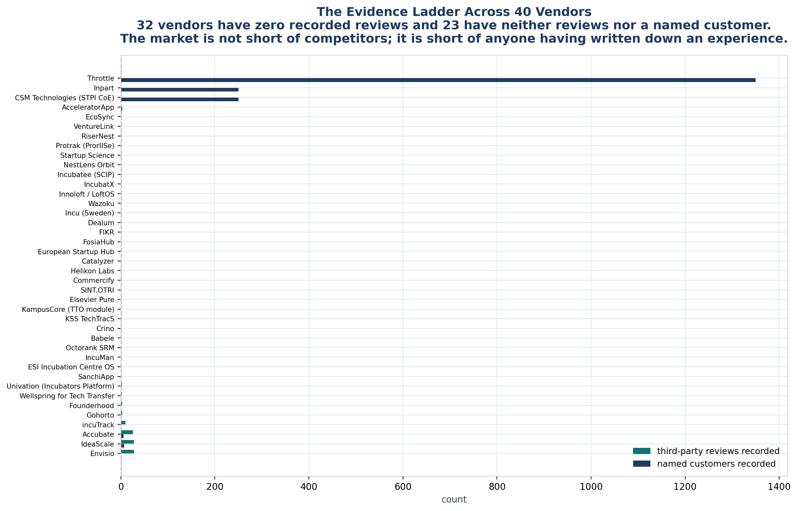

<!-- GENERATED by build/build_phase11.py on 2026-10-19. DO NOT EDIT BY HAND.
     Edit build/data_p11_reviews.py and re-run. -->

> **0 interviews conducted. 0 competitor conversations.**
> Every record below is a public document retrieved on 2026-10-19. Quotes
> are short excerpts exactly as retrieved; nothing is paraphrased or completed.
> Records graded other than USER_* are **excluded** from every claim.

# 03 - Vendor Reviews

3 vendors have retrievable user voice. 37 of the
40 matrix vendors have none.

## Vendors with user voice

### Accubate

| | |
|---|---|
| Records retrieved | 13 |
| Usable as user voice | 13 |
| Platforms | CAPTERRA |
| Incentive-flagged | 5 |
| Top pains | NO_COMPLAINT_RECORDED (4), INFORMATION_OVERLOAD (3), BUG_STABILITY (1) |
| Matrix position | PROVEN |

> "I feel, there different modules can be separated. having too many modules creates confusion at times."
>
> — Program Associate, Non-Profit Organization Management, CAPTERRA, 2025-06-25

### IdeaScale

| | |
|---|---|
| Records retrieved | 8 |
| Usable as user voice | 6 |
| Platforms | SOFTWAREREVIEWS; SPOTSAAS |
| Incentive-flagged | 3 |
| Top pains | PRICE_VALUE (2), INTEGRATION_GAP (1), UI_COMPLEXITY (1) |
| Matrix position | PROVEN |

> "The major drawback is that it is generalized for engineering specific needs. It lacks in built-in integrations with design tools like CAD or PLM systems."
>
> — Industry Specific Role, Technology, SOFTWAREREVIEWS, 2025-09

### incuTrack

| | |
|---|---|
| Records retrieved | 5 |
| Usable as user voice | 1 |
| Platforms | G2; GETAPP; TOPBUSINESSSOFTWARE; VENDOR_SITE |
| Incentive-flagged | 0 |
| Top pains | NO_COMPLAINT_RECORDED (1) |
| Matrix position | PROVEN |

_No dissatisfaction recorded in any retrieved review._

## Vendors with none

The following 37 vendors were searched across Capterra, G2, GetApp,
Software Advice, Software Reviews, SpotSaaS, Product Hunt, Reddit, LinkedIn and
YouTube. **None has a retrievable review record.** Their coverage in this study
rests entirely on their own published material, which is `VENDOR_CLAIM` or
`UNKNOWN` in the Phase 10 matrix.

- AcceleratorApp
- Babele
- CSM Technologies (STPI CoE)
- Catalyzer
- Commercify
- Crino
- Dealum
- ESI Incubation Centre OS
- EcoSync
- Elsevier Pure
- Envisio
- European Startup Hub
- FIKR
- FosiaHub
- Founderhood
- Gohorto
- Helikon Labs
- Incu (Sweden)
- IncuMan
- IncubatX
- Incubatee (SCIP)
- Innoloft / LoftOS
- Inpart
- KSS TechTracS
- KampusCore (TTO module)
- NestLens Orbit
- Octorank SRM
- Protrak (ProrIISe)
- RiserNest
- SINT.OTRI
- SanchiApp
- Startup Science
- Throttle
- Univation (Incubators Platform)
- VentureLink
- Wazoku
- Wellspring for Tech Transfer

That list is the finding. It means the matrix's scores for these vendors describe
what they *say they do*, and the evidence-grading column already records that.

## Category-level voices

Two records are not about any single vendor but are the most credible evidence in
the corpus.

### ICUBE, University of Toronto

> "the ICUBE team relied on multiple platforms alongside a system of spreadsheets,
> each serving a different purpose. This approach was time-consuming, prone to
> errors, and difficult to scale."

> "existing incubator support systems like AcceleratorApp and F6S were either too
> costly and overloaded with unnecessary features or too limited for ICUBE's needs."

Graded `USER_INSTITUTIONAL` with a self-interest caveat: ICUBE built its own
Ecosystem Management System and published this while launching it. A named
institution describing its own operating problem, but one with a reason to frame
it favourably.

It is still the most useful record retrieved, because it names **both failure
modes of the incumbent** - too big and too small - from a buyer who evaluated both
and chose to build instead.

### University incubator manager, six years

> "I've managed an incubator and proof-of-concept center at a university for nearly
> 6 years now, and have still not found a management system for tracking
> applications, running competitions, bring the ecosystem together on one platform."

Graded `USER_FORUM`. A single anonymous practitioner, and the most direct statement
of unmet need in the entire study.
