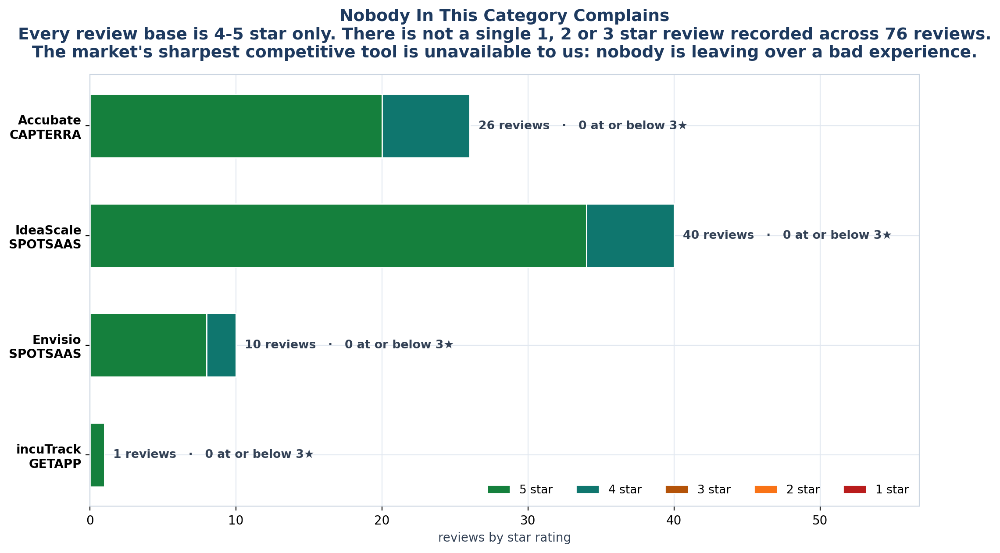
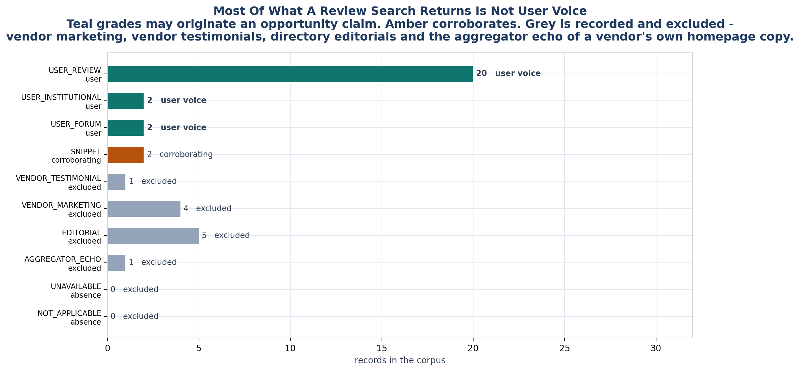
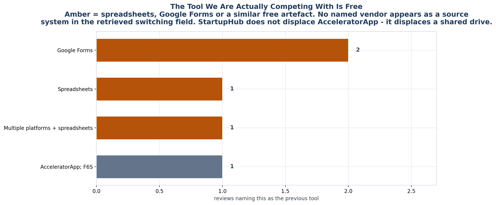

<!-- GENERATED by build/build_phase11.py on 2026-10-19. DO NOT EDIT BY HAND.
     Edit build/data_p11_reviews.py and re-run. -->

> **0 interviews conducted. 0 competitor conversations.**
> Every record below is a public document retrieved on 2026-10-19. Quotes
> are short excerpts exactly as retrieved; nothing is paraphrased or completed.
> Records graded other than USER_* are **excluded** from every claim.

# Phase 11 - Competitor User Reviews

> *"Don't only read competitor websites... You want to discover **what users hate**
> about existing solutions. That becomes your opportunity."*

## The headline is a negative one

**Nobody in this category complains.**

Across every platform searched, not one 1, 2 or 3 star review exists. Accubate -
the only vendor with a substantial review base - holds 4.8 across 26 reviews with
twenty 5-star and six 4-star and nothing lower. IdeaScale holds 40 ratings in the
same shape. Envisio's ten are all positive.

That is not a compliment to the products. It means **nobody in this market is losing
customers to a bad experience**, which means StartupHub cannot enter on "better
software". The competitive tool this phase was supposed to hand us - user
disappointment - does not exist here.

## What we found instead

| | |
|---|---|
| Review records retrieved | **37** |
| Records usable as user voice | **24** |
| Vendors with any user voice | **6 of 40** |
| Records flagged vendor-incentivised | **8** |
| Platforms searched | **13** |
| Searched-but-empty cells recorded | **32** |
| Source conflicts found | **4** |
| **New competitors found** | **4** |

Three findings survived scrutiny, and all three matter more than the corpus they
came from:

**1. Most "complaint content" in this category is not user voice.**
Searching for pain returns confident prose about user struggle. Nearly all of it is
written by the vendors selling the cure - SanchiApp's "vs Spreadsheets", Gohorto's
"Run Your Accelerator Without Spreadsheets", RiserNest's case study. These are
marketing assets. They are often accurate. They are not independent testimony.

**2. The tool we are actually competing with is free.**
No named vendor appears as a previous system in any retrieved switching field. What
appears is Google Forms and spreadsheets.

**3. Four competitors were missing from the matrix - three aimed at our buyer.**
Phase 9's own falsifier said its vendor set was good-not-exhaustive. Phase 11
searched vendor marketing rather than category lists and found **IncuMan**,
**ESI Incubation Centre OS**, **CSM Technologies (STPI CoE)** and **SanchiApp**.
The matrix has been extended from 36 vendors to 40.

## The documents

| File | What it settles |
|---|---|
| [01_Evidence_Grading.md](01_Evidence_Grading.md) | Why most retrieved text cannot be used |
| [02_Complaint_Taxonomy.md](02_Complaint_Taxonomy.md) | The 12 categories and their counts |
| [03_Vendor_Reviews.md](03_Vendor_Reviews.md) | Per-vendor findings across all 40 |
| [04_What_Users_Hate.md](04_What_Users_Hate.md) | The ranked synthesis |
| [05_Opportunity_Mapping.md](05_Opportunity_Mapping.md) | Handed to Phase 12 |
| [06_Limitations.md](06_Limitations.md) | What is **not** here, and why |

## Machine-readable

`_exports/phase11/` - seven files. `reviews.csv` is the corpus; `complaints.csv`
is the subset that may support a claim; `evidence_exclusions.csv` records every
platform cell that was searched and came back empty.

**Workbook:** [`_exports/xlsx/09_Competitor_User_Reviews.xlsx`](../_exports/xlsx/09_Competitor_User_Reviews.xlsx)

## The evidence ladder at a glance

| Grade | Family | May claim? | Records |
|---|---|---|---|
| `USER_REVIEW` | user | YES | 20 |
| `USER_INSTITUTIONAL` | user | YES | 2 |
| `USER_FORUM` | user | YES | 2 |
| `SNIPPET` | corroborating | CORROBORATE | 2 |
| `VENDOR_TESTIMONIAL` | excluded | NO | 1 |
| `VENDOR_MARKETING` | excluded | NO | 4 |
| `EDITORIAL` | excluded | NO | 5 |
| `AGGREGATOR_ECHO` | excluded | NO | 1 |
| `UNAVAILABLE` | absence | N/A - absence | 0 |
| `NOT_APPLICABLE` | absence | N/A - absence | 0 |
