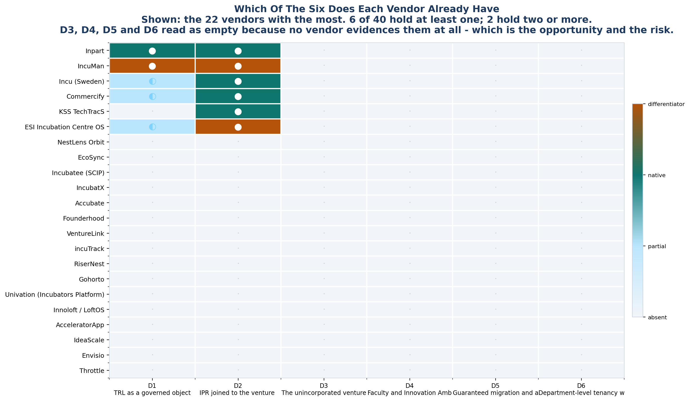

<!-- GENERATED by build/build_phase12.py on 2026-10-19. DO NOT EDIT BY HAND.
     Edit build/data_p12_gaps.py and re-run. -->

> **0 interviews conducted. 0 competitor conversations.**
> Competitor absence is measured across **40 vendors**. User
> demand rests on **24 usable review records**, none
> of them from an Indian university. The two are never merged.

# 01 - The Differentiators

Six. Each one states what it is, why the market lacks it, what would prove us
wrong, and why we would win it.

### D1 · TRL as a governed object, mapped to eligible Indian schemes

| | |
|---|---|
| Gap | GAP-02 |
| Held by | 2 of 40 vendors — Inpart, IncuMan |
| Confidence | **HIGH on absence, UNPROVEN on demand** |

**What it is.** Model Technology Readiness Level as a tracked, auditable property of the venture - not a free-text stage label - and map it to the schemes a venture at that level is actually eligible for.

**Why it is a gap.** Every platform tracks 'stage' as prose. A TRL that a return can be filed against is the object both NIRF and IIC actually ask for, and it is the input a scheme-eligibility check needs. Phase 1 found only 32 of 354 DPIIT-recognised startups appear in the NIRF Innovation table.

| | |
|---|---|
| **A** — competitor absence | 2 of 40 build TRL natively; 32 of 40 are evidenced-absent. The widest technical gap in the matrix. |
| **U** — user demand | None. No user in the corpus asked for TRL. |

**If it is contested:** Inpart builds it for TTOs. IncuMan builds it for HEIs but is in private beta with no customers.

**Falsifier.** If two vendors demonstrate a live Indian university running TRL to scheme-mapped eligibility, this closes. Watch IncuMan's beta exit.

**Our edge.** INERTIA. This is exactly the capability that is tedious, unglamorous and requires scheme-by-scheme eligibility maintenance. Incumbents with investor-facing roadmaps will not build it. Phase 5 also shows the budget filter excludes nobody at Rs 1.2L, so nobody is being undercut on price - we would be the only one offering it at all.

### D2 · IPR joined to the venture lifecycle, not bolted beside it

| | |
|---|---|
| Gap | GAP-01 |
| Held by | 2 of 40 vendors — IncuMan, ESI Incubation Centre OS |
| Confidence | **HIGH on absence, MODERATE on demand** |

**What it is.** One venture record carries the disclosure, the docket, the milestone and the licence. Filing status changes when the venture changes stage, because they are the same object.

**Why it is a gap.** Six of the ten vendors that build IPR are technology-transfer platforms that never touch incubation. The four that do join it are mostly Indian newcomers with no named customer. A TTO officer and an incubation manager today hold two systems and reconcile them by hand - the same reconciliation problem Phase 1 documented for startup counts.

| | |
|---|---|
| **A** — competitor absence | 4 of 40 build IPR JOINED to incubation, against 10 that build IPR alone. Only Protrak/IISc has a named Indian university, and it is IP-only. |
| **U** — user demand | None directly. The FRAGMENTATION complaint category is the nearest signal, and it is about handoffs between people, not modules. |

**If it is contested:** Protrak (IISc, IP-only), Inpart, IncuMan, ESI. None demonstrates a full venture-to-licence lifecycle in production.

**Falsifier.** If IncuMan or ESI ships and names an Indian university running joint incubation + IPR, the joined claim narrows to Protrak's reference advantage alone.

**Our edge.** REFERENCE + SCOPE. StartupHub already competes for the IIC budget line; Protrak competes for the TTO budget line, which is a separate and slower approval chain (Phase 2: 0 of 25 roles have documented budget authority). Winning the IIC budget first and adding IPR second is a sequencing advantage Protrak does not have.

### D3 · The unincorporated venture as a first-class state

| | |
|---|---|
| Gap | GAP-09 |
| Held by | 0 of 40 vendors — **nobody — uncontested** |
| Confidence | **HIGH on absence, UNPROVEN on demand** |

**What it is.** Track the idea, the student team and the pre-entity venture as real records with their own lifecycle, which can later convert into an incorporated entity without losing history.

**Why it is a gap.** Every one of 40 vendors assumes a registered entity with a DPIIT number. The Indian university funnel is mostly before that point. Phase 1 shows NIT Calicut attributing 38 of 55 ventures to an undefined 'others' bucket, and 843 ideas arising from 42 activities - a pipeline of unidentified pre-entity work that no incumbent can represent.

| | |
|---|---|
| **A** — competitor absence | 0 of 40, with no partial implementations either. Nobody has even attempted the easy version. |
| **U** — user demand | None. This is a Phase 1 document finding, not a user finding. |

**If it is contested:** UNCONTESTED. Which usually means nobody thinks it is worth building - and also that nobody has proven it wrong.

**Falsifier.** If the Phase 1 'others'-bucket and idea-count findings turn out to be a reporting artefact rather than a real pipeline, this collapses. This is precisely what a Phase 3B interview is designed to test.

**Our edge.** LACK OF INCUMBENT MOTIVE. Incumbents sell to incubators whose revenue comes from accepted cohorts. Counting people who will never be accepted is unmonetisable for them and central to the university's accreditation return. Different buyer, different metric.

### D4 · Faculty and Innovation Ambassadors as first-class entities

| | |
|---|---|
| Gap | GAP-06 |
| Held by | 0 of 40 vendors — **nobody — uncontested** |
| Confidence | **MODERATE on absence, UNPROVEN on demand** |

**What it is.** Model the faculty inventor, the student innovator and the Innovation Ambassador as entities with their own records, so innovation activity is not forced through a 'startup application' form.

**Why it is a gap.** Every incubation platform in the set begins intake at 'startup application'. Faculty appear only in tech-transfer platforms. But Phase 1 shows the institution splits innovation funding three ways - innovation, startup, IPR - and runs 15,000 college Innovation Ambassadors and 25,000 school ambassadors who are not startups at all.

| | |
|---|---|
| **A** — competitor absence | 0 incubation platforms hold it (Phase 9 'faculty' flag). NOT MEASURED in the Phase 10 matrix, so the 12 later vendors are unscored on this axis - a known gap. |
| **U** — user demand | None. Not asked for by anyone in the corpus. |

**If it is contested:** UNCONTESTED and unmeasured. The weakest evidence base of the six and the one most in need of a Phase 3B interview.

**Falsifier.** A single IIC coordinator saying 'we already track that in the annual return' closes it. Do not fund this before that conversation.

**Our edge.** ADJACENCY TO ACCREDITATION. The buyer already produces this data annually for NIRF and ARIIA. It is not a new reporting burden; it is the report they are already late submitting.

### D5 · Guaranteed migration and adoption - the inertia wedge

| | |
|---|---|
| Gap | GAP-10 |
| Held by | 0 of 40 vendors — **nobody — uncontested** |
| Confidence | **HIGH on demand, HIGH on absence** |

**What it is.** A scoped, fixed-price migration off forms, spreadsheets and WhatsApp with the data carried over, plus a named onboarding owner for the first two intake cycles.

**Why it is a gap.** Every vendor claims migration; none sells the guarantee. Phase 11 showed the displaced incumbent is free - two Accubate reviewers moved from Google Forms - and identified the real blocker: programmes that have the means to automate still do it by hand, because nobody sells change management.

| | |
|---|---|
| **A** — competitor absence | 0 of 40 sell migration as a guaranteed engagement. It is a services offer, and services do not appear on feature pages. |
| **U** — user demand | STRONGEST user evidence of the six. Three independent routes: the ICUBE institutional record, a six-year university incubator manager, and FRAGMENTATION being the only complaint category with multi-source support. |

**If it is contested:** UNCONTESTED. Note the trap: this is also the thing the few incumbents most likely to copy, because it is service work and not a feature.

**Falsifier.** If the ICUBE record turns out to be an outlier - a sophisticated university that most buyers are unlike - the wedge weakens sharply.

**Our edge.** SEQUENCING. Migration is the only differentiator that generates its own proof: a migrated institution is the reference institution GAP-13 says nobody has. It converts directly into case studies and into the Protrak-style evidence the market currently lacks.

### D6 · Department-level tenancy with departmental P&L

| | |
|---|---|
| Gap | GAP-11 |
| Held by | 0 of 40 vendors — **nobody — uncontested** |
| Confidence | **MODERATE on absence, UNPROVEN on demand** |

**What it is.** Sub-tenancy per academic department, each with its own budget view and correct ownership of IP between the department, the institute and any SPV.

**Why it is a gap.** Multi-campus is table stakes. How Indian universities are actually organised - by department, with separate heads and separate money - is not. It also determines who signs, which matters given that Phase 2 found 0 of 25 roles with documented budget authority: the Department Head may be a cheaper approval than the institute.

| | |
|---|---|
| **A** — competitor absence | 0 of 40 demonstrably. Phase 9's 'multisite' flag cannot distinguish campus-level from department-level, so this is asserted rather than counted - a stated limitation. |
| **U** — user demand | None. |

**If it is contested:** UNCONTESTED but unmeasured. Weakest absence evidence of the six.

**Falsifier.** If multi-campus tenancy in any incumbent is already department-granular, this is already solved and we are describing a checkbox.

**Our edge.** APPROVAL-PATH OPTIMISATION. Phased differently from the product wedge: this may be worth shipping as tenancy plumbing rather than positioning it as a differentiator.

## The seventh candidate

### Deployment shape an Indian university can actually buy — **REQUIREMENT, NOT DIFFERENTIATOR**

Phase 8: Fedena sells a FULL college ERP at Rs 1,00,000 flat with unlimited users - below the recommended Rs 1.2 lakh list. Phase 11 found a second free competitor (Univation, free to universities with Google Ads credit). A flat, unlimited-user, sub-Rs-1.5-lakh shape is the price of admission. Meeting it is not an advantage; failing to meet it is a non-starter.

**Falsifier.** A university procurement rule requiring per-user or per-module
pricing would remove the constraint entirely.

---

## Why only six

| Filter | Effect |
|---|---|
| 13 gaps carried in from Phase 9 | — |
| Rule 1 retires saturated capabilities | −3 (GAP-04 retired; GAP-05, GAP-07 narrowed past usefulness) |
| GAP-12 reclassified as packaging | −1 |
| Six survive as genuine differentiators | **6** |

The instruction asked for 5-7. Six is where the evidence landed. Manufacturing
a seventh would have meant promoting one of the five retired capabilities back
into the set, which is the specific failure the instruction exists to prevent.
