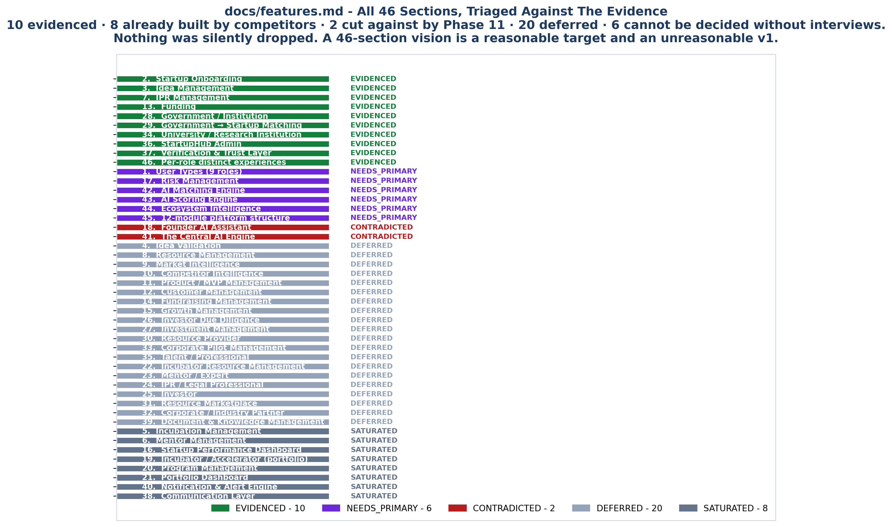
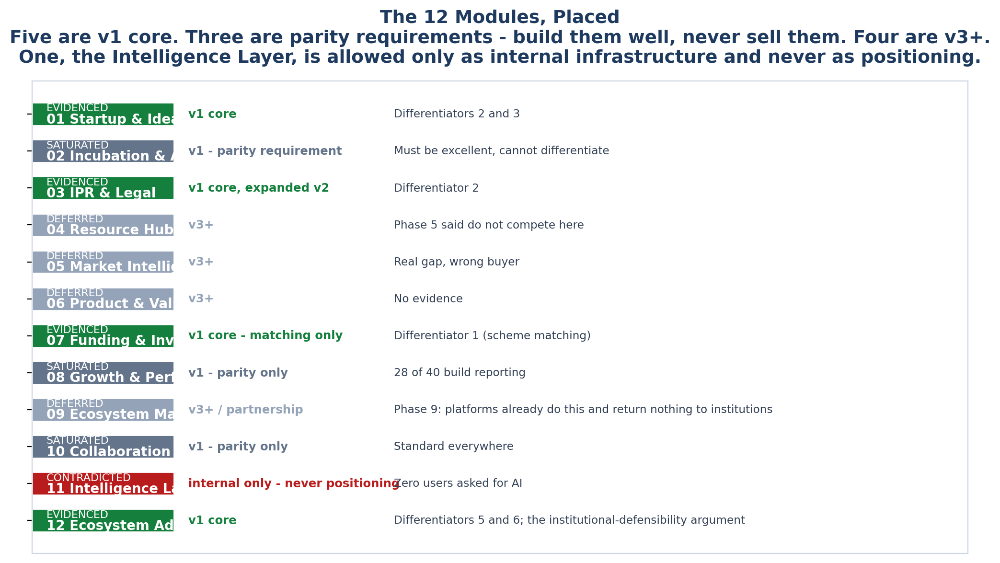

<!-- GENERATED by build/build_phase12.py on 2026-10-19. DO NOT EDIT BY HAND.
     Edit build/data_p12_gaps.py and re-run. -->

> **0 interviews conducted. 0 competitor conversations.**
> Competitor absence is measured across **40 vendors**. User
> demand rests on **24 usable review records**, none
> of them from an Indian university. The two are never merged.

# 04 - `docs/features.md` Triage

The 46-section architecture in `docs/features.md` is a reasonable **target** and
an unreasonable **v1**. Every section is placed here.

| Verdict | Count | Meaning |
|---|:--:|---|
| `EVIDENCED` | 10 | Backed by a differentiator or a Phase 1 documented problem |
| `SATURATED` | 8 | Competitors already build it — parity requirement, never a wedge |
| `CONTRADICTED` | 2 | Research actively cuts against it |
| `DEFERRED` | 20 | Plausible, no evidence, not differentiating — v3+ |
| `NEEDS_PRIMARY` | 6 | Cannot be decided without the interviews we have not run |

## All 46

| # | Section | Verdict | Why |
|--:|---|---|---|
| **2** | Startup Onboarding | `EVIDENCED` | Feeds differentiator 3 - the venture record must exist before incorporation. |
| **3** | Idea Management | `EVIDENCED` | Feeds GAP-09 and Phase 1's 843-ideas-from-42-activities finding. |
| **7** | IPR Management | `EVIDENCED` | Differentiator 2. The full discovery-to-licence workflow is a v2 expansion of the joined-venture record. |
| **13** | Funding | `EVIDENCED` | Scheme-eligibility matching is the second half of differentiator 1. A plain grant LIST is saturated at 11 of 40 native - matching a venture's TRL and sector against actual scheme criteria is not built by anyone. |
| **28** | Government / Institution | `EVIDENCED` | The mandate and accreditation-return surface is the commercial reason the IIC budget exists. Note GAP-03 is now CONTESTED. |
| **29** | Government → Startup Matching | `EVIDENCED` | Same object as differentiator 1's scheme mapping, seen from the government side. |
| **34** | University / Research Institution | `EVIDENCED` | This IS the buyer. Research-to-IP-to-startup connection is differentiator 2. |
| **36** | StartupHub Admin | `EVIDENCED` | Governance, audit logs and permissions are load-bearing for the accreditation argument and for GAP-08's auditable posture. |
| **37** | Verification & Trust Layer | `EVIDENCED` | Required for the institutional-defensibility wedge; a committee buying a system of record needs to know who certified each record. |
| **46** | Per-role distinct experiences | `EVIDENCED` | The strongest idea in features.md, and the one Phase 2 independently converged on: the IIC coordinator's question is 'which startup needs intervention', not 'show me the list'. Build the surfaces around that question. |
| **1** | User Types (9 roles) | `NEEDS_PRIMARY` | 9 roles; the research evidences at most 4 as buyers (IIC coordinator, incubation manager, TTO/IP officer, evaluator). Phase 2 mapped 25 roles but found 0 with documented budget authority. Founder, mentor, investor, corporate and resource-provider roles are all DEFERRED. |
| **17** | Risk Management | `NEEDS_PRIMARY` | Plausible and connected to the TRL object, but Phase 11 found no user asking for risk scoring. Cannot be scoped without interviews. |
| **42** | AI Matching Engine | `NEEDS_PRIMARY` | Mentor matching is saturated and unasked-for. Grant/mentor matching tied to TRL is differentiator 1 and IS evidenced. Only the evidenced use ships. |
| **43** | AI Scoring Engine | `NEEDS_PRIMARY` | Eight proposed scores, none evidenced. EcoSync's refusal to publish AI scores and VentureLink's actor-reason audit trail are the two data points that matter, and both are about auditability rather than the score. |
| **44** | Ecosystem Intelligence | `NEEDS_PRIMARY` | Requires cross-institution data nobody has shared. Not reachable by a single institution's purchase. |
| **45** | 12-module platform structure | `NEEDS_PRIMARY` | The module taxonomy is sound as architecture. As a delivery plan for v1 it is 12x too large for the evidence. Triaged at module level in MODULES_MAP. |
| **18** | Founder AI Assistant | `CONTRADICTED` | Phase 11: zero users asked for AI, and 'AI assistant' is exactly the positioning Phase 11 declined to make. Keep as an internal surface over the TRL object, never as a differentiator. |
| **41** | The Central AI Engine | `CONTRADICTED` | As positioning, contradicted by Phase 11. As internal infrastructure, fine - but it must never be the reason a customer buys. |
| **4** | Idea Validation | `DEFERRED` | Reasonable, no competitor builds it, but nothing in 11 phases evidences demand and it is a founder-side module, not the institutional buyer. |
| **8** | Resource Management | `DEFERRED` | Only 3 of 40 build it natively, so the gap is real - but Phase 5 concluded we should NOT compete here: incuTrack and EcoSync are strong and this is most likely a free defensive feature, not a wedge. |
| **9** | Market Intelligence | `DEFERRED` | Startup-side analytics. 27 of 40 build analytics; market intel is 7 native / 15 partial. Real gap, wrong buyer. |
| **10** | Competitor Intelligence | `DEFERRED` | Founder-side. Would require the data this study itself collects. Interesting but not this buyer. |
| **11** | Product / MVP Management | `DEFERRED` | No evidence in 11 phases. Founder-side. |
| **12** | Customer Management | `DEFERRED` | Startup-side CRM for customer discovery, retention and churn. No evidence in any phase, no competitor demand, and it belongs to the founder's business rather than the institutional buyer this product sells to. |
| **14** | Fundraising Management | `DEFERRED` | Investor-side: pipeline, data rooms, term sheets, cap table. Phase 9 found Startup India Hub and MAARG already overlapping this, and it addresses the investor rather than the university that StartupHub sells to. |
| **15** | Growth Management | `DEFERRED` | Startup-side growth planning and metrics. Nothing in eleven phases evidences demand, and the buyer who would pay for it is the founder, who is not in the procurement chain Phase 2 mapped. |
| **26** | Investor Due Diligence | `DEFERRED` | The diligence workspace and data room serve the investor's due-diligence process, not the university's innovation return. Phase 9 found no named Indian university asking for it. |
| **27** | Investment Management | `DEFERRED` | Post-investment portfolio tracking for funds. A different buyer, a different budget and a different approval chain entirely from the IIC coordinator. |
| **30** | Resource Provider | `DEFERRED` | Marketplace supply side: cloud credits, labs, hardware, consultants. Only 3 of 40 vendors build resource management natively, so the gap is real - but Phase 5 concluded we should not compete here. |
| **33** | Corporate Pilot Management | `DEFERRED` | Challenge-to-pilot-to-contract workflow. corporate_match is 5 native and 18 partial across the market - mostly weak, and there is no evidence in any phase that the university buyer wants it inside the v1 system of record. |
| **35** | Talent / Professional | `DEFERRED` | Marketplace supply side for skills and freelancing. Two-sided marketplace economics with no demand evidence and no institutional buyer attached. |
| **22** | Incubator Resource Management | `DEFERRED` | Same reasoning as #8 - real gap, wrong strategic choice. |
| **23** | Mentor / Expert | `DEFERRED` | Retained only for the NDA-tiered visibility half (GAP-07). |
| **24** | IPR / Legal Professional | `DEFERRED` | Second persona for differentiator 2; expand after the venture record ships. |
| **25** | Investor | `DEFERRED` | Investor-side. Not this buyer. |
| **31** | Resource Marketplace | `DEFERRED` | Two-sided marketplace economics, months of work, zero evidence of demand. |
| **32** | Corporate / Industry Partner | `DEFERRED` | Phase 9 found corporate_match is 5 native / 18 partial - mostly weak. No evidence the university buyer wants this in v1. |
| **39** | Document & Knowledge Management | `DEFERRED` | Needed eventually, not differentiating, and heavily commoditised. |
| **5** | Incubation Management | `SATURATED` | 21 of 40 build incubation natively, 11 partially. Rule 1 applies. Must be built well; cannot be the wedge. |
| **6** | Mentor Management | `SATURATED` | 15 of 40 native. Mentorship is even sold as a paid add-on by incuTrack. Only the NDA-tiered visibility half of GAP-07 survives. |
| **16** | Startup Performance Dashboard | `SATURATED` | 28 of 40 vendors build reporting natively or better and 27 build analytics. Rule 1 applies: this cannot be a differentiator and must not appear in positioning. It remains a v1 parity requirement. |
| **19** | Incubator / Accelerator (portfolio) | `SATURATED` | Portfolio view is standard in 15+ vendors. |
| **20** | Program Management | `SATURATED` | Cohort and programme management is the most built capability in the category. |
| **21** | Portfolio Dashboard | `SATURATED` | The at-a-glance cohort table with stage, risk and progress is standard in every vendor with a portfolio view. Fifteen or more build it natively. Keep it for parity; never sell it. |
| **40** | Notification & Alert Engine | `SATURATED` | Centralised alerts are standard across the category. Phase 11's one real complaint in this area was email reaching spam - a deliverability problem, not a missing feature. Building an engine against it solves the wrong thing. |
| **38** | Communication Layer | `SATURATED` | Every vendor has email, chat and reminders. Phase 11's one real complaint - email to spam - is a deliverability problem, not a feature gap. |

## The 12 modules

| Module | Verdict | Timing | Rationale |
|---|---|---|---|
| 01 Startup & Idea | `EVIDENCED` | v1 core | Differentiators 2 and 3 |
| 02 Incubation & Acceleration | `SATURATED` | v1 - parity requirement | Must be excellent, cannot differentiate |
| 03 IPR & Legal | `EVIDENCED` | v1 core, expanded v2 | Differentiator 2 |
| 04 Resource Hub | `DEFERRED` | v3+ | Phase 5 said do not compete here |
| 05 Market Intelligence | `DEFERRED` | v3+ | Real gap, wrong buyer |
| 06 Product & Validation | `DEFERRED` | v3+ | No evidence |
| 07 Funding & Investment | `EVIDENCED` | v1 core - matching only | Differentiator 1 (scheme matching) |
| 08 Growth & Performance | `SATURATED` | v1 - parity only | 28 of 40 build reporting |
| 09 Ecosystem Marketplace | `DEFERRED` | v3+ / partnership | Phase 9: platforms already do this and return nothing to institutions |
| 10 Collaboration | `SATURATED` | v1 - parity only | Standard everywhere |
| 11 Intelligence Layer | `CONTRADICTED` | internal only - never positioning | Zero users asked for AI |
| 12 Ecosystem Administration | `EVIDENCED` | v1 core | Differentiators 5 and 6; the institutional-defensibility argument |

## The three contradictions

These are the parts of `features.md` that the research cuts against, stated
plainly because they are the most likely to be quoted back at us:

**§18 Founder AI Assistant and §41 The Central AI Engine.** Phase 11 found
**zero** users asking for AI in the entire retrieved corpus, and explicitly
listed *"nobody has solved AI-driven incubation"* as **NOT SUPPORTED BY
EVIDENCE**. The Intelligence Layer is retained as internal infrastructure only.
It must never be the reason a customer buys.

**§38 Communication Layer and §40 Notification Engine.** Both are `SATURATED`.
Phase 11's one real complaint in this area was *"startups wont access emails or
goes to spam"* — a deliverability problem, not a missing feature. Building a
notification engine in response would be solving the wrong problem.

**§5, §6, §16, §19–§21 — incubation, mentorship and dashboards.** 21 of 40
vendors build incubation natively, 15 build mentorship, 28 build reporting,
27 build analytics. These are parity requirements. They must be excellent and
must never appear in positioning.

## The best idea in `features.md`

§46 — *"don't make every feature available to every user; give each role a
different question."* Phase 2 arrived at the same conclusion independently:
the IIC coordinator's question is **"which startup needs intervention?"**, not
"show me the list". That convergence between an aspirational architecture and an
independent procurement study is the strongest signal in this document.
