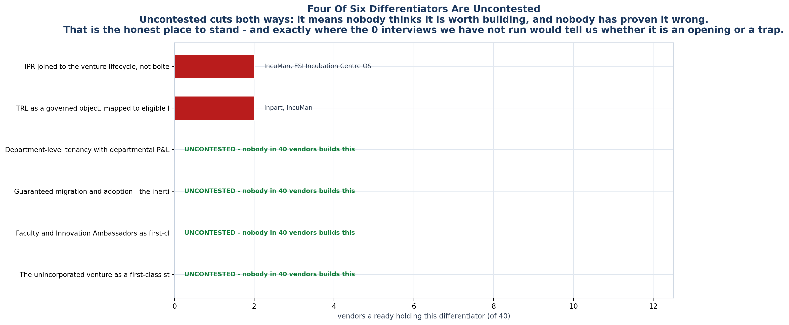
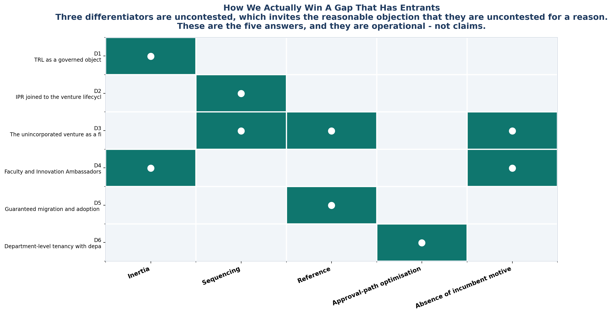

<!-- GENERATED by build/build_phase12.py on 2026-10-19. DO NOT EDIT BY HAND.
     Edit build/data_p12_gaps.py and re-run. -->

> **0 interviews conducted. 0 competitor conversations.**
> Competitor absence is measured across **40 vendors**. User
> demand rests on **24 usable review records**, none
> of them from an Indian university. The two are never merged.

# 06 - How We Win A Contested Gap

34 of 40 vendors hold none of the six.
Four differentiators are uncontested.

That is a fair source of scepticism, and it deserves a direct answer rather than
optimism. An uncontested gap usually means **nobody thinks it is worth
building** — which may also mean nobody wants it.

## Five answers, all operational

### Inertia — applies to **D1**, **D4**

Boring, unglamorous, scheme-maintenance-heavy capability that investor-facing roadmaps will not prioritise.

**Risk.** Requires discipline to stay unfashionable when fundraising gets loud.

### Sequencing — applies to **D2**, **D3**

Winning the IIC budget line is cheaper and faster than winning the TTO line, so build the module the IIC buyer pays for first.

**Risk.** Phase 2 found 0 of 25 roles with documented budget authority - the IIC line may be easier to reach but not easy to spend.

### Reference — applies to **D5**, **D3**

Every migration produces a named Indian university deployment, which is the one asset GAP-13 says nobody in the category has.

**Risk.** Cannot be bought. Requires selling into institutions that do not currently buy anything.

### Approval-path optimisation — applies to **D6**

Offering a cheaper-to-approve buyer than the incumbent's target user converts a budget problem into a procurement win.

**Risk.** A department-level budget is smaller. Does not replace the institute deal.

### Absence of incumbent motive — applies to **D3**, **D4**

Capabilities that pay the incubator but not the vendor get systematically skipped. Count pre-entity ventures; they will never be an accepted cohort.

**Risk.** If a vendor's pricing ever moves to per-registered-venture, this closes.

## Which strategy each differentiator leans on

| | D1 TRL | D2 IPR joined | D3 Pre-incubation | D4 Faculty | D5 Migration | D6 Dept tenancy |
|---|:--:|:--:|:--:|:--:|:--:|:--:|
| **Inertia** | ● |  |  | ● |  |  |
| **Sequencing** |  | ● | ● |  |  |  |
| **Reference** |  |  | ● |  | ● |  |
| **Approval-path optimisation** |  |  |  |  |  | ● |
| **Absence of incumbent motive** |  |  | ● | ● |  |  |

## The uncomfortable one

**D5 — guaranteed migration — is the differentiator most likely to be copied.**

Migration is service work. It appears on no feature page, produces no software
moat, and any incumbent can hire two people to offer it. It is listed first here
not because it is the most defensible, but because it is the one with the
**strongest user evidence** (three independent routes in Phase 11) and the one
that **generates its own proof**: a migrated institution is the reference
institution that GAP-13 says nobody in this category has.

Treat it as the entry wedge, not the moat. The moat is D1 and D2, where the
work is tedious enough that nobody wants to maintain it and specific enough that
doing it well takes years of scheme-by-scheme research.

## What we are NOT claiming

That any of these is unique to us. IncuMan and ESI are two small teams building
directly adjacent products right now. The claim is narrower:

> Nobody in 40 vendors is building these for a *university IIC
> coordinator*, at a *price a committee can approve*, with a *guaranteed
> migration* from the spreadsheet they are using today.

That is a smaller claim than Phase 9 was making. It is also one we can actually
defend.
