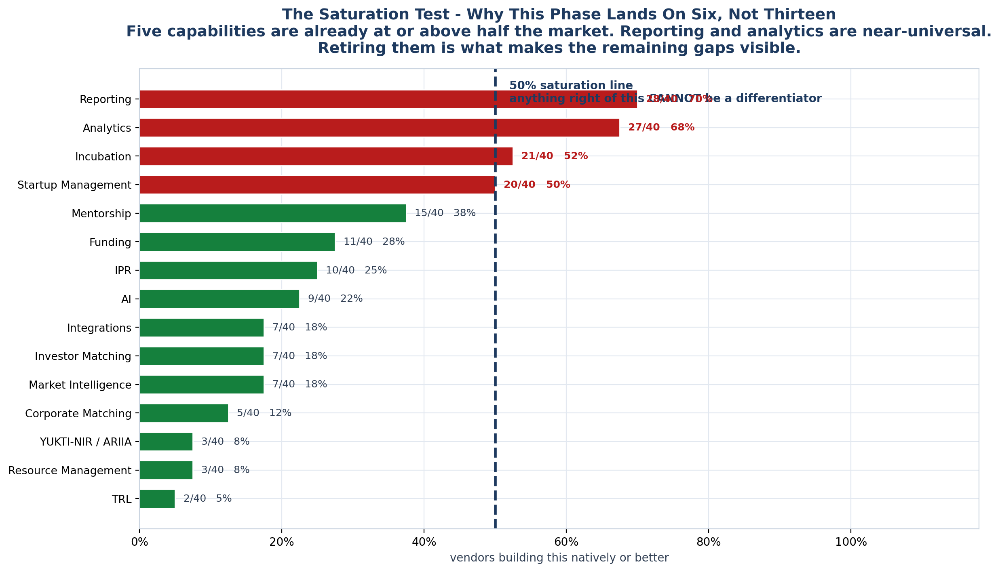
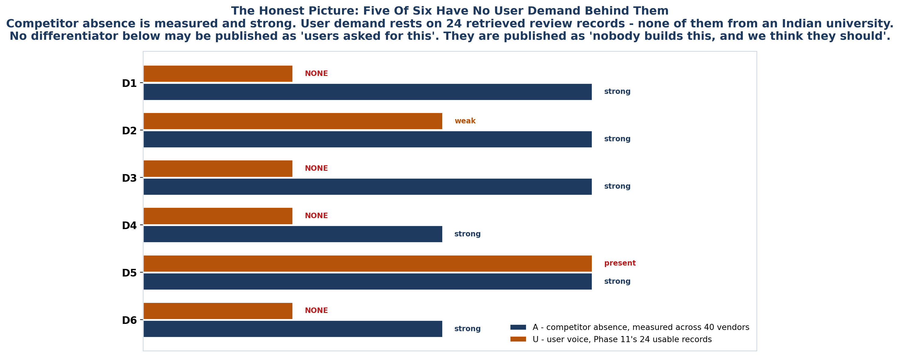

<!-- GENERATED by build/build_phase12.py on 2026-10-19. DO NOT EDIT BY HAND.
     Edit build/data_p12_gaps.py and re-run. -->

> **0 interviews conducted. 0 competitor conversations.**
> Competitor absence is measured across **40 vendors**. User
> demand rests on **24 usable review records**, none
> of them from an Indian university. The two are never merged.

# Phase 12 - Feature Gap Analysis

> *"For every competitor: what they have, vs what users actually need, vs what
> StartupHub can uniquely provide. Your goal is to find 5-7 meaningful
> differentiators, not 50 features."*

## Thirteen gaps in. Six differentiators out.

| | |
|---|---|
| Gaps re-scored against **40 vendors** | **13** |
| Survive · narrowed · contested · retired | **5 · 5 · 1 · 2** |
| **Differentiators** | **6** |
| Packaging requirements (not differentiators) | **1** |
| Vendors holding at least one differentiator | **6 of 40** |
| Vendors holding two or more | **2 of 40** |
| `docs/features.md` sections triaged | **46 of 46** |

## The six

| | Differentiator | Contested by | Confidence |
|---|---|---|---|
| **D1** | [TRL as a governed object, mapped to eligible Indian schemes](01_Differentiators.md) | 2 of 40 | HIGH on absence, UNPROVEN on demand |
| **D2** | [IPR joined to the venture lifecycle, not bolted beside it](01_Differentiators.md) | 2 of 40 | HIGH on absence, MODERATE on demand |
| **D3** | [The unincorporated venture as a first-class state](01_Differentiators.md) | 0 of 40 | HIGH on absence, UNPROVEN on demand |
| **D4** | [Faculty and Innovation Ambassadors as first-class entities](01_Differentiators.md) | 0 of 40 | MODERATE on absence, UNPROVEN on demand |
| **D5** | [Guaranteed migration and adoption - the inertia wedge](01_Differentiators.md) | 0 of 40 | HIGH on demand, HIGH on absence |
| **D6** | [Department-level tenancy with departmental P&L](01_Differentiators.md) | 0 of 40 | MODERATE on absence, UNPROVEN on demand |

Plus **[deployment shape](01_Differentiators.md#the-seventh-candidate)** - real,
and deliberately *not* a differentiator, because it is a packaging decision
rather than a capability.

## What changed since the last gap list

**GAP-03 died.** Phase 9 recorded it as *"Zero of 29 competitors. Highest-value
and most-defensible gap in the category."* Phase 11's sweep found four missing
vendors, three of which build YUKTI-NIR/ARIIA compliance. It is now **3 of 40** -
and all three are unproven: IncuMan is in private beta, ESI publishes a
compliance export carrying a live `(TODO)`, and CSM Technologies is a government
systems integrator rather than a product.

Not closed. **Contested by entrants with no customer proof**, which is a
different and more winnable problem than the one Phase 9 believed it had.

**GAP-04 is retired.** "Unified mandate-spanning reporting" was HIGH severity.
28 of 40 vendors build reporting natively or better; exactly one has it absent.

## Three rules that did the work

1. **The saturation test.** A capability held natively by ≥50% of the market
   cannot be a differentiator. This alone retires reporting, analytics and
   incubation - which three separate gaps were leaning on.
2. **Absence ≠ demand.** "Nobody builds this" is measured across 40 vendors.
   "Users want this" rests on 24 review records, none
   from an Indian university. Both columns exist, and are never merged.
3. **Every differentiator carries a falsifier.** A differentiator nothing could
   kill is not a strategy.

## The documents

| File | What it settles |
|---|---|
| [01_Differentiators.md](01_Differentiators.md) | The six, each with a falsifier |
| [02_Gap_Scorecard.md](02_Gap_Scorecard.md) | All 13, re-scored, with what Phase 11 changed |
| [03_Competitor_Coverage.md](03_Competitor_Coverage.md) | 40 vendors against the six |
| [04_Features_Map.md](04_Features_Map.md) | All 46 `features.md` sections triaged |
| [05_Not_Differentiators.md](05_Not_Differentiators.md) | What was cut, and why it is painful |
| [06_How_We_Win.md](06_How_We_Win.md) | The contested-gap question, answered |
| [07_Limitations.md](07_Limitations.md) | What this phase cannot tell you |

## Machine-readable

`_exports/phase12/` - eight files. `differentiators.csv` is the six.
`competitor_coverage.csv` is 40 x 6. `features_map.csv` is all 46 sections.

**Workbook:** [`_exports/xlsx/10_Feature_Gap.xlsx`](../_exports/xlsx/10_Feature_Gap.xlsx)

## A note on the folder name

`10_Feature_Gap` follows the live convention in this repository: Phase 7 →
`05_`, Phase 8 → `06_`, Phase 9 → `07_`, Phase 10 → `08_`, Phase 11 → `09_`,
so Phase 12 → `10_`, and Phase 13 → `11_Customer_Journey`. The legacy
placeholder `10_AI_Opportunity` is **empty** and unused; nothing is lost.
Several older folders (`01_Evidence_Vault`, `08_User_Roles`) predate this
convention and are not part of the active Phase 7-13 chain. The legacy
`11_Legal_Policy_Tech` folder was likewise empty and was removed at Phase 13;
its reserved home is now `15_Legal_Policy_Tech`.
