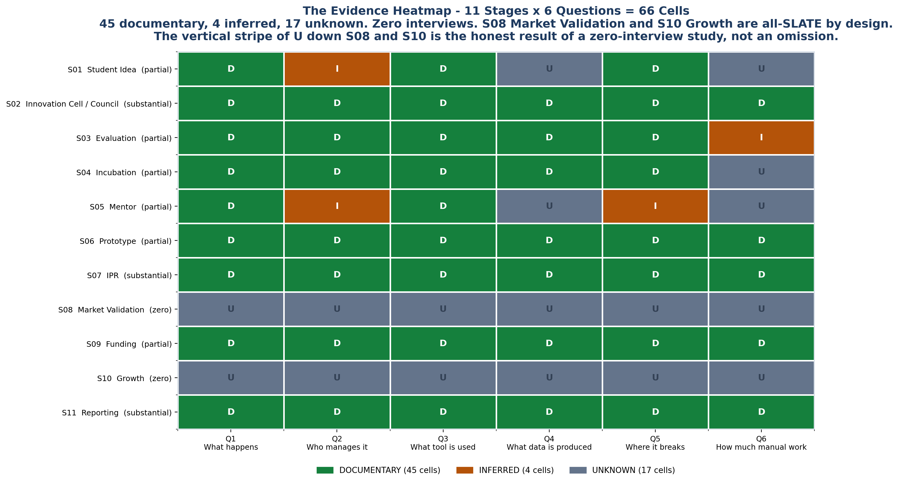

<!-- GENERATED by build/build_phase13.py on 2026-10-19. DO NOT EDIT BY HAND.
     Edit build/data_p13_journey.py and re-run. -->

> **0 interviews conducted. 0 buyer conversations.**
> Every cell below is graded **DOCUMENTARY** (45), **INFERRED** (4),
> **UNKNOWN** (17) or **NOT_APPLICABLE** (0). No respondent quote
> appears anywhere in this phase, because none was collected.

# 02 - Stage Dossiers

All 66 cells, stage by stage, with the sources that back each one and
what each one still needs.

---

## S01 · Student Idea

*A student or faculty member has an idea and surfaces it somehow - usually through a WhatsApp group or a department coordinator. No portal exists at this stage.*

| | Q | Question | Grade | Answer | Sources | Cross-ref |
|---|---|---|---|---|---|---|
| **Q1** | What happens | **DOCUMENTARY** | Students and faculty form ideas and surface them informally. Two NIT-level IICs differ ~75x in ideas generated under the same national programme, so the count is a function of local practice, not of any standard intake process. | P1-001 | P-A01 |
| **Q2** | Who manages it | **INFERRED** | Innovation Activity Coordinator (A-06) and IIC Members (A-12) collect; the Convener (A-03) controls what is presented to council. No source binds a named role specifically to idea intake. | P1-001 | Phase 2 roles A-03, A-06, A-12 |
| **Q3** | What tool is used | **DOCUMENTARY** | No mandated portal for idea capture. IISc routes student coordination through WhatsApp (COMP-024); Diagram 5 reconstructs the coordinator asking in the same group. | COMP-024 | Diagram 5 N1, N2; COMP-024 |
| **Q4** | What data is produced | **UNKNOWN** | Idea description, team, department - captured informally. No registered source documents an idea-capture schema. | — | P-A10 evidence_gap |
| **Q5** | Where it breaks | **DOCUMENTARY** | Idea counts are not funnel-linked to downstream outputs: reported prototypes can exceed reported ideas, proving the fields are not one funnel. | P1-008 | P-A01 |
| **Q6** | How much manual work | **UNKNOWN** | UNKNOWN. Phase 10 problem analysis P-A10 states hours are not measured and calls this the highest-value unknown in that section. | — | P-A10:554 |

**Basis**

- **Q1** — P1-001 measures the 75x variance directly from published IIC reports. No source documents a standardised intake process.
- **Q2** — The roles are documentary (Phase 2) and the Convener's agenda control is documentary, but the binding of any role to THIS stage is inferred from role descriptions, not stated.
- **Q3** — COMP-024 is a direct quote from IISc's own coordination page. Diagram 5 is a marked reconstruction from official forms.
- **Q4** — P-A10 states internal tooling and schemas are UNKNOWN at every stage. No registered source documents an idea-capture form.
- **Q5** — P1-008 is measured directly from published IIC reports.
- **Q6** — P-A10:554 is explicit: 'Not measured. This is the highest-value unknown in Section A.'

**Still needs**

- **Q2** — Phase 3B: ask who actually receives an idea first, and whether that person is named in any institutional document.
- **Q3** — Internal tooling at this stage is UNKNOWN across every registered source (P-A10).
- **Q4** — Phase 3B: capture the actual fields an institution records when an idea is first logged.
- **Q6** — Phase 3B interview instrument: hours per idea logged, per quarter.

---

## S02 · Innovation Cell / Council

*The IIC council meets quarterly and approves activities. The council-meeting upload is a hard gate: no meeting uploaded, no activities can be filed for that quarter.*

| | Q | Question | Grade | Answer | Sources | Cross-ref |
|---|---|---|---|---|---|---|
| **Q1** | What happens | **DOCUMENTARY** | The IIC council meets quarterly. Minimum 3 IIC Calendar activities plus 1 Celebration per quarter, i.e. a 16+ activity/year baseline. Activities cannot be filed until the quarter's council meeting is uploaded. | GOV-020, GOV-019 | P-A02; Diagram 5 P5 |
| **Q2** | Who manages it | **DOCUMENTARY** | IIC President (A-01) chairs and can change council membership; Convener (A-03) controls the quarterly agenda; nine named coordinator roles (A-04 to A-12) implement. | GOV-018 | Phase 2 roles A-01..A-12; P-A08 |
| **Q3** | What tool is used | **DOCUMENTARY** | IIC Portal (mandated). Menu exposes dashboard, IIC performance, activity status, council status, student/faculty participation, incubation unit registration and e-Repository. | GOV-018 | GOV-018 |
| **Q4** | What data is produced | **DOCUMENTARY** | Per activity: 4 social media links, participant counts, expenditure, video URL, 2 photographs and 1 document upload. | GOV-021 | P-A02 |
| **Q5** | Where it breaks | **DOCUMENTARY** | The council-meeting upload gates the entire activity pipeline for the quarter. If the meeting is not uploaded, no activities can be added - a single missing artefact blocks 16+ downstream filings. | GOV-019 | Diagram 5 P5; P-A02 |
| **Q6** | How much manual work | **DOCUMENTARY** | 16+ mandated activities/year, each carrying 4 social links + 2 photos + 1 video + 1 document = 8 evidence artefacts, so ~128+ artefacts/year per institution. Structural count MEASURED-FROM-DOCS; hours UNKNOWN. | GOV-020, GOV-021 | P-A02 |

**Basis**

- **Q1** — GOV-020 states the activity minimums; GOV-019 states the council-meeting gate verbatim from the IIC portal.
- **Q2** — The full council role set is documented on the IIC portal (GOV-018) and mapped in Phase 2 against 25 institutional roles.
- **Q3** — GOV-018 enumerates the portal's dashboard fields directly.
- **Q4** — GOV-021 lists the per-activity report requirements verbatim from the IIC portal.
- **Q5** — GOV-019 states the gate directly. Diagram 5 P5 independently names it as a pain point.
- **Q6** — The 16 and the 8 are both registered portal requirements. The product (~128) is arithmetic on two documentary numbers. Hours are not stated in any registered source.

**Still needs**

- **Q6** — Phase 3B: hours per activity report, and hours to assemble the quarterly evidence pack.

---

## S03 · Evaluation

*YUKTI-NIR runs an institute-side verifier workflow with a Recommended / Not Recommended status. This is the only documented evaluation gate in the mandated stack.*

| | Q | Question | Grade | Answer | Sources | Cross-ref |
|---|---|---|---|---|---|---|
| **Q1** | What happens | **DOCUMENTARY** | YUKTI-NIR runs an institute-side verification workflow. Status flow is Pending -> Recommended / Not Recommended. A Recommended entry is eligible for YIC, which in 2025 was open to TRL 4+ registered innovations. | GOV-023 | GOV-023 |
| **Q2** | Who manages it | **DOCUMENTARY** | YUKTI Coordinator (A-04) verifies submissions - a gatekeeping act, but over YUKTI entries only. HEIs manage expert verification through an 'Add Verifier' tab. | GOV-023 | Phase 2 roles A-04 |
| **Q3** | What tool is used | **DOCUMENTARY** | YUKTI-NIR, reachable from the IIC portal but under SEPARATE credentials: 'IIC login credentials and the YUKTI login credentials are different.' | GOV-025 | GOV-025; Diagram 5 N7 |
| **Q4** | What data is produced | **DOCUMENTARY** | TRL bucket (Idea/PoC 1-4, Innovation/Prototype 5-9, Business/Startup), indexed on Themes & Stages, TRL, MRL and IRL. | GOV-023 | GOV-023 |
| **Q5** | Where it breaks | **DOCUMENTARY** | Two breaks. Separate credentials force a second login and a second identity. And IIC's own 'Rating and Scoring System' help page returns 'Coming Soon', so the star-rating formula is not publicly documented. | GOV-025, GOV-044 | GOV-044 |
| **Q6** | How much manual work | **INFERRED** | Each recommended entry must be re-submitted downstream to ARIIA (auto-pool) and separately to NIRF (manual). The re-key is structural; the hours are UNKNOWN. | GOV-024 | GOV-024; GOV-028 |

**Basis**

- **Q1** — GOV-023 states the verifier workflow and the YIC eligibility threshold directly from the IIC portal.
- **Q2** — GOV-023 documents the Add Verifier tab and the status flow; Phase 2 documents the A-04 role.
- **Q3** — GOV-025 is a verbatim portal statement about credential divergence.
- **Q4** — GOV-023 enumerates the three TRL buckets and the four indexing axes.
- **Q5** — GOV-025 and GOV-044 are both verbatim portal observations.
- **Q6** — GOV-024 documents the ARIIA auto-pool; GOV-028 documents that NIRF does not auto-populate. The inference is that the coordinator therefore re-keys at least once.

**Still needs**

- **Q6** — Phase 3B: hours per YUKTI entry, and whether the coordinator re-keys or copies.

---

## S04 · Incubation

*The institution registers an incubation unit on the IIC portal. No registered source describes the incubation workflow beyond unit registration.*

| | Q | Question | Grade | Answer | Sources | Cross-ref |
|---|---|---|---|---|---|---|
| **Q1** | What happens | **DOCUMENTARY** | The institution registers an incubation unit on the IIC portal. No registered source describes the incubation workflow beyond unit registration. | GOV-018 | GOV-018 |
| **Q2** | Who manages it | **DOCUMENTARY** | Incubation Manager / TBI Manager (B-03) is the named role. No source establishes a procurement or spend role for it. | — | Phase 2 roles B-03; P-A10 |
| **Q3** | What tool is used | **DOCUMENTARY** | IIC Portal has an incubation unit registration field. Internal incubation tooling is UNKNOWN across every registered source. | GOV-018 | P-A10; COMP-026 |
| **Q4** | What data is produced | **DOCUMENTARY** | Unit existence and (for TTOs) floor area. No venture-level incubation record schema is documented in any registered source. | GOV-018, GOV-022 | GOV-022 |
| **Q5** | Where it breaks | **DOCUMENTARY** | Departments outside the system keep their own registers. DigiERP's own marketing states the institution 'carries both the software cost and the duplicate work'. | COMP-026 | P-A10; COMP-026 |
| **Q6** | How much manual work | **UNKNOWN** | UNKNOWN. | — | P-A10 |

**Basis**

- **Q1** — GOV-018 lists 'incubation unit registration' as a dashboard field. No source documents workflow beyond it.
- **Q2** — Phase 2 documents B-03 and explicitly records its spend authority as UNKNOWN.
- **Q3** — GOV-018 documents the registration field. COMP-026 quotes two ERP vendors describing departments keeping their own registers.
- **Q4** — GOV-018 documents unit registration; GOV-022 documents the IPR/TTO menu's limited field set (existence + floor area).
- **Q5** — COMP-026 is a verbatim vendor statement about departmental duplicate registers.
- **Q6** — P-A10 records internal incubation tooling and hours as UNKNOWN.

**Still needs**

- **Q2** — Phase 3B: does the Incubation Manager hold a budget line, and at what ceiling?
- **Q3** — Phase 3B: what system holds the incubation cohort, and is it a spreadsheet?
- **Q4** — Phase 3B: what per-venture fields the institution actually maintains inside the incubation unit.
- **Q6** — Phase 3B: hours per incubation unit per year, and how many ventures are tracked inside it.

---

## S05 · Mentor

*MAARG is the national mentorship platform. Internal mentor session records are undocumented across every registered source.*

| | Q | Question | Grade | Answer | Sources | Cross-ref |
|---|---|---|---|---|---|---|
| **Q1** | What happens | **DOCUMENTARY** | MAARG is the national mentorship platform, with AI matchmaking, session scheduling, cohort programmes and dashboards. | GOV-041 | GOV-041 |
| **Q2** | Who manages it | **INFERRED** | IIC Member (A-12) and Entrepreneurship Cell (B-04). Mentorship coordination is problem area 5. | — | Phase 2 roles A-12, B-04; problem area 5 |
| **Q3** | What tool is used | **DOCUMENTARY** | MAARG (mandated, GOV-041). Internal mentor-session records are UNKNOWN; Diagram 5 reconstructs mentorship in WhatsApp threads. | GOV-041 | Diagram 5 N10, P3 |
| **Q4** | What data is produced | **UNKNOWN** | Mentor profiles, matching, session logs. Schema undocumented in every registered source. | — | P-A10 |
| **Q5** | Where it breaks | **INFERRED** | No permissions model - mentors see everything. Diagram 5 names this as pain point P3. | — | Diagram 5 P3 |
| **Q6** | How much manual work | **UNKNOWN** | UNKNOWN. | — | P-A10 |

**Basis**

- **Q1** — GOV-041 enumerates MAARG's four capabilities directly from Startup India.
- **Q2** — The roles are documentary; the binding of either to mentorship is inferred from role titles, not stated.
- **Q3** — GOV-041 documents MAARG. Diagram 5 N10 is a marked reconstruction from official forms.
- **Q4** — No registered source documents an internal mentor-session schema.
- **Q5** — Diagram 5 P3 is a marked reconstruction. It is the only source naming the permissions gap; no registered documentary source states it.
- **Q6** — No registered source measures mentorship hours.

**Still needs**

- **Q2** — Phase 3B: who owns the mentor roster, and does that person appear in any institutional document?
- **Q3** — Phase 3B: does the institution log mentor sessions anywhere, and where?
- **Q4** — Phase 3B: capture the mentor-session record fields, if any.
- **Q5** — Phase 3B: confirm whether mentor visibility is actually unrestricted, and whether NDA-tiered access is ever discussed internally.
- **Q6** — Phase 3B: hours per mentor per month, and hours to arrange a session.

---

## S06 · Prototype

*YUKTI-NIR buckets innovations by TRL. Recommended entries auto-pool into ARIIA Section 4 - the single documentary join between the venture track and the data track.*

| | Q | Question | Grade | Answer | Sources | Cross-ref |
|---|---|---|---|---|---|---|
| **Q1** | What happens | **DOCUMENTARY** | YUKTI-NIR buckets innovations by TRL: Idea/PoC (1-4), Innovation/Prototype (5-9), Business/Startup. Recommended entries auto-pool into ARIIA Section 4. | GOV-023, GOV-024 | GOV-024; D1 |
| **Q2** | Who manages it | **DOCUMENTARY** | YUKTI Coordinator (A-04) verifies; HEI manages verifiers through the 'Add Verifier' tab. Status: Pending -> Recommended / Not Recommended. | GOV-023 | Phase 2 roles A-04 |
| **Q3** | What tool is used | **DOCUMENTARY** | YUKTI-NIR, separate login. No venture lifecycle, no funding ledger, no IP docket, no cohort management - YUKTI is a submission plus verification queue with three static buckets. | GOV-025 | GOV-025; D1 |
| **Q4** | What data is produced | **DOCUMENTARY** | TRL, MRL and IRL indexing; Theme & Stage tags; a Recommended status that becomes the ARIIA Section 4 record. | GOV-023, GOV-024 | GOV-024 |
| **Q5** | Where it breaks | **DOCUMENTARY** | The auto-pool is one-directional and scoped to ARIIA only. NIRF Innovation screens show no evidence of auto-population from YUKTI, so a Recommended prototype still has to be re-keyed for NIRF. | GOV-024, GOV-028 | GOV-028; two-track join |
| **Q6** | How much manual work | **DOCUMENTARY** | One YUKTI entry does NOT equal one NIRF row: NIRF requires ~11 screens per discipline, so a 4-discipline university files the Innovation form 4x. Structural count MEASURED-FROM-DOCS; hours UNKNOWN. | GOV-028 | GOV-028; Diagram 5 N6, N7 |

**Basis**

- **Q1** — GOV-023 gives the TRL buckets; GOV-024 states the ARIIA auto-pool.
- **Q2** — GOV-023 documents the Add Verifier tab and status flow.
- **Q3** — GOV-025 documents the credential split. The absence of lifecycle features is documented in the Phase 4 ecosystem deep-dive (GOV-023 scope).
- **Q4** — GOV-023 and GOV-024 both document the indexing and the auto-pool.
- **Q5** — GOV-024 states the ARIIA auto-pool; GOV-028 documents NIRF's own per-discipline capture with no auto-population. The absence of a YUKTI->NIRF write path is the core two-track finding.
- **Q6** — GOV-028 documents the per-discipline repetition. The 4x is arithmetic on that documentary number.

**Still needs**

- **Q6** — Phase 3B: hours per YUKTI entry, and hours per NIRF discipline row.

---

## S07 · IPR

*The mandated portal has an IPR/TTO Centres menu that records a TTO's existence and floor area but has no field to record a patent. Patent tables live in annual reports and private registers.*

| | Q | Question | Grade | Answer | Sources | Cross-ref |
|---|---|---|---|---|---|---|
| **Q1** | What happens | **DOCUMENTARY** | IIC has an 'IPR/TTO Centres' menu that registers a TTO's existence and floor area but has NO field to record a patent. Institutions file patent tables separately, usually in the annual report, often splitting granted / published / filed. | GOV-022, P1-009 | P-A06; D2 |
| **Q2** | Who manages it | **DOCUMENTARY** | IPR Activity Coordinator (A-08) brings IPR matters to council. A named IPR/TTO Cell with a named in-charge is achievable but rare. | P1-006 | Phase 2 roles A-08; P-A06 |
| **Q3** | What tool is used | **DOCUMENTARY** | No mandated patent register. ARIIA DCS requires 'Patent Application No', 'Year of Patent Application', 'Current Status' and 'IP / Patented Technology' per innovation - fields the IIC portal does not carry. | COMP-032, GOV-022 | COMP-032; D2 |
| **Q4** | What data is produced | **DOCUMENTARY** | Granted / published / filed split (P1-009). A Yes/No commercialisation column already exists in some institutional IP registers (P1-016). Foreign IP has no field anywhere (P1-012). | P1-009, P1-016, P1-012 | P-A06 |
| **Q5** | Where it breaks | **DOCUMENTARY** | The mandated portal cannot record a patent, and foreign IP has no field. Separately, NIDHI-PRAYAS 2.0 requires an NOC confirming IP vests entirely with the innovator or startup - a requirement with no portal to enforce it. | GOV-022, P1-012, GOV-037 | P-A06; D2; GOV-037 |
| **Q6** | How much manual work | **DOCUMENTARY** | Four-year IP tables are common but frequently unreadable by text extraction (P1-010). Diagram 5 reconstructs patents tracked in a private register, re-keyed every year. | P1-010 | P-A06; Diagram 5 N9 |

**Basis**

- **Q1** — GOV-022 states the menu's field set directly. P1-009 measures the granted/published/filed split from published reports.
- **Q2** — P1-006 measures the rarity of a named IPR/TTO Cell directly from published reports.
- **Q3** — COMP-032 enumerates ARIIA's per-patent DCS fields; GOV-022 documents the IIC portal's absence of a patent field.
- **Q4** — All three are measured directly from published IIC reports and IP registers.
- **Q5** — GOV-022, P1-012 and GOV-037 are each documented: the portal gap, the foreign-IP gap, and the NIDHI-PRAYAS NOC requirement.
- **Q6** — P1-010 measures the unreadability problem directly. Diagram 5 N9 is a marked reconstruction.

**Still needs**

_Nothing. This stage is fully closed at the documentary level._

---

## S08 · Market Validation

*No registered source describes institutional market-validation practice. All six questions are UNKNOWN by design.*

| | Q | Question | Grade | Answer | Sources | Cross-ref |
|---|---|---|---|---|---|---|
| **Q1** | What happens | **UNKNOWN** | UNKNOWN. No registered source describes institutional market-validation practice. | — | P-A09 |
| **Q2** | Who manages it | **UNKNOWN** | UNKNOWN. | — | P-A09 |
| **Q3** | What tool is used | **UNKNOWN** | UNKNOWN. | — | P-A09 |
| **Q4** | What data is produced | **UNKNOWN** | UNKNOWN. | — | P-A09 |
| **Q5** | Where it breaks | **UNKNOWN** | UNKNOWN. | — | P-A09 |
| **Q6** | How much manual work | **UNKNOWN** | UNKNOWN. | — | P-A09 |

**Basis**

- **Q1** — Zero registered sources address this stage. Ship UNKNOWN by design.
- **Q2** — Zero registered sources address this stage.
- **Q3** — Zero registered sources address this stage.
- **Q4** — Zero registered sources address this stage.
- **Q5** — Zero registered sources address this stage.
- **Q6** — Zero registered sources address this stage.

**Still needs**

- **Q1** — Phase 3B interview: how does an institution know a venture has customers?
- **Q2** — Phase 3B: which role, if any, owns market validation.
- **Q3** — Phase 3B: is any tool used, or is this informal?
- **Q4** — Phase 3B: what evidence of market validation, if any, is ever recorded.
- **Q5** — Phase 3B: where does market validation typically fail or stall?
- **Q6** — Phase 3B: hours, if any.

---

## S09 · Funding

*DPIIT-recognised startups feed the NIRF FSI sub-metric. Per-startup rows are hand-typed per discipline per year with no auto-population from MCA, GST, ROC or DPIIT.*

| | Q | Question | Grade | Answer | Sources | Cross-ref |
|---|---|---|---|---|---|---|
| **Q1** | What happens | **DOCUMENTARY** | DPIIT-recognised startups feed the NIRF FSI sub-metric SU = 20 x f(N_vsp), where N_vsp = DPIIT-recognised startups in the previous three years. NIDHI-PRAYAS 2.0 requires an NOC confirming IP vests entirely with the innovator or startup. | GOV-027, GOV-037 | GOV-027; D1 |
| **Q2** | Who manages it | **DOCUMENTARY** | Startup Activity Coordinator (A-09) implements. Institutional spend authority sits with VC/Director (B-01) and Dean (B-02) at documented ceilings - one of only two Phase 2 roles with DOCUMENTED budget authority. | — | Phase 2 roles A-09, B-01, B-02, C-01, C-03 |
| **Q3** | What tool is used | **DOCUMENTARY** | NIRF Innovation DCS per-startup rows. No funding ledger is mandated by any registered portal. | GOV-028 | GOV-028; P-A09 |
| **Q4** | What data is produced | **DOCUMENTARY** | Per startup: name, DPIIT number, amount, funding organisation name, year, achievement level and type of investment - repeated per discipline per year. | GOV-028 | GOV-028; P-A02 |
| **Q5** | Where it breaks | **DOCUMENTARY** | The awareness-spend field can carry a budget proposal rather than an actual, and the gap to real grants is 40x. Money fields carry sponsor identity and purpose, not just a number. | P1-023, P1-013 | P-A02; P-A09 |
| **Q6** | How much manual work | **DOCUMENTARY** | Hand-typed per startup per discipline per year. None of it auto-populates from MCA, GST, ROC or DPIIT's own recognition database. | GOV-028 | GOV-028; Diagram 5 N6 |

**Basis**

- **Q1** — GOV-027 states the SU formula; GOV-037 states the NIDHI-PRAYAS NOC requirement.
- **Q2** — Phase 2 documents the approval chain with named ceilings (NIT Warangal Director = all cases; CRSU VC above Rs 2,00,000; Dean Rs 10,00,000 non-consumable).
- **Q3** — GOV-028 enumerates the NIRF per-startup capture fields. No registered source documents a mandated funding ledger.
- **Q4** — GOV-028 lists all seven per-startup fields verbatim from the NIRF DCS.
- **Q5** — P1-023 measures the 40x proposal-vs-actual gap; P1-013 measures the sponsor-identity contamination. Both are measured from published IIC reports.
- **Q6** — GOV-028 documents the per-discipline repetition and the absence of any auto-population source.

**Still needs**

_Nothing. This stage is fully closed at the documentary level._

---

## S10 · Growth

*No registered source describes institutional growth-tracking practice. All six questions are UNKNOWN by design.*

| | Q | Question | Grade | Answer | Sources | Cross-ref |
|---|---|---|---|---|---|---|
| **Q1** | What happens | **UNKNOWN** | UNKNOWN. No registered source describes institutional growth-tracking practice. | — | P-A10; Diagram 5 P6 |
| **Q2** | Who manages it | **UNKNOWN** | UNKNOWN. | — | P-A10 |
| **Q3** | What tool is used | **UNKNOWN** | UNKNOWN. | — | P-A10 |
| **Q4** | What data is produced | **UNKNOWN** | UNKNOWN. | — | P-A10 |
| **Q5** | Where it breaks | **UNKNOWN** | UNKNOWN. Diagram 5 names 'cannot answer how many are still alive' as pain point P6, but that is a reconstruction. | — | Diagram 5 P6 |
| **Q6** | How much manual work | **UNKNOWN** | UNKNOWN. | — | P-A10 |

**Basis**

- **Q1** — Zero registered sources address this stage. Diagram 5 P6 ('cannot answer how many are still alive') is a reconstruction, not documentary evidence of a growth process.
- **Q2** — Zero registered sources address this stage.
- **Q3** — Zero registered sources address this stage.
- **Q4** — Zero registered sources address this stage.
- **Q5** — Diagram 5 P6 is a marked reconstruction. No documentary source states the break.
- **Q6** — Zero registered sources address this stage.

**Still needs**

- **Q1** — Phase 3B interview: does the institution track post-incubation growth at all?
- **Q2** — Phase 3B: which role, if any, owns growth tracking.
- **Q3** — Phase 3B: is any system used, or is growth untracked?
- **Q4** — Phase 3B: what growth metrics, if any, are recorded.
- **Q5** — Phase 3B: confirm whether the institution can answer the alumni-venture question today.
- **Q6** — Phase 3B: hours, if any.

---

## S11 · Reporting

*Four mandated systems - IIC, YUKTI-NIR, ARIIA, NIRF - each with its own schema and (for IIC vs YUKTI) its own credentials. The annual report is hand-assembled from spreadsheets.*

| | Q | Question | Grade | Answer | Sources | Cross-ref |
|---|---|---|---|---|---|---|
| **Q1** | What happens | **DOCUMENTARY** | Institutions hand-assemble annual reports from spreadsheets and file IIC, YUKTI-NIR, ARIIA and NIRF returns. A single IIC report can carry two irreconcilable values for the same KPI field. | P1-002 | P-A08; P-A10; D5 |
| **Q2** | Who manages it | **DOCUMENTARY** | ARIIA Coordinator (A-10) and NIRF Coordinator (A-11) advise council on rank improvement. ARIIA's own DCS fetches from IIC, NISP, YUKTI and Innovation Ambassador portals. | GOV-031 | Phase 2 roles A-10, A-11; GOV-031 |
| **Q3** | What tool is used | **DOCUMENTARY** | Four mandated systems: IIC Portal, YUKTI-NIR, ARIIA DCS and NIRF DCS. IIC and YUKTI use separate credentials. No public API, developer documentation or bulk export exists for any of them. | GOV-018, GOV-025, GOV-043 | GOV-043; D5; Diagram 5 N7, N8 |
| **Q4** | What data is produced | **DOCUMENTARY** | ARIIA DCS fetches from IIC, NISP, YUKTI and Innovation Ambassador portals. NIRF Innovation is ~11 screens per discipline, so a 4-discipline university files the Innovation form 4x. | GOV-031, GOV-028 | GOV-028; GOV-031; D6 |
| **Q5** | Where it breaks | **DOCUMENTARY** | One IIC report can carry two irreconcilable values for the same KPI field (P1-002). Money fields carry sponsor identity and purpose, not just a number (P1-013). 'In-progress' is used as a value in a money field on a filed report (P1-025). | P1-002, P1-013, P1-025 | P-A02; P-A08 |
| **Q6** | How much manual work | **DOCUMENTARY** | A university with 4 disciplines files the NIRF Innovation form 4x. None of the per-startup or per-patent data auto-populates. Structural count MEASURED-FROM-DOCS; hours UNKNOWN. | GOV-028 | P-A08; P-A10; D5 |

**Basis**

- **Q1** — P1-002 measures the within-document contradiction directly from published IIC reports. P-A10 documents the hand-consolidation from departmental silos.
- **Q2** — GOV-031 states the ARIIA DCS fetch behaviour verbatim. Phase 2 documents both coordinator roles.
- **Q3** — GOV-018 and GOV-025 document the portals and the credential split; GOV-043 states the absence of any public API or bulk export.
- **Q4** — GOV-031 states the ARIIA fetch; GOV-028 documents the per-discipline repetition. The 4x is arithmetic on the documentary 11-screen figure.
- **Q5** — All three are measured directly from published IIC reports.
- **Q6** — GOV-028 documents the repetition. P-A10:554 states hours are not measured.

**Still needs**

- **Q6** — Phase 3B: total hours per reporting cycle across all four systems.

---

## Reading the grades

| Grade | Meaning | Count |
|---|---|---|
| **DOCUMENTARY** | A registered source states it, or it is arithmetic on registered sources | 45 |
| **INFERRED** | The inputs are documentary; the binding to this stage is not | 4 |
| **UNKNOWN** | No registered source measures it | 17 |
| **NOT_APPLICABLE** | The question does not apply to this stage | 0 |

**INFERRED is not a softer DOCUMENTARY.** An INFERRED cell names the inference
chain in its *Basis* field. If you cannot write the chain, the cell is
UNKNOWN.
