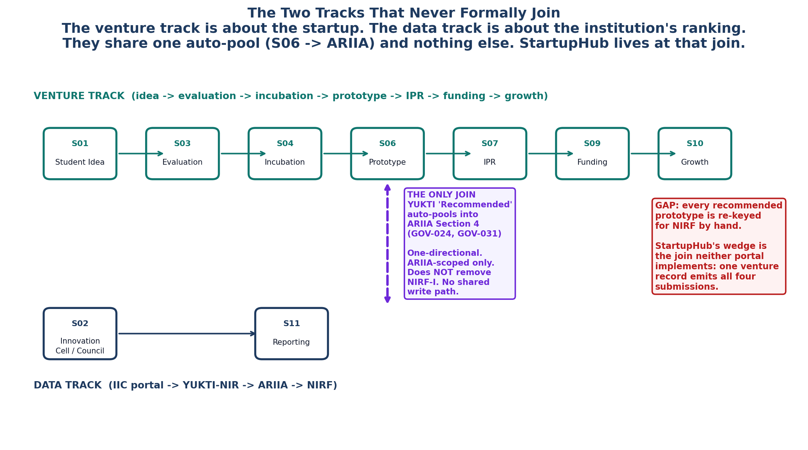

<!-- GENERATED by build/build_phase13.py on 2026-10-19. DO NOT EDIT BY HAND.
     Edit build/data_p13_journey.py and re-run. -->

> **0 interviews conducted. 0 buyer conversations.**
> Every cell below is graded **DOCUMENTARY** (45), **INFERRED** (4),
> **UNKNOWN** (17) or **NOT_APPLICABLE** (0). No respondent quote
> appears anywhere in this phase, because none was collected.

# 03 - The Two Tracks

The single most important structural fact this phase found.

## The venture track

The path a venture takes through the institution.

| | Stage | Name |
|---|---|---|
| S01 | Student Idea |
| S03 | Evaluation |
| S04 | Incubation |
| S06 | Prototype |
| S07 | IPR |
| S09 | Funding |
| S10 | Growth |

## The data track

The path a piece of data takes through the mandated systems.

| | Stage | Name |
|---|---|---|
| S02 | Innovation Cell / Council |
| S11 | Reporting |

## Where they touch

**One place. And it is not a join.**

YUKTI-NIR entries with 'Recommended' status auto-pool into ARIIA Section 4. This is the only documentary join between the two tracks, and it is one-directional: ARIIA pulls, with no shared write path back, scoped to ARIIA only, and it does not remove NIRF-I.

Sources: GOV-024, GOV-031.

Three properties of that "join" matter more than its existence:

1. **One-directional.** ARIIA pulls from YUKTI. There is no shared write path
   back.
2. **ARIIA-scoped.** The auto-pool is an ARIIA Section 4 feature. It does not
   write into IIC, does not write into NIRF, and does not update YUKTI.
3. **It does not remove NIRF-I.** A recommended prototype still has to be
   re-keyed for the NIRF Innovation form.

## The four re-key targets

Every one of these is a place where the same fact is typed more than once.

| | System | Sources |
|---|---|---|
| IIC Portal | GOV-018, GOV-021 |
| YUKTI-NIR | GOV-023, GOV-025 |
| ARIIA DCS | GOV-031 |
| NIRF Innovation | GOV-028 |

## Why this is the wedge

StartupHub's wedge is the join neither portal implements: a single venture record that emits all four submissions as a by-product, keyed on the entity and its state over time.

The market is not missing a piece of software. It is missing the *join*. Three
of the six Phase 12 differentiators are about a capability - TRL as a governed
object, IPR joined to the lifecycle, the unincorporated venture as a
first-class state. Only one is about the journey itself: the wedge that
emits four submissions as a by-product of one record.

**A product that owns the join also owns the state.** If StartupHub holds the
venture record and its state over time, then TRL, IPR status, discipline
ownership and funding events are not fields to be re-entered - they are
properties of a record that already exists. That is the difference between
a form-filling tool and a system of record.

## What this does not say

It does not say the join is uncontested. Phase 12 found 40 vendors; ARIIA's
cross-portal fetch is a template for what a generalised version looks like,
and it is a template that sits inside a government portal, which means it is
both a floor and a warning. See
[09_External_Benchmarks.md](09_External_Benchmarks.md) (XB-03).
