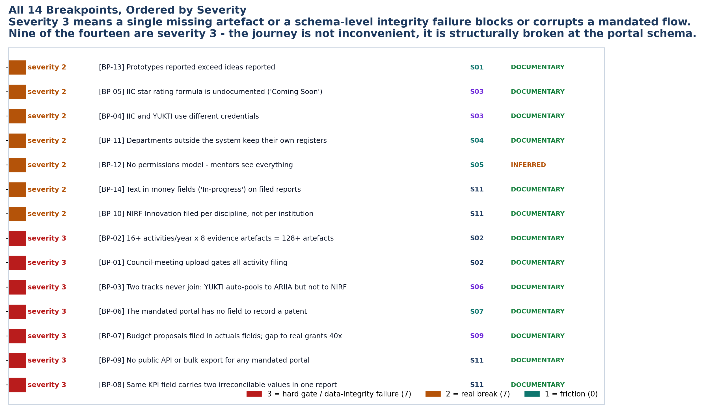

<!-- GENERATED by build/build_phase13.py on 2026-10-19. DO NOT EDIT BY HAND.
     Edit build/data_p13_journey.py and re-run. -->

> **0 interviews conducted. 0 buyer conversations.**
> Every cell below is graded **DOCUMENTARY** (45), **INFERRED** (4),
> **UNKNOWN** (17) or **NOT_APPLICABLE** (0). No respondent quote
> appears anywhere in this phase, because none was collected.

# 04 - Breakpoints

14 places where the journey breaks.

Severity 1 = friction, 2 = real break, 3 = hard gate or data-integrity
failure.

## Severity 3 — Hard gates and data-integrity failures

These block the journey or corrupt it. A missing artefact stops work; a wrong number is worse than a missing one.

### BP-01 · Council-meeting upload gates all activity filing

| | |
|---|---|
| Stage | S02 · Innovation Cell / Council |
| Severity | **3** |
| Grade | **DOCUMENTARY** |
| Sources | GOV-019 |
| Cross-ref | Diagram 5 P5 |

If the quarterly council meeting is not uploaded, no activities can be added for that quarter - a single missing artefact blocks 16+ downstream filings.

### BP-02 · 16+ activities/year x 8 evidence artefacts = 128+ artefacts

| | |
|---|---|
| Stage | S02 · Innovation Cell / Council |
| Severity | **3** |
| Grade | **DOCUMENTARY** |
| Sources | GOV-020, GOV-021 |
| Cross-ref | P-A02 |

Each activity report requires 4 social links, 2 photos, 1 video and 1 document. The volume is structural and mandatory.

### BP-03 · Two tracks never join: YUKTI auto-pools to ARIIA but not to NIRF

| | |
|---|---|
| Stage | S06 · Prototype |
| Severity | **3** |
| Grade | **DOCUMENTARY** |
| Sources | GOV-024, GOV-028 |
| Cross-ref | two-track join; D1 |

The ARIIA auto-pool is one-directional and ARIIA-scoped. NIRF screens show no evidence of auto-population from YUKTI, so every recommended prototype is re-keyed for NIRF.

### BP-06 · The mandated portal has no field to record a patent

| | |
|---|---|
| Stage | S07 · IPR |
| Severity | **3** |
| Grade | **DOCUMENTARY** |
| Sources | GOV-022, COMP-032 |
| Cross-ref | P-A06; D2 |

IIC's IPR/TTO Centres menu registers TTO existence and floor area only. ARIIA DCS requires per-patent fields the IIC portal does not carry.

### BP-07 · Budget proposals filed in actuals fields; gap to real grants 40x

| | |
|---|---|
| Stage | S09 · Funding |
| Severity | **3** |
| Grade | **DOCUMENTARY** |
| Sources | P1-023, P1-013 |
| Cross-ref | P-A02; P-A09 |

The awareness-spend field can carry a proposal rather than an actual. Money fields also carry sponsor identity and purpose instead of a number.

### BP-08 · Same KPI field carries two irreconcilable values in one report

| | |
|---|---|
| Stage | S11 · Reporting |
| Severity | **3** |
| Grade | **DOCUMENTARY** |
| Sources | P1-002 |
| Cross-ref | Diagram 5 P2 |

Measured directly from published IIC reports. Relational integrity is absent at the schema level.

### BP-09 · No public API or bulk export for any mandated portal

| | |
|---|---|
| Stage | S11 · Reporting |
| Severity | **3** |
| Grade | **DOCUMENTARY** |
| Sources | GOV-043 |
| Cross-ref | D5 |

No public API, developer documentation or bulk export found for IIC, YUKTI, NIRF, AISHE or MAARG. Every integration is therefore manual or screen-scraped.

## Severity 2 — Real breaks

Work still completes, but it completes badly - duplicated entry, second credentials, no separation of duties.

### BP-04 · IIC and YUKTI use different credentials

| | |
|---|---|
| Stage | S03 · Evaluation |
| Severity | **2** |
| Grade | **DOCUMENTARY** |
| Sources | GOV-025 |
| Cross-ref | Diagram 5 N7 |

The portal states IIC and YUKTI logins are different - a second identity for the same coordinator.

### BP-05 · IIC star-rating formula is undocumented ('Coming Soon')

| | |
|---|---|
| Stage | S03 · Evaluation |
| Severity | **2** |
| Grade | **DOCUMENTARY** |
| Sources | GOV-044 |
| Cross-ref | Phase 22 |

The official Rating and Scoring help page returns 'Coming Soon'. A product that promises to optimise the star rating is promising against an unpublished formula.

### BP-10 · NIRF Innovation filed per discipline, not per institution

| | |
|---|---|
| Stage | S11 · Reporting |
| Severity | **2** |
| Grade | **DOCUMENTARY** |
| Sources | GOV-028 |
| Cross-ref | D6 |

~11 screens per discipline. A 4-discipline university files the same startup rows 4 times.

### BP-11 · Departments outside the system keep their own registers

| | |
|---|---|
| Stage | S04 · Incubation |
| Severity | **2** |
| Grade | **DOCUMENTARY** |
| Sources | COMP-026 |
| Cross-ref | P-A10 |

ERP vendors' own marketing states the institution carries both the software cost and the duplicate work.

### BP-12 · No permissions model - mentors see everything

| | |
|---|---|
| Stage | S05 · Mentor |
| Severity | **2** |
| Grade | **INFERRED** |
| Sources | Diagram-5 reconstruction (Diagram 5 P3) |
| Cross-ref | Diagram 5 P3 |

Diagram 5 names this as pain point P3. NDA-tiered visibility is absent.

### BP-13 · Prototypes reported exceed ideas reported

| | |
|---|---|
| Stage | S01 · Student Idea |
| Severity | **2** |
| Grade | **DOCUMENTARY** |
| Sources | P1-008 |
| Cross-ref | P-A01 |

The idea and prototype fields are not one funnel. Reported prototypes can exceed reported ideas.

### BP-14 · Text in money fields ('In-progress') on filed reports

| | |
|---|---|
| Stage | S11 · Reporting |
| Severity | **2** |
| Grade | **DOCUMENTARY** |
| Sources | P1-025 |
| Cross-ref | P-A08 |

Measured from published IIC reports. Numeric validation is absent at the portal schema level.

---

## The pattern

Read the severity-3 list as one sentence: **the journey is gated by artefacts,
joined by re-keying, and closed by a data model that has no foreign keys.**

- **Gated by artefacts.** A council meeting upload blocks a quarter of
  activity filing (BP-01). 16+ activities a year times 8 evidence artefacts
  each is 128+ files that must exist before anything downstream can be filed
  (BP-02).
- **Joined by re-keying.** The portal has no field to record a patent
  (BP-06). Money fields can carry a proposal instead of an actual (BP-07).
  The same KPI can carry two irreconcilable values in one report (BP-08).
  Per-startup rows are hand-typed with no auto-population (BP-10).
- **Closed by a data model with no foreign keys.** Text appears in money
  fields on filed reports (BP-14), and relational integrity is absent at the
  schema level (BP-08).

**Every severity-3 breakpoint except BP-06 sits at S11 Reporting** - which is
not where the journey *looks* like it breaks. It is where it breaks because
the journey's own records were never structured in the first place.
