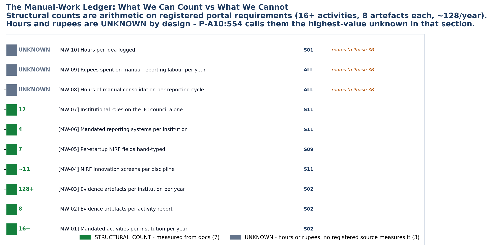

<!-- GENERATED by build/build_phase13.py on 2026-10-19. DO NOT EDIT BY HAND.
     Edit build/data_p13_journey.py and re-run. -->

> **0 interviews conducted. 0 buyer conversations.**
> Every cell below is graded **DOCUMENTARY** (45), **INFERRED** (4),
> **UNKNOWN** (17) or **NOT_APPLICABLE** (0). No respondent quote
> appears anywhere in this phase, because none was collected.

# 05 - Manual Work

What can be counted, and what cannot.

## The rule

| Measure | Grade | How it is produced |
|---|---|---|
| Structural count | **DOCUMENTARY** | Counted from registered portal requirements |
| Hours | **UNKNOWN** | No registered source measures it |
| Rupees | **UNKNOWN** | No registered source prices it |

This is not caution for its own sake. Phase 10 problem analysis P-A10 states
hours are not measured and calls it *"the highest-value unknown in Section
A"*. Inventing a number here would have been the easiest fabrication in the
whole programme.

## The ledger

| | Stage | Metric | Value | Measure | Sources |
|---|---|---|---|---|---|
| **MW-01** | S02 | Mandated activities per institution per year | **16+** | STRUCTURAL_COUNT | GOV-020 |
| **MW-02** | S02 | Evidence artefacts per activity report | **8** | STRUCTURAL_COUNT | GOV-021 |
| **MW-03** | S02 | Evidence artefacts per institution per year | **128+** | STRUCTURAL_COUNT | GOV-020, GOV-021 |
| **MW-04** | S11 | NIRF Innovation screens per discipline | **~11** | STRUCTURAL_COUNT | GOV-028 |
| **MW-05** | S09 | Per-startup NIRF fields hand-typed | **7** | STRUCTURAL_COUNT | GOV-028 |
| **MW-06** | S11 | Mandated reporting systems per institution | **4** | STRUCTURAL_COUNT | GOV-018, GOV-023, GOV-031, GOV-028, GOV-025 |
| **MW-07** | S11 | Institutional roles on the IIC council alone | **12** | STRUCTURAL_COUNT | GOV-018 |
| **MW-08** | ALL | Hours of manual consolidation per reporting cycle | **UNKNOWN** | UNKNOWN | — |
| **MW-09** | ALL | Rupees spent on manual reporting labour per year | **UNKNOWN** | UNKNOWN | — |
| **MW-10** | S01 | Hours per idea logged | **UNKNOWN** | UNKNOWN | — |

## The arithmetic that is real

Three structural counts compose into a figure that matters:

**16+ activities/year × 8 evidence artefacts = 128+ artefacts per institution
per year.** (MW-01 × MW-02 = MW-03.) Every one of those is a file that has to
be collected, named, uploaded and linked to a quarter.

**~11 NIRF Innovation screens × 4 disciplines = 4 filings of the same rows.**
(MW-04.) A four-discipline university files the same startup data four
times, because NIRF is filed per discipline, not per institution.

**7 per-startup fields × 4 disciplines × every year.** (MW-05.) Name, DPIIT
number, amount, funding organisation, year, achievement level, investment
type - none of it auto-populates from MCA, GST, ROC or DPIIT.

**4 mandated reporting systems.** (MW-06.) IIC Portal, YUKTI-NIR, ARIIA DCS,
NIRF Innovation - and IIC and YUKTI use separate credentials, so the same
coordinator holds two logins for the same institution.

**12 roles on the IIC council alone** (MW-07), on top of the 25 institutional
roles Phase 2 mapped.

## The three that stay unknown

| | Metric | Why it is unknown | Where it goes |
|---|---|---|---|
| MW-08 | Hours of manual consolidation per reporting cycle | P-A10 states it is not measured | Phase 3B |
| MW-09 | Rupees spent on manual reporting labour per year | No source prices the labour; OQ-03 is unmeasured | Phase 3B |
| MW-10 | Hours per idea logged | No source measures idea-intake effort | Phase 3B |

## The number that decides the business case

**MW-09 is the commercial question.** Everything else on this page is a
productivity argument. Rupees per year per institution is the number that
would let anyone - including us - say whether the product pays for itself.
It is unknown, and it routes to Phase 3B.
