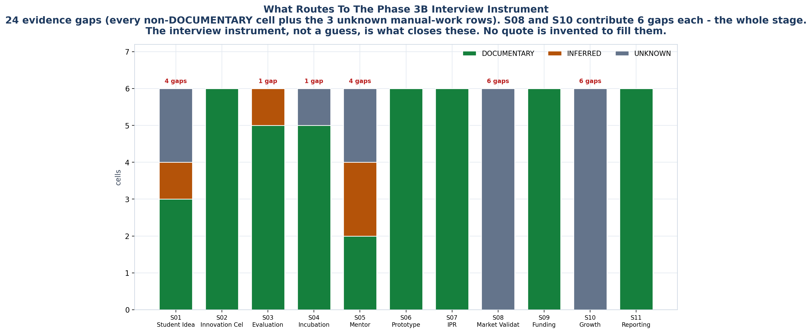

<!-- GENERATED by build/build_phase13.py on 2026-10-19. DO NOT EDIT BY HAND.
     Edit build/data_p13_journey.py and re-run. -->

> **0 interviews conducted. 0 buyer conversations.**
> Every cell below is graded **DOCUMENTARY** (45), **INFERRED** (4),
> **UNKNOWN** (17) or **NOT_APPLICABLE** (0). No respondent quote
> appears anywhere in this phase, because none was collected.

# 06 - Evidence Gaps

Every cell that is not documentary, and what would close it.

| | |
|---|---|
| Gaps routed to Phase 3B | **24** |
| Of which UNKNOWN cells | **17** |
| Of which INFERRED cells | **4** |
| Of which UNKNOWN manual-work rows | **3** |

## By stage

| | Stage | Open items |
|---|---|---|
| ALL | All stages | 2 |
| S01 | Student Idea | 4 |
| S03 | Evaluation | 1 |
| S04 | Incubation | 1 |
| S05 | Mentor | 4 |
| S08 | Market Validation | 6 |
| S10 | Growth | 6 |

## The instrument this earns

### S01 · Student Idea — who_manages (INFERRED)

**Still needs:** Phase 3B: ask who actually receives an idea first, and whether that person is named in any institutional document.
**Cross-ref:** Phase 2 roles A-03, A-06, A-12

### S01 · Student Idea — what_data (UNKNOWN)

**Still needs:** Phase 3B: capture the actual fields an institution records when an idea is first logged.
**Cross-ref:** P-A10 evidence_gap

### S01 · Student Idea — manual_work (UNKNOWN)

**Still needs:** Phase 3B interview instrument: hours per idea logged, per quarter.
**Cross-ref:** P-A10:554

### S03 · Evaluation — manual_work (INFERRED)

**Still needs:** Phase 3B: hours per YUKTI entry, and whether the coordinator re-keys or copies.
**Cross-ref:** GOV-024; GOV-028

### S04 · Incubation — manual_work (UNKNOWN)

**Still needs:** Phase 3B: hours per incubation unit per year, and how many ventures are tracked inside it.
**Cross-ref:** P-A10

### S05 · Mentor — who_manages (INFERRED)

**Still needs:** Phase 3B: who owns the mentor roster, and does that person appear in any institutional document?
**Cross-ref:** Phase 2 roles A-12, B-04; problem area 5

### S05 · Mentor — what_data (UNKNOWN)

**Still needs:** Phase 3B: capture the mentor-session record fields, if any.
**Cross-ref:** P-A10

### S05 · Mentor — where_breaks (INFERRED)

**Still needs:** Phase 3B: confirm whether mentor visibility is actually unrestricted, and whether NDA-tiered access is ever discussed internally.
**Cross-ref:** Diagram 5 P3

### S05 · Mentor — manual_work (UNKNOWN)

**Still needs:** Phase 3B: hours per mentor per month, and hours to arrange a session.
**Cross-ref:** P-A10

### S08 · Market Validation — what_happens (UNKNOWN)

**Still needs:** Phase 3B interview: how does an institution know a venture has customers?
**Cross-ref:** P-A09

### S08 · Market Validation — who_manages (UNKNOWN)

**Still needs:** Phase 3B: which role, if any, owns market validation.
**Cross-ref:** P-A09

### S08 · Market Validation — what_tool (UNKNOWN)

**Still needs:** Phase 3B: is any tool used, or is this informal?
**Cross-ref:** P-A09

### S08 · Market Validation — what_data (UNKNOWN)

**Still needs:** Phase 3B: what evidence of market validation, if any, is ever recorded.
**Cross-ref:** P-A09

### S08 · Market Validation — where_breaks (UNKNOWN)

**Still needs:** Phase 3B: where does market validation typically fail or stall?
**Cross-ref:** P-A09

### S08 · Market Validation — manual_work (UNKNOWN)

**Still needs:** Phase 3B: hours, if any.
**Cross-ref:** P-A09

### S10 · Growth — what_happens (UNKNOWN)

**Still needs:** Phase 3B interview: does the institution track post-incubation growth at all?
**Cross-ref:** P-A10; Diagram 5 P6

### S10 · Growth — who_manages (UNKNOWN)

**Still needs:** Phase 3B: which role, if any, owns growth tracking.
**Cross-ref:** P-A10

### S10 · Growth — what_tool (UNKNOWN)

**Still needs:** Phase 3B: is any system used, or is growth untracked?
**Cross-ref:** P-A10

### S10 · Growth — what_data (UNKNOWN)

**Still needs:** Phase 3B: what growth metrics, if any, are recorded.
**Cross-ref:** P-A10

### S10 · Growth — where_breaks (UNKNOWN)

**Still needs:** Phase 3B: confirm whether the institution can answer the alumni-venture question today.
**Cross-ref:** Diagram 5 P6

### S10 · Growth — manual_work (UNKNOWN)

**Still needs:** Phase 3B: hours, if any.
**Cross-ref:** P-A10

### ALL · All stages — Hours of manual consolidation per reporting cycle (UNKNOWN)

**Still needs:** Measure via Phase 3B interview.
**Cross-ref:** P-A10:554

### ALL · All stages — Rupees spent on manual reporting labour per year (UNKNOWN)

**Still needs:** Measure via Phase 3B interview.
**Cross-ref:** OQ-03

### S01 · Student Idea — Hours per idea logged (UNKNOWN)

**Still needs:** Measure via Phase 3B interview.
**Cross-ref:** P-A10

---

## Why this is a list and not a paragraph

Each row is a question that can only be answered by a person who has done the
work. That is what a Phase 3B interview instrument is: this list, ordered by
which answer would change the product most.

**The highest-value clusters, in order:**

1. **Hours per reporting cycle (MW-08) and rupees per year (MW-09).** These
   decide whether there is a business case at all, and they are the only
   numbers on this page that are commercially decisive.
2. **S08 Market Validation and S10 Growth.** Twelve cells, zero evidence,
   no registered source. Nobody has documented what an institution does at
   these two stages. This is the widest hole in the map.
3. **S01 idea intake.** Who receives an idea first, and what fields are
   recorded when it is logged (MW-10). Phase 1 measured a 75x variance in
   ideas generated across NIT-level IICs under the same national programme -
   so whatever is happening is local practice, and local practice is
   exactly what a product replaces.
4. **S03 evaluation.** The internal tooling behind a YUKTI verdict is
   UNKNOWN at every stage (P-A10), and the IIC star-rating formula is
   unpublished (BP-05). A product that promises to optimise a score needs
   the score.
