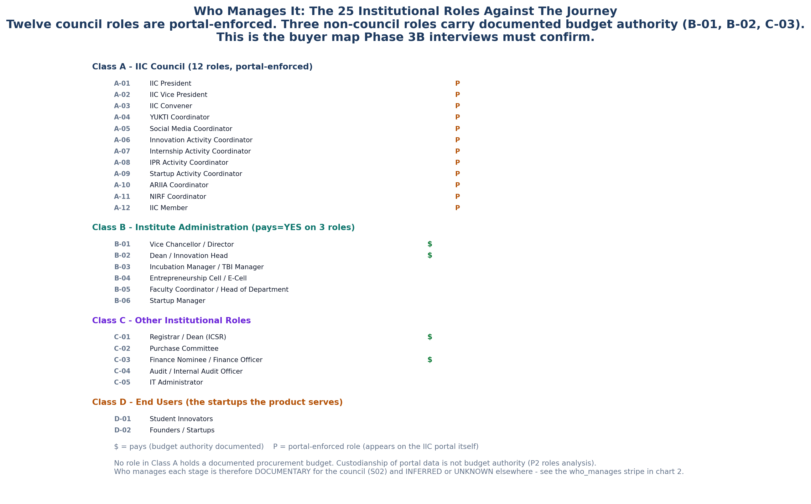

<!-- GENERATED by build/build_phase13.py on 2026-10-19. DO NOT EDIT BY HAND.
     Edit build/data_p13_journey.py and re-run. -->

> **0 interviews conducted. 0 buyer conversations.**
> Every cell below is graded **DOCUMENTARY** (45), **INFERRED** (4),
> **UNKNOWN** (17) or **NOT_APPLICABLE** (0). No respondent quote
> appears anywhere in this phase, because none was collected.

# 07 - Implications For StartupHub

Which Phase 12 differentiator each stage supports, and what the journey says
that the vendor matrix could not.

## The journey supports three differentiators hardest

| | Differentiator | Journey stages that back it |
|---|---|---|
| **D1** | TRL as a governed object, mapped to eligible Indian schemes | S06 (TRL bucketing is the join point), S03 |
| **D2** | IPR joined to the venture lifecycle, not bolted beside it | S07 (no portal field for a patent), S06 |
| **D3** | The unincorporated venture as a first-class state | S01 (idea counts are not funnel-linked), S04 |

**D3 is the one the journey strengthens.** Phase 12 had to *assert* that the
unincorporated venture is a real state: it was D3's evidence that 0 of 40
vendors represent it, and its falsifier was explicitly "a Phase 3B interview
is designed to test this". The journey adds a documentary reason to believe
the falsifier will not fire: **reported prototypes can exceed reported ideas**
(BP-13), which means the idea and prototype fields are not one funnel, which
means pre-entity work exists in the pipeline and is not being counted as
ventures. A pipeline that is not counted is a pipeline nobody's product
represents.

## The journey says something the vendor matrix could not

The Phase 10 matrix compares vendors on capabilities. It has no way to express
this:

> **Every stage where the journey meets a mandated system is a stage where the
> journey breaks.**

The 7 severity-3 breakpoints land on S02, S06, S07, S09, S11 -
the IIC council (S02), the YUKTI-NIR join (S06), the IIC IPR/TTO menu (S07),
the NIRF funding rows (S09) and the four reporting systems (S11). The six
stages with no severity-3 break - S01, S03, S04, S05, S08, S10 - are the ones
where no portal has yet claimed the work.

Nothing here is broken *because* a portal is badly built. Nothing is broken
because reporting is bad either. **Reporting is bad because the journey's
records were never structured in the first place.** You cannot build a better
form for data that was never captured.

That is the argument for a system of record rather than a form-filler, and it
is the argument D5 (the migration wedge) needs in order to be more than a
service line.

## Where the wedge is precisely

StartupHub's position is the join neither portal implements: **a single
venture record that emits all four submissions as a by-product, keyed on the
entity and its state over time.** Concretely, the journey says that means:

| | The record owns | Because |
|---|---|---|
| 1 | The venture, from idea to growth | BP-13: ideas and prototypes are not one funnel |
| 2 | Its discipline ownership | MW-04: NIRF is filed per discipline, not per institution |
| 3 | Its TRL state | BP-03: TRL bucketing is the only documentary join point |
| 4 | Its IPR docket | BP-06: no portal field carries a patent |
| 5 | Its funding events | MW-05: 7 fields per startup, hand-typed, per discipline, per year |
| 6 | Its evidence artefacts | BP-02: 128+ artefacts per institution per year |

Six things a single record owns. Each one is currently re-typed somewhere,
which is why each one is a proof-of-value rather than a feature.

## Where the journey does NOT support the product

Two honest negatives, stated because a phase that only argues for itself is
not evidence.

1. **The internal tool is UNKNOWN at every stage.** (P-A10.) We know what the
   *mandated* tools are - IIC portal, ARIIA DCS, YUKTI, NIRF, all
   documentary - and we know the internal tooling is not documented anywhere.
   A product built to replace an unknown internal tool is a product built on
   a guess.
2. **Willingness to pay is unmeasured.** OQ-03 is still open. MW-09 is the
   metric that would answer it and it is unknown. Until Phase 3B runs, no
   pricing claim in this programme survives contact with a procurement
   office.

## What Phase 3B must do to make this phase worth having

The journey map earns its keep if, and only if, the 17 unknowns get closed.
In priority order:

| Priority | Instrument | Closes |
|---|---|---|
| 1 | Hours + rupees per reporting cycle | MW-08, MW-09, and the business case |
| 2 | Market-validation practice | 6 cells at S08, zero evidence today |
| 3 | Idea intake: who, and what fields | S01 Q2/Q4, MW-10 |
| 4 | Growth-tracking practice | 6 cells at S10, zero evidence today |
| 5 | Internal tooling per stage | P-A10, every stage |

Until that instrument runs, Phase 13 is a **map of where the work is**, not a
map of what the work costs.
