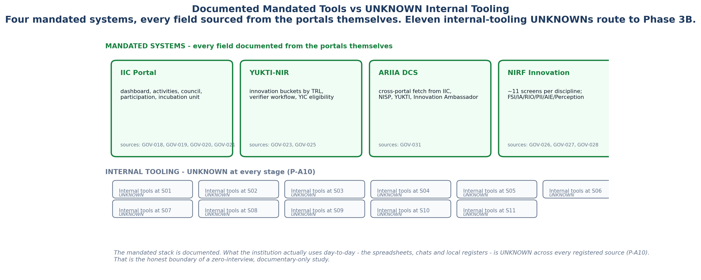

<!-- GENERATED by build/build_phase13.py on 2026-10-19. DO NOT EDIT BY HAND.
     Edit build/data_p13_journey.py and re-run. -->

> **0 interviews conducted. 0 buyer conversations.**
> Every cell below is graded **DOCUMENTARY** (45), **INFERRED** (4),
> **UNKNOWN** (17) or **NOT_APPLICABLE** (0). No respondent quote
> appears anywhere in this phase, because none was collected.

# 09 - External Benchmarks

12 benchmarks, deliberately **outside** the
66-cell matrix.

## Why they are separated

The 66-cell matrix answers one question: *what happens to our user, and what
do we actually know about it?* These benchmarks answer a different question:
*what is happening in the world around that user?*

Mixing them would do two bad things at once. It would inflate the journey
evidence count with facts that are not about the journey, and it would let a
market-context fact launder itself into a claim about our user. The
separation is the point, so it is enforced in the data model: external
benchmarks live in their own register and are excluded from the matrix by
construction.

## The register

### XB-01 · NIRF Innovation parameters 2025

| | |
|---|---|
| Grade | **DOCUMENTARY** |
| Sources | GOV-026 |

FSI 0.25, IA 0.15, RIO 0.30, PII 0.10, AIE 0.10, Perception 0.10. Weights changed from 2024.

**Why it matters here.** Sets the scoring surface StartupHub's reporting output must satisfy.

### XB-02 · NIRF FSI startup sub-metric

| | |
|---|---|
| Grade | **DOCUMENTARY** |
| Sources | GOV-027 |

SU = 20 x f(N_vsp), N_vsp = DPIIT-recognised startups in previous 3 years. 5 marks of the final Innovation score hinge on one countable.

**Why it matters here.** The single most quantified institutional incentive in the mandated stack.

### XB-03 · ARIIA DCS cross-portal fetch

| | |
|---|---|
| Grade | **DOCUMENTARY** |
| Sources | GOV-031 |

ARIIA fetches from IIC, NISP, YUKTI and Innovation Ambassador portals, reducing submission effort by checking redundancy. One-directional, ARIIA-scoped only.

**Why it matters here.** The only existing cross-portal de-duplication, and the template for what StartupHub generalises.

### XB-04 · Factly/Dataful NIRF startup dataset

| | |
|---|---|
| Grade | **DOCUMENTARY** |
| Sources | GOV-029, GOV-030 |

6,817 rows, 204 institutions, 5,490 distinct ventures, 4,538 registration numbers, 26 states, 80 cities, 2024-2026. Monetised from public DCS PDFs.

**Why it matters here.** Proves institution-submitted innovation data is already public and already packaged by a third party.

### XB-05 · State Startup Ranking (SRF) 5.0

| | |
|---|---|
| Grade | **DOCUMENTARY** |
| Sources | GOV-035 |

Results announced 16 Jan 2026; 34 States/UTs participated; 19 Action Points, 6 Reform Areas. Best Performer Cat A = Gujarat.

**Why it matters here.** State-level pressure that propagates down to HEI reporting expectations.

### XB-06 · Maharashtra Startup Policy 2025

| | |
|---|---|
| Grade | **DOCUMENTARY** |
| Sources | GOV-036 |

Commits to an online system mapping startups, incubators, accelerators, innovation labs, investors and mentors under a unique ID.

**Why it matters here.** A state building the registry StartupHub would sit under - both a channel and a competitive risk.

### XB-07 · NIDHI-PRAYAS 2.0 NOC requirement

| | |
|---|---|
| Grade | **DOCUMENTARY** |
| Sources | GOV-037 |

Students/faculty must submit an NOC confirming IP vests entirely with the innovator or startup.

**Why it matters here.** An IP-vesting requirement with no portal to enforce it - StartupHub's IPR docket (D2) is the enforcement point.

### XB-08 · MeitY Startup Hub IP due diligence

| | |
|---|---|
| Grade | **DOCUMENTARY** |
| Sources | GOV-038 |

Mandates TRL benchmarking and IP due diligence: ownership clarity, freedom to operate, defensibility. Distinguishes ownership vs a 2-year university tech-transfer licence.

**Why it matters here.** The most explicit institutional statement that TRL and IP must be joined - StartupHub D1 + D2.

### XB-09 · BHASKAR ID

| | |
|---|---|
| Grade | **DOCUMENTARY** |
| Sources | GOV-039 |

DPIIT launched BHASKAR (Bharat Startup Knowledge Access Registry) 16 Sep 2024, issuing an ecosystem-universal BHASKAR ID.

**Why it matters here.** A national identity layer StartupHub must key to, not duplicate.

### XB-10 · National Startup Master Data (planned)

| | |
|---|---|
| Grade | **DOCUMENTARY** |
| Sources | GOV-040 |

DPIIT plans to overhaul BHASKAR into a National Startup Master Data registry tracking the startup lifecycle. MeitY Startup Hub floated a similar tender.

**Why it matters here.** The largest structural risk and the largest channel opportunity in the segment.

### XB-11 · MAARG national mentorship platform

| | |
|---|---|
| Grade | **DOCUMENTARY** |
| Sources | GOV-041 |

AI matchmaking, session scheduling, cohort programmes and dashboards.

**Why it matters here.** Mandated mentorship surface; StartupHub must integrate, not compete.

### XB-12 · Kerala Startup Mission scale

| | |
|---|---|
| Grade | **DOCUMENTARY** |
| Sources | GOV-042 |

375+ IEDCs across colleges and universities, 27 R&D institutions, 63 incubators; issues a KSUM UID as a third identity layer.

**Why it matters here.** The densest documented state ecosystem and a model for how far a UID layer can reach.

---

## The two that change the plan

**XB-10, National Startup Master Data (planned).** DPIIT plans to overhaul
BHASKAR into a National Startup Master Data registry tracking the startup
lifecycle, and MeitY Startup Hub has floated a similar tender. If a national
identity and lifecycle registry ships, the "single venture record" wedge
narrows - but it narrows to a *platform* question, and the question becomes
whether StartupHub integrates with it or competes with it. This is the
largest structural risk in the segment and the largest channel opportunity in
it, and it is the same shape.

**XB-03, the ARIIA cross-portal fetch.** ARIIA DCS fetches from IIC, NISP,
YUKTI and Innovation Ambassador portals, reducing submission effort by
checking redundancy. It is one-directional and ARIIA-scoped. It is also the
proof that cross-portal de-duplication is not just possible but already
mandated - by a government portal, at government scale. That cuts both ways:
it validates the approach, and it sets a floor that a private vendor will be
compared against.
