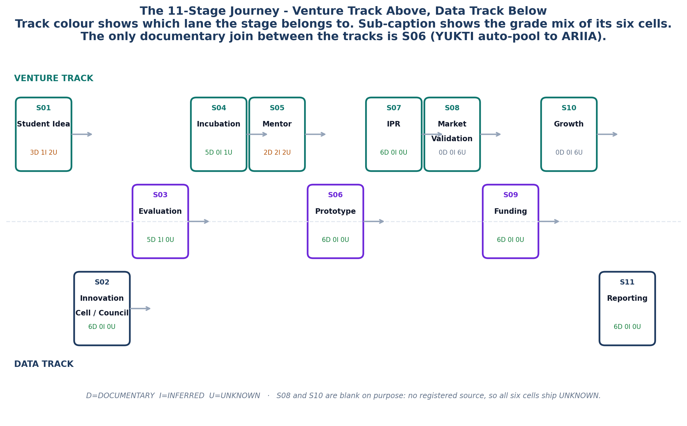

<!-- GENERATED by build/build_phase13.py on 2026-10-19. DO NOT EDIT BY HAND.
     Edit build/data_p13_journey.py and re-run. -->

> **0 interviews conducted. 0 buyer conversations.**
> Every cell below is graded **DOCUMENTARY** (45), **INFERRED** (4),
> **UNKNOWN** (17) or **NOT_APPLICABLE** (0). No respondent quote
> appears anywhere in this phase, because none was collected.

# Phase 13 - Customer Journey Research

> *"Show me my week in this product."*
>
> Phases 0-12 established what the mandated portals require and what the market
> does not build. None of that answers the question a buyer asks at the demo.
> This phase maps the journey stage by stage, with the same evidentiary
> discipline as everything else in the programme.

## The shape of it

| | |
|---|---|
| Stages mapped | **11** |
| Questions asked at each stage | **6** |
| Cells graded | **66** |
| DOCUMENTARY · INFERRED · UNKNOWN | **45 · 4 · 17** |
| Stages with substantial evidence | **3** (S02, S07, S11) |
| Stages with partial evidence | **6** (S01, S03, S04, S05, S06, S09) |
| Stages with zero evidence | **2** (S08, S10) |
| Breakpoints found | **14** |
| Manual-work rows | **10** (7 structural counts, 3 unknowns) |
| Distinct registered sources cited | **43** |
| Interviews conducted | **0** |

## The eleven stages

| | Stage | Track | Evidence | Doc | Inf | Unk |
|---|---|---|---|---|---|---|
| **S01** | Student Idea | venture | Partial | 3 | 1 | 2 |
| **S02** | Innovation Cell / Council | data | Substantial | 6 | 0 | 0 |
| **S03** | Evaluation | both | Partial | 5 | 1 | 0 |
| **S04** | Incubation | venture | Partial | 5 | 0 | 1 |
| **S05** | Mentor | venture | Partial | 2 | 2 | 2 |
| **S06** | Prototype | both | Partial | 6 | 0 | 0 |
| **S07** | IPR | venture | Substantial | 6 | 0 | 0 |
| **S08** | Market Validation | venture | Zero | 0 | 0 | 6 |
| **S09** | Funding | both | Partial | 6 | 0 | 0 |
| **S10** | Growth | venture | Zero | 0 | 0 | 6 |
| **S11** | Reporting | data | Substantial | 6 | 0 | 0 |

## The finding

**The venture track and the data track never join.**

The venture track runs idea → evaluation → incubation → prototype → IPR →
funding → growth. The data track runs IIC portal → YUKTI-NIR → ARIIA → NIRF.
There is exactly one documentary join between them: YUKTI-NIR entries with
`Recommended` status auto-pool into ARIIA Section 4. It is one-directional,
scoped to ARIIA alone, and it does not remove the NIRF Innovation form.

That join is the wedge. StartupHub sits on it.

## Four rules that governed every cell

1. **Zero interviews.** No respondent, buyer or competitor quote appears
   anywhere in this phase, because none was collected. Every fact is
   documentary with per-cell provenance, or it is graded UNKNOWN.
2. **Grade vocabulary is DOCUMENTARY | INFERRED | UNKNOWN | NOT_APPLICABLE.**
   The words ASSUMED and HYPOTHESIS are hard audit failures - the build stops.
3. **No external fetching.** Evaluation, Market Validation and Growth ship
   UNKNOWN. That is the correct result of a zero-interview study with no
   registered sources on those three stages, not an omission.
4. **Structural counts are MEASURED-FROM-DOCS. Hours and rupees are UNKNOWN.**
   Activities per year, artefacts per activity and screens per discipline are
   countable from documents. Effort and cost are not, and they route to the
   Phase 3B interview instrument.

## The documents

| File | What it settles |
|---|---|
| [01_Journey_Map.md](01_Journey_Map.md) | The 11 stages, in order, with what each one is |
| [02_Stage_Dossiers.md](02_Stage_Dossiers.md) | All 66 cells, stage by stage, with provenance |
| [03_The_Two_Tracks.md](03_The_Two_Tracks.md) | The join that does not exist, and why it matters |
| [04_Breakpoints.md](04_Breakpoints.md) | 14 places the journey breaks, by severity |
| [05_Manual_Work.md](05_Manual_Work.md) | What is countable, and what is not |
| [06_Evidence_Gaps.md](06_Evidence_Gaps.md) | Every unknown, and what would close it |
| [07_Implications_For_StartupHub.md](07_Implications_For_StartupHub.md) | Which Phase 12 differentiator each stage supports |
| [08_Limitations.md](08_Limitations.md) | What this phase cannot tell you |
| [09_External_Benchmarks.md](09_External_Benchmarks.md) | 12 external benchmarks, kept outside the matrix |

## Machine-readable

`_exports/phase13/` - eight files. `stage_question_matrix.csv` is the 66-cell
matrix. `breakpoints.csv` is the 14. `evidence_gaps.csv` is what routes to
Phase 3B.

**Workbook:** [`_exports/xlsx/11_Customer_Journey.xlsx`](../_exports/xlsx/11_Customer_Journey.xlsx)

## A note on the folder name

`11_Customer_Journey` follows the live convention in this repository:
Phase 7 → `05_`, Phase 8 → `06_`, Phase 9 → `07_`, Phase 10 → `08_`,
Phase 11 → `09_`, Phase 12 → `10_`, so Phase 13 → `11_`. The legacy
placeholder `11_Legal_Policy_Tech` was **empty and unused**; it was removed
rather than left as a decoy. Phases 22-26 (technology, legal, policy) are
repointed to `15_`.
