<!-- GENERATED by build/build_charts_infographics.py on 2026-10-19.
     DO NOT EDIT BY HAND. Edit the builder and re-run. -->

# Cross-Phase Infographic Pack

> Twelve figures that read the whole study at once. The per-phase charts are
> scoped to their own phase; the interesting questions live in the joins.

**Start here:** [`inf_12_executive_dashboard.png`](../_exports/charts/infographics/inf_12_executive_dashboard.png)

---

## The joins

### 1. The market funnel - every filter, with its counting rule
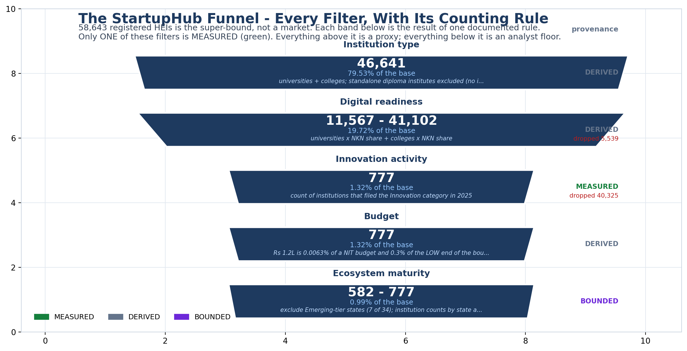

7 filters reduce 58,643 registered HEIs to a serviceable market
of 582-777. **Only 2 of those filters is MEASURED** - the NIRF Innovation filer
count. Everything above it is a proxy; everything below is an analyst floor.

### 2. What the entire study rests on
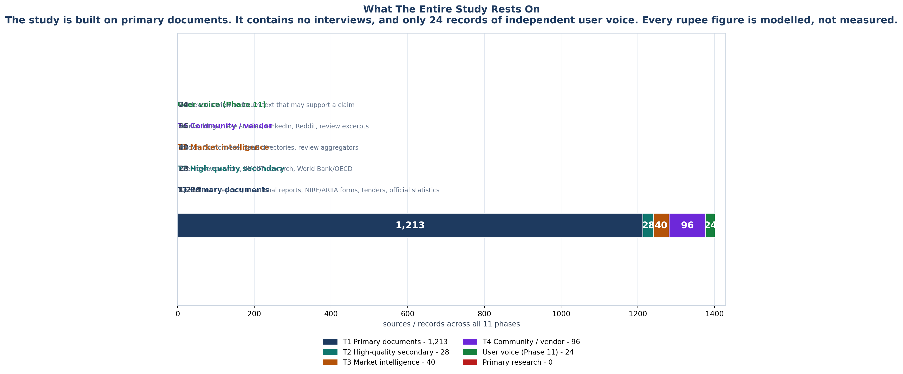

76 registered sources and 36 institutional IIC reports carry
this study. It contains **zero interviews** and exactly **24 records of
independent user voice**. Every rupee figure is modelled, not measured.

### 3. The phase arc - including the phases that changed nothing
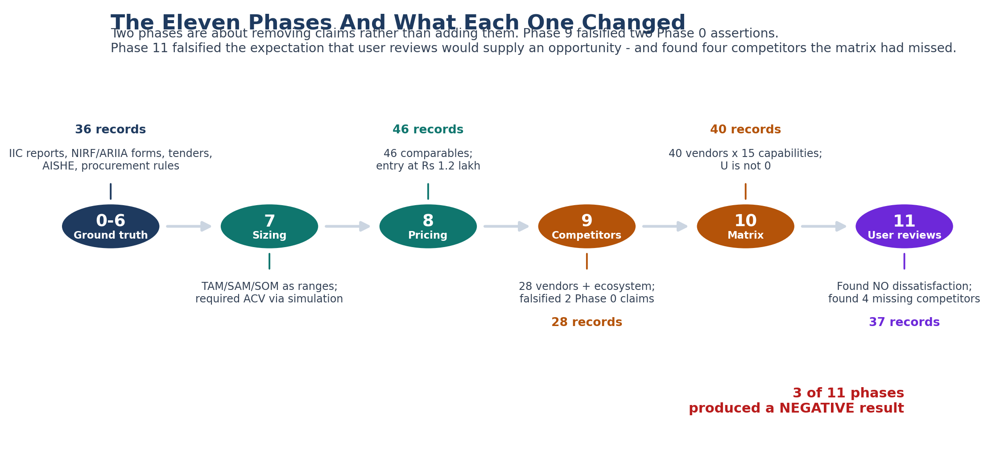

Phases 9 and 11 both produced **negative** results. Phase 9 falsified two Phase 0
assertions; Phase 11 found no user dissatisfaction at all - and found four
competitors the matrix had missed.

### 4. Where the evidence actually is
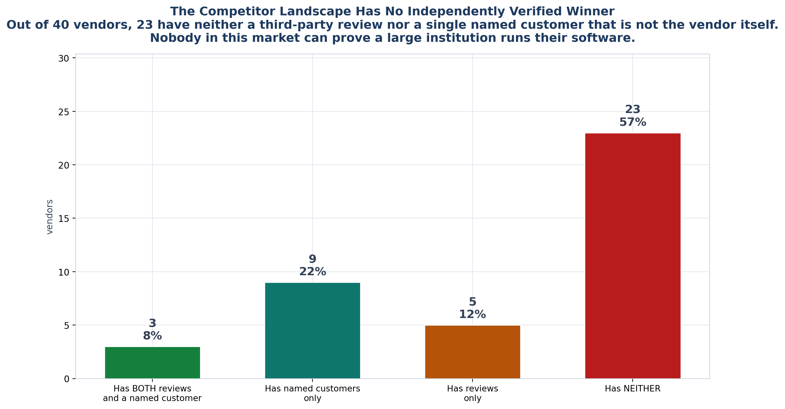

23 of 40 vendors have neither a third-party review nor a named customer.
Nobody in this market can prove a large institution runs their software.

---

## The single-phase reads

### Documented problems
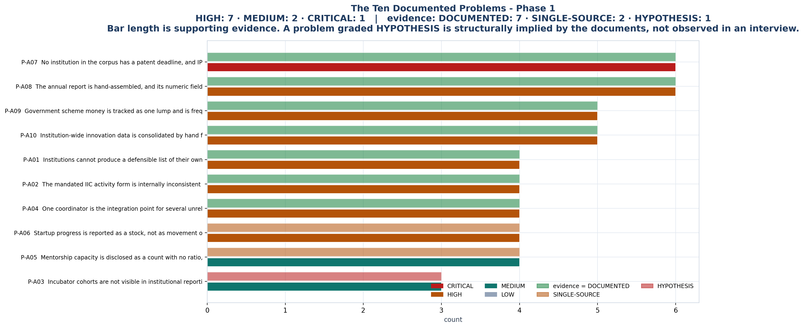

10 problems from 36 institutional IIC reports. Bar length is
supporting evidence; a problem graded HYPOTHESIS is structurally implied by the
documents, not observed in an interview.

### The buying centre
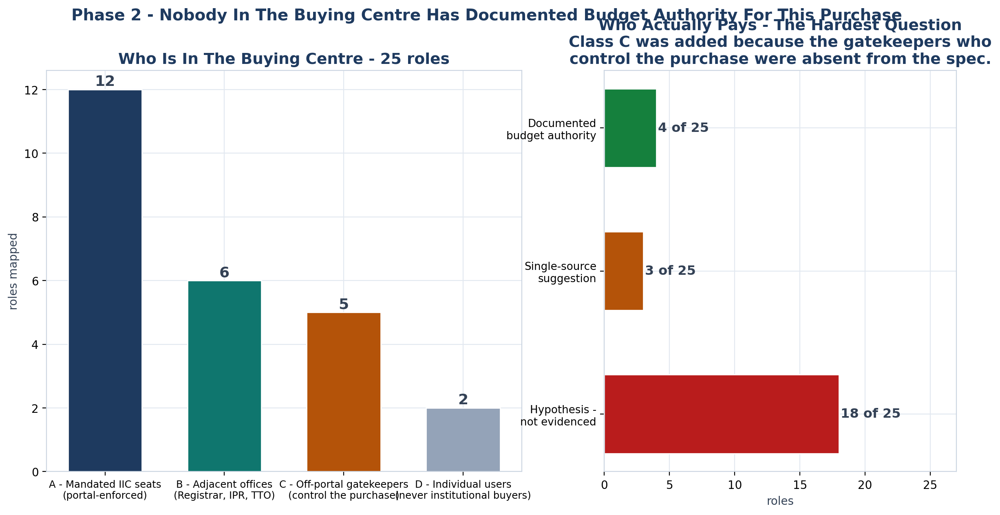

25 roles mapped across four classes. **Documented budget authority: 4.**
Class C exists because the gatekeepers who control the purchase were absent from
the original brief.

### Capability saturation
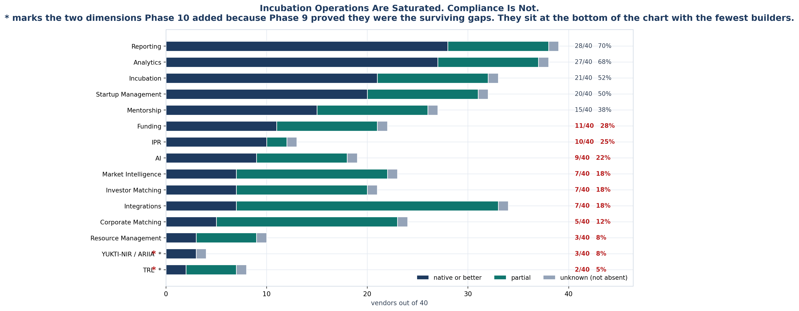

40 vendors x 15 capabilities. Incubation operations are saturated;
compliance and TRL are not. The two dimensions Phase 10 added sit at the bottom.

### The price ladder
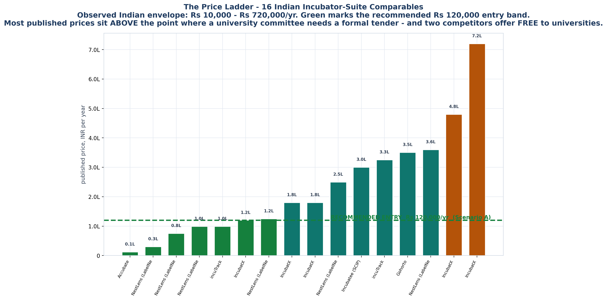

Indian incubation-suite comparables against a Rs 120,000 entry
recommendation. Two competitors offer **free** to universities - free is an active
price in this market.

### Claim provenance
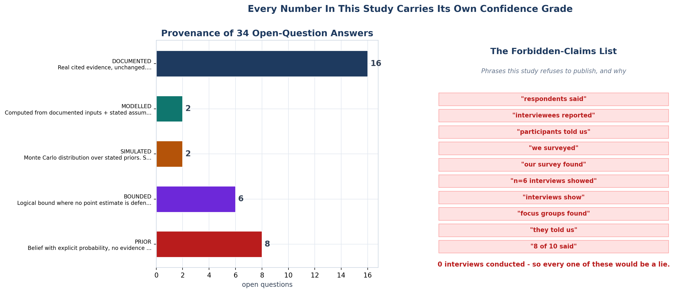

34 open-question answers, each carrying its own confidence grade -
next to the forbidden-claims list this study refuses to publish because
**0 interviews** have been conducted.

### The surviving gaps
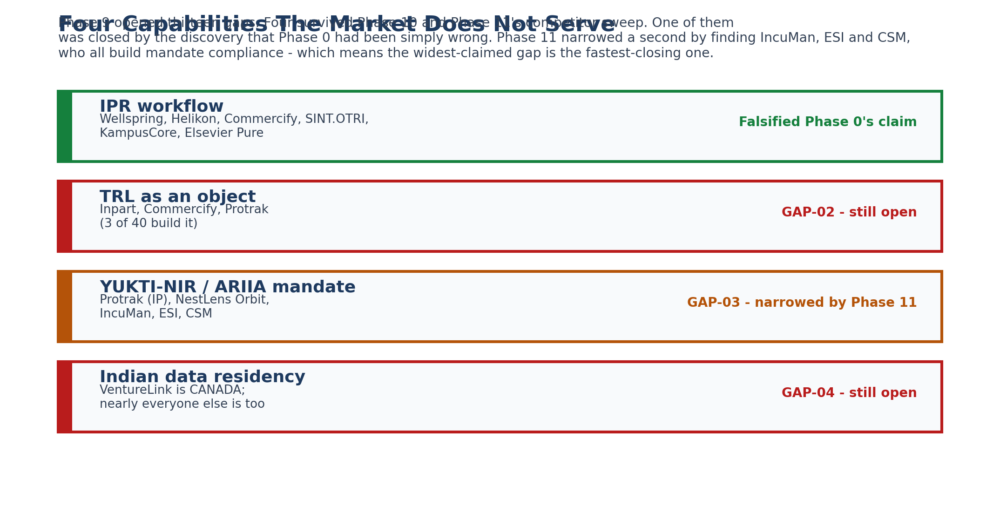

Phase 9 opened thirteen gaps. Four survived Phase 10 and Phase 11's competitor
sweep. One was closed by discovering Phase 0 had simply been wrong.

### The simulation
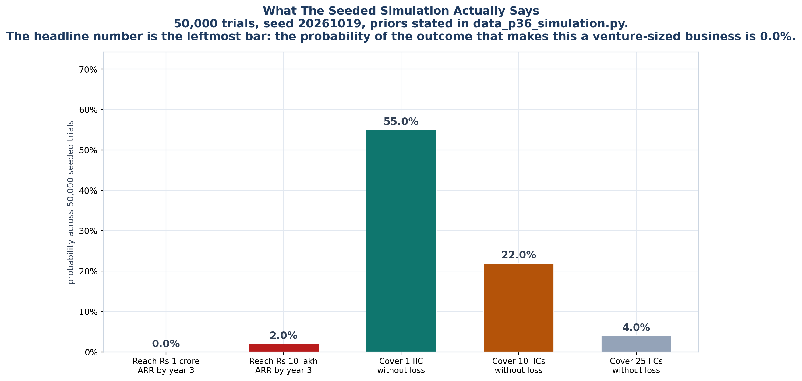

50,000 seeded trials. The headline probability - reaching Rs 1 crore ARR by
year 3 - is **0.0%**.

---

## How to read these honestly

Every figure here is a *rendering of a data module*, not a claim in itself. The
numbers come from `build/data_p*.py`, each of which carries its own validation and
provenance class. Where a figure is ambiguous - and several are, deliberately - the
caption says so.

The two figures most likely to be misread:

- **The funnel** reads as a market size. It is not. It is a chain of counting
  rules, and only one of them rests on an observed number.
- **The evidence base** reads as confidence. It is not. A large number of T1
  sources does not compensate for zero interviews.

**0 interviews conducted. 0 competitor conversations.**
