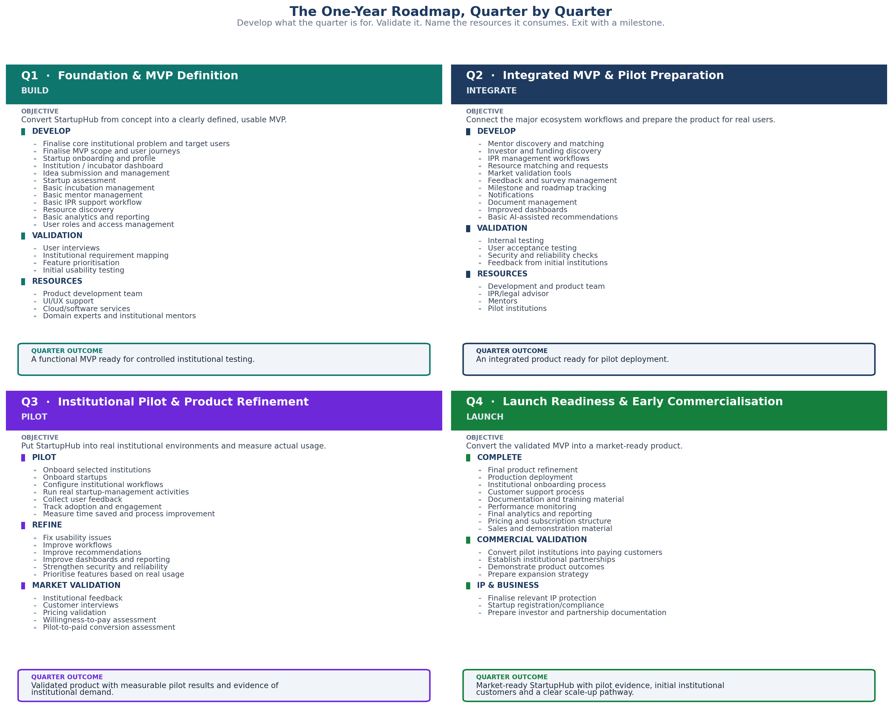

<!-- GENERATED by build/build_questions_funding.py on 2026-10-20. DO NOT EDIT BY HAND.
     Edit build/data_questions_funding.py and re-run. -->

> **PROVISIONAL. No quotation has been obtained for a single rupee in this document.**
> Every figure below is a planning estimate. The budget arithmetic reconciles and is
> verified on every build; the costs themselves are not evidenced. See
> [07_What_Is_Not_Yet_Verified.md](07_What_Is_Not_Yet_Verified.md).

# Q1 - What Is The One-Year Roadmap?

**A.** Four quarters. Each one develops what the quarter is for, validates
it, names the resources it consumes, and exits with a milestone. The
workstreams change shape as the year goes on, because the work does.

---

## Q1 · Foundation & MVP Definition — BUILD

**Objective.** Convert StartupHub from concept into a clearly defined, usable MVP.

| Workstream | Items |
|---|---|---|
| **Develop** | Finalise core institutional problem and target users, Finalise MVP scope and user journeys, Startup onboarding and profile, Institution / incubator dashboard, Idea submission and management, Startup assessment, Basic incubation management, Basic mentor management, Basic IPR support workflow, Resource discovery, Basic analytics and reporting, User roles and access management |
| **Validation** | User interviews, Institutional requirement mapping, Feature prioritisation, Initial usability testing |
| **Resources** | Product development team, UI/UX support, Cloud/software services, Domain experts and institutional mentors |

**Resources consumed.** Product development team, UI/UX support, Cloud/software services, Domain experts and institutional mentors

> **Quarter outcome.** A functional MVP ready for controlled institutional testing.

**Budget for this quarter.** Rs 1,35,000

---

## Q2 · Integrated MVP & Pilot Preparation — INTEGRATE

**Objective.** Connect the major ecosystem workflows and prepare the product for real users.

| Workstream | Items |
|---|---|---|
| **Develop** | Mentor discovery and matching, Investor and funding discovery, IPR management workflows, Resource matching and requests, Market validation tools, Feedback and survey management, Milestone and roadmap tracking, Notifications, Document management, Improved dashboards, Basic AI-assisted recommendations |
| **Validation** | Internal testing, User acceptance testing, Security and reliability checks, Feedback from initial institutions |
| **Resources** | Development and product team, IPR/legal advisor, Mentors, Pilot institutions |

**Resources consumed.** Development and product team, IPR/legal advisor, Mentors, Pilot institutions

> **Quarter outcome.** An integrated product ready for pilot deployment.

**Budget for this quarter.** Rs 1,50,000

---

## Q3 · Institutional Pilot & Product Refinement — PILOT

**Objective.** Put StartupHub into real institutional environments and measure actual usage.

| Workstream | Items |
|---|---|---|
| **Pilot** | Onboard selected institutions, Onboard startups, Configure institutional workflows, Run real startup-management activities, Collect user feedback, Track adoption and engagement, Measure time saved and process improvement |
| **Refine** | Fix usability issues, Improve workflows, Improve recommendations, Improve dashboards and reporting, Strengthen security and reliability, Prioritise features based on real usage |
| **Market Validation** | Institutional feedback, Customer interviews, Pricing validation, Willingness-to-pay assessment, Pilot-to-paid conversion assessment |

**Resources consumed.** Named within the workstreams above, and priced in the quarter's budget line below.

> **Quarter outcome.** Validated product with measurable pilot results and evidence of institutional demand.

**Budget for this quarter.** Rs 1,65,000

---

## Q4 · Launch Readiness & Early Commercialisation — LAUNCH

**Objective.** Convert the validated MVP into a market-ready product.

| Workstream | Items |
|---|---|---|
| **Complete** | Final product refinement, Production deployment, Institutional onboarding process, Customer support process, Documentation and training material, Performance monitoring, Final analytics and reporting, Pricing and subscription structure, Sales and demonstration material |
| **Commercial Validation** | Convert pilot institutions into paying customers, Establish institutional partnerships, Demonstrate product outcomes, Prepare expansion strategy |
| **IP & Business** | Finalise relevant IP protection, Startup registration/compliance, Prepare investor and partnership documentation |

**Resources consumed.** Named within the workstreams above, and priced in the quarter's budget line below.

> **Quarter outcome.** Market-ready StartupHub with pilot evidence, initial institutional customers and a clear scale-up pathway.

**Budget for this quarter.** Rs 1,50,000

---

## Why the shape changes

**Q1 and Q2 are build quarters.** Both have a *Develop* workstream, a
*Validation* workstream and a *Resources* workstream, and in both cases
the Develop list is the longest thing in the panel. That is what building
a product looks like.

**Q3 is a different shape.** Develop becomes *Pilot*, *Refine* and *Market
Validation*. Nothing new is being specified; real institutions are running
the thing and the product is being changed by what they do. This is why
the market-research line rises from Rs 10,000 to Rs 35,000 across the year
- Q3 is when the plan starts buying information instead of code.

**Q4 is a third shape again.** *Complete*, *Commercial Validation*, *IP &
Business*. The product is finished and the work is now selling it,
documenting it and protecting it.

## The milestone each quarter has to clear

| | Quarter | Milestone | What it means |
|---|---|---|---|
| **Q1** | Build | **MVP Ready** | A functional MVP ready for controlled institutional testing |
| **Q2** | Integrate | **Pilot Ready** | An integrated product ready for pilot deployment |
| **Q3** | Validate | **Validated Product** | Measurable pilot results and evidence of institutional demand |
| **Q4** | Launch | **Market Ready** | Pilot evidence, initial institutional customers, a scale-up pathway |

**Q2 is the one that gets skipped.** It is the least visible quarter and
the easiest to compress, because "integrate the ecosystem" sounds like
work rather than an outcome. It is also the quarter that produces the
pilot institutions Q3 depends on. Compress Q2 and Q3 cannot start.
