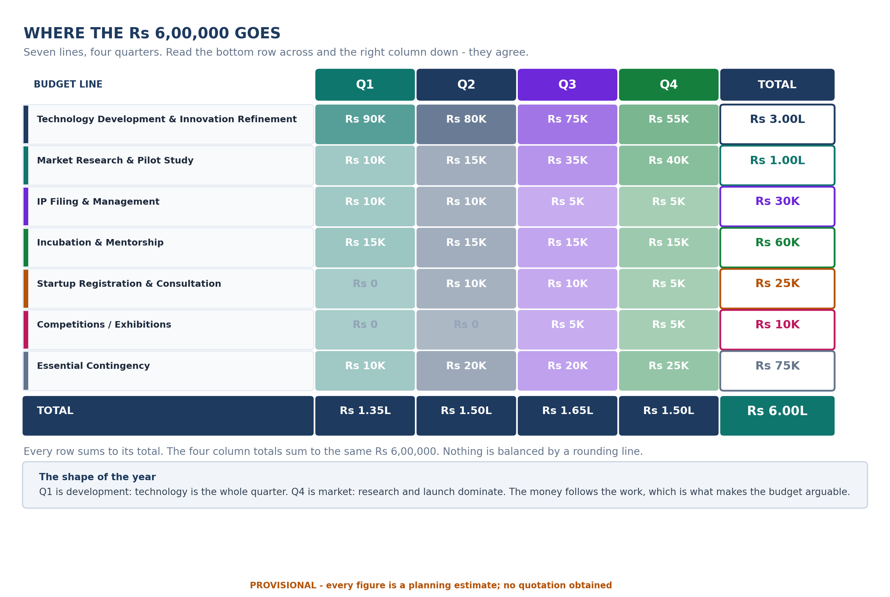
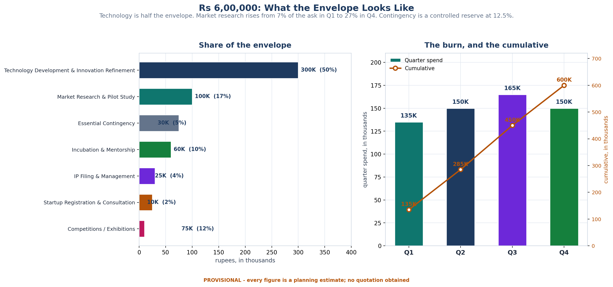

<!-- GENERATED by build/build_questions_funding.py on 2026-10-20. DO NOT EDIT BY HAND.
     Edit build/data_questions_funding.py and re-run. -->

> **PROVISIONAL. No quotation has been obtained for a single rupee in this document.**
> Every figure below is a planning estimate. The budget arithmetic reconciles and is
> verified on every build; the costs themselves are not evidenced. See
> [07_What_Is_Not_Yet_Verified.md](07_What_Is_Not_Yet_Verified.md).

# Q3 - What Does It Cost?

**A.** Rs 6,00,000 across seven lines and four quarters. The arithmetic
reconciles - and the build fails if it ever stops doing so, so this table
cannot drift away from itself.

> ⚠️ **PROVISIONAL.** Every figure is a planning estimate. **No quotation
> has been obtained for any line.** See
> [Q5](05_Funding_Evidence.md) for what would substantiate each one.

| Particular | Q1 | Q2 | Q3 | Q4 | Total | Share |
|---|---:|---:|---:|---:|---:|---:|
| Technology Development & Innovation Refinement | Rs 90K | Rs 80K | Rs 75K | Rs 55K | **Rs 300K** | 50% |
| Market Research & Pilot Study | Rs 10K | Rs 15K | Rs 35K | Rs 40K | **Rs 100K** | 17% |
| IP Filing & Management | Rs 10K | Rs 10K | Rs 5K | Rs 5K | **Rs 30K** | 5% |
| Incubation & Mentorship | Rs 15K | Rs 15K | Rs 15K | Rs 15K | **Rs 60K** | 10% |
| Startup Registration & Consultation | Rs 0 | Rs 10K | Rs 10K | Rs 5K | **Rs 25K** | 4% |
| Competitions / Exhibitions | Rs 0 | Rs 0 | Rs 5K | Rs 5K | **Rs 10K** | 2% |
| Essential Contingency | Rs 10K | Rs 20K | Rs 20K | Rs 25K | **Rs 75K** | 12% |
| **TOTAL** | **Rs 135K** | **Rs 150K** | **Rs 165K** | **Rs 150K** | **Rs 600K** | **100%** |

## Why this structure and not a flat list

**The spending follows the development logic.** Q1 is development-heavy
because Q1 is development. Q3 and Q4 are market-heavy because that is when
the plan is buying information and customers rather than code. A reader
can check the story against the numbers, and the numbers agree.

| | Quarter | Technology | Market research | The rest |
|---|---:|---:|---:|---:|
| Q1 | Rs 135,000 | 67% | 7% | 26% |
| Q2 | Rs 150,000 | 53% | 10% | 37% |
| Q3 | Rs 165,000 | 45% | 21% | 33% |
| Q4 | Rs 150,000 | 37% | 27% | 37% |

## The reconciliation, in the open

The criticism of the previous sheet was that the stated quarterly total did
not reconcile with the individual line items, and that some category
totals differed from their sub-items. This table fixes that by
construction:

| | Check | Result |
|---|---|---|
| 1 | Every line total equals its own four quarters | ✅ all 7 |
| 2 | The four column totals equal the stated quarter totals | ✅ Rs 1,35,000 · 1,50,000 · 1,65,000 · 1,50,000 |
| 3 | The four column totals sum to the grand total | ✅ Rs 6,00,000 |
| 4 | The seven line totals sum to the grand total | ✅ Rs 6,00,000 |
| 5 | The technology line equals the technology breakdown | ✅ Rs 3,00,000 |
| 6 | No negative amounts | ✅ clean |

**These six checks run on every build.** If anyone edits a number and
breaks the arithmetic, the build stops rather than shipping a budget
that does not add up.

## Three lines that need a note

**Technology Development & Innovation Refinement — Rs 3,00,000 (50%).** Half
the envelope. The most scrutinised line in the document, and the one with
the most room to be wrong. Broken down in
[Q4](04_Technology_Budget.md).

**Essential Contingency — Rs 75,000 (12.5%).** This is
**not extra money** and it is not a rounding line. It is a *controlled
reserve for essential unforeseen MVP/pilot requirements, subject to
approval and funding rules*. It grows across the year because the
unforeseen requirements of a live pilot are more expensive than the
unforeseen requirements of a design document. It is the largest single
item in Q4.

**Market Research & Pilot Study — Rs 1,00,000 (17%).** The smallest line
in the plan and the one that does the most work: it is what buys the
customer interviews, the pilot and the willingness-to-pay evidence that
turns Q3 and Q4 from assertion into finding.

## The framing that has to be used

> Rs 6 lakh is the estimated first-year MVP-to-market requirement, derived from the planned development, validation, IP, incubation, registration and pilot activities across four defined milestones. Individual cost heads will be supported through quotations, official fee schedules, vendor estimates, or institutional documentation wherever applicable.

And the thing that must **not** be said: that Rs 6 lakh is the
MIC-approved or eligible amount. That cannot be claimed until the specific
current call and the guidelines applicable to the institution have been
checked. The MIC material establishes an innovation-development and
handholding framework, which is not by itself enough to infer eligibility
for every proposed expense head.
