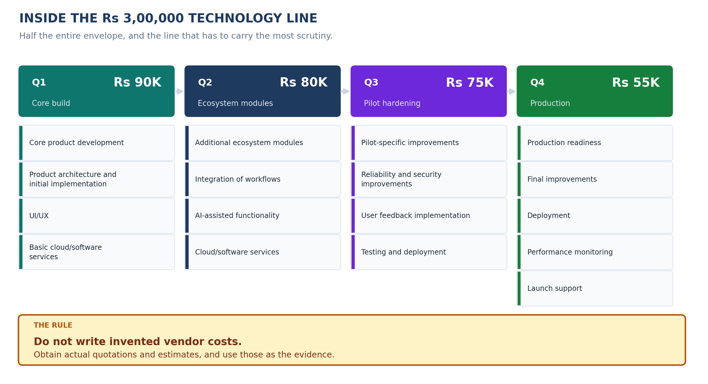

<!-- GENERATED by build/build_questions_funding.py on 2026-10-20. DO NOT EDIT BY HAND.
     Edit build/data_questions_funding.py and re-run. -->

> **PROVISIONAL. No quotation has been obtained for a single rupee in this document.**
> Every figure below is a planning estimate. The budget arithmetic reconciles and is
> verified on every build; the costs themselves are not evidenced. See
> [07_What_Is_Not_Yet_Verified.md](07_What_Is_Not_Yet_Verified.md).

# Q4 - What Is Inside The Rs 3,00,000 Technology Budget?

**A.** Four quarters of technology work, and the rule that governs all of
it.

### Q1 — Rs 90,000 (Core build)

- Core product development
- Product architecture and initial implementation
- UI/UX
- Basic cloud/software services

### Q2 — Rs 80,000 (Ecosystem modules)

- Additional ecosystem modules
- Integration of workflows
- AI-assisted functionality
- Cloud/software services

### Q3 — Rs 75,000 (Pilot hardening)

- Pilot-specific improvements
- Reliability and security improvements
- User feedback implementation
- Testing and deployment

### Q4 — Rs 55,000 (Production)

- Production readiness
- Final improvements
- Deployment
- Performance monitoring
- Launch support

---

## Why this line is broken out separately

It is half the envelope, and it is the line a reviewer will interrogate.
Writing "Technology Development" as a single figure invites the question
*"for what?"*. Writing it as four quarters of named work invites a
different question - *"is that the right work?"* - which is a question you
can actually answer.

The shape also tells the truth about the year: **core build → ecosystem
modules → pilot hardening → production**. The money falls from Rs 90,000
to Rs 55,000 - a fall of 39% - because the work gets
cheaper as it gets more specific. A reviewer who thinks that fall is
suspicious should be told that the fall is the *point*: the expensive part
of a product is deciding what it is.

## The rule

> **Do not write invented vendor costs.**
> Obtain actual quotations and estimates, and use those as the evidence.

This applies to every number in this folder, not just this one. The
technology line is where it bites hardest, because vendor and developer
rates are the easiest numbers to guess and the hardest to defend.

## The evidence this line needs

| Artefact | What it would cover |
|---|---|
| Developer / team quotation | The people who build it |
| Software subscription quotations | The tooling the product runs on |
| Cloud / service estimates | The infrastructure it lives on |
| AI / API pricing pages | The AI-assisted functionality in Q2 |
| Deployment / testing estimates | The pilot and production work in Q3 and Q4 |

**None of the five exists yet.** They are listed in
[Q5](05_Funding_Evidence.md) with the rest.
