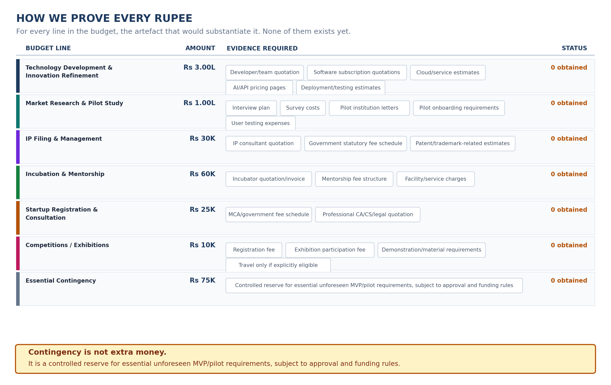

<!-- GENERATED by build/build_questions_funding.py on 2026-10-20. DO NOT EDIT BY HAND.
     Edit build/data_questions_funding.py and re-run. -->

> **PROVISIONAL. No quotation has been obtained for a single rupee in this document.**
> Every figure below is a planning estimate. The budget arithmetic reconciles and is
> verified on every build; the costs themselves are not evidenced. See
> [07_What_Is_Not_Yet_Verified.md](07_What_Is_Not_Yet_Verified.md).

# Q5 - How Do We Prove Every Rupee?

**A.** For every line in the budget, the artefact that would substantiate
it. This is the most important part of a funding proposal, because it is
the only part that survives a hostile reading.

### Technology

- Developer/team quotation
- Software subscription quotations
- Cloud/service estimates
- AI/API pricing pages
- Deployment/testing estimates

### Market Research

- Interview plan
- Survey costs
- Pilot institution letters
- Pilot onboarding requirements
- User testing expenses

### IP

- IP consultant quotation
- Government statutory fee schedule
- Patent/trademark-related estimates

### Incubation

- Incubator quotation/invoice
- Mentorship fee structure
- Facility/service charges

### Registration

- MCA/government fee schedule
- Professional CA/CS/legal quotation

### Competitions / Exhibitions

- Registration fee
- Exhibition participation fee
- Demonstration/material requirements
- Travel only if explicitly eligible

### Contingency

- Controlled reserve for essential unforeseen MVP/pilot requirements, subject to approval and funding rules

---

## The register

| | Category | Artefacts required | Obtained |
|---|---|---:|---:|
| | Technology | 5 | **0** |
| | Market Research | 5 | **0** |
| | IP | 3 | **0** |
| | Incubation | 3 | **0** |
| | Registration | 2 | **0** |
| | Competitions / Exhibitions | 4 | **0** |
| | Contingency | 1 | **0** |

**Total artefacts required: 23. Obtained: 0.**

That zero is the honest state of the document, and it is written on the
chart and on the budget page rather than buried. A proposal that shows an
empty register is credible; a proposal that shows a filled-in register
that is not actually filled in is not.

## What counts as evidence

| | Artefact type | Why it is acceptable |
|---|---|---|
| ✓ | **Quotation** | A named vendor, a scope, a price, a date |
| ✓ | **Official fee schedule** | A government-published tariff - the IP and MCA lines |
| ✓ | **Vendor estimate** | A published price page, captured with a date |
| ✓ | **Institutional documentation** | A letter, an MoU, a written commitment |
| ✗ | **"Roughly, a developer costs..."** | An invented number, however reasonable |

## Two checks that must happen before this budget is submitted

**Check the DPIIT IP benefits before finalising the IP line.** Startup India
is stated to allow eligible DPIIT-recognised startups to access IP
facilitators with the government bearing the facilitator fees, and patents
to receive an 80% filing-fee rebate. **That claim could not be confirmed
from the live Startup India scheme page** - the page renders its
substantive content through JavaScript and the text could not be read.

This matters more than a normal verification because it is the reason the
IP line is only Rs 30,000. If the benefits apply, the line is right. If
they do not, the line is wrong and it should be larger. Check it before
committing either way - the full entry is
[UV-03](07_What_Is_Not_Yet_Verified.md).

**Get the MCA and government fee schedules for the registration line.**
Startup India notes that private-company incorporation carries statutory
costs plus professional fees, with the amount varying by circumstance and
state. No amount is asserted in this folder, because none is verified.

## Contingency is not extra money

Do not describe it that way. It is:

> **A controlled reserve for essential unforeseen MVP/pilot requirements,
> subject to approval and funding rules.**

Two consequences follow. It is not a place to park money for a nicer
office, and it is not a line that quietly absorbs overruns elsewhere. It
has rules, and the rules have to survive scrutiny.
