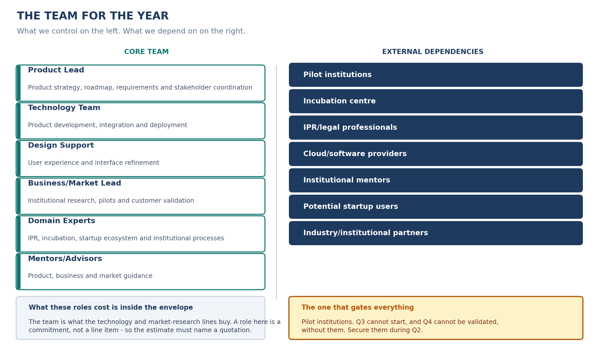

<!-- GENERATED by build/build_questions_funding.py on 2026-10-20. DO NOT EDIT BY HAND.
     Edit build/data_questions_funding.py and re-run. -->

> **PROVISIONAL. No quotation has been obtained for a single rupee in this document.**
> Every figure below is a planning estimate. The budget arithmetic reconciles and is
> verified on every build; the costs themselves are not evidenced. See
> [07_What_Is_Not_Yet_Verified.md](07_What_Is_Not_Yet_Verified.md).

# Q6 - Who Does The Work?

**A.** Six core roles we control, and seven external dependencies we do
not. The plan needs both, and the second list is where the schedule risk
lives.

## The core team

| Role | What they own |
|---|---|---|
| **Product Lead** | Product strategy, roadmap, requirements and stakeholder coordination |
| **Technology Team** | Product development, integration and deployment |
| **Design Support** | User experience and interface refinement |
| **Business/Market Lead** | Institutional research, pilots and customer validation |
| **Domain Experts** | IPR, incubation, startup ecosystem and institutional processes |
| **Mentors/Advisors** | Product, business and market guidance |

## The external dependencies

- Pilot institutions
- Incubation centre
- IPR/legal professionals
- Cloud/software providers
- Institutional mentors
- Potential startup users
- Industry/institutional partners

## The one that gates everything

**Pilot institutions.** Q3 cannot start without them, and Q4 cannot be
validated without Q3. Every other dependency degrades the plan; this one
stops it.

Which means the pilot institutions have to be secured **during Q2**, not
during Q3. Q2 already has "Pilot institutions" in its Resources
workstream, and the market-research line is already weighted towards Q3
and Q4 - the conversation with a pilot institution is a market-research
activity, and it has to start before the pilot budget arrives.

## A note on what a team costs

The team is what the technology and market-research lines buy. A role on
this list is a **commitment, not a line item** - which means the estimate
has to name a quotation, not a rate someone remembers. This is the
practical reason the [Q5 evidence register](05_Funding_Evidence.md) starts
with "Developer/team quotation" rather than "Development".

## Keep it this simple

Do not turn this into an org chart. The point of the slide is the
separation: **what we control on the left, what we depend on on the
right.** A reader who wants to know whether the plan is realistic wants to
know which list is longer and which one is harder to fill.
