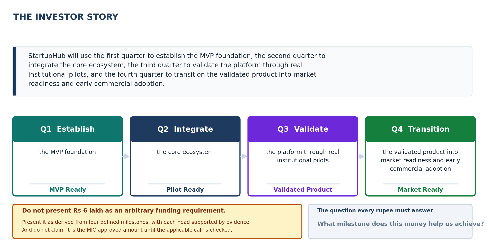

<!-- GENERATED by build/build_questions_funding.py on 2026-10-20. DO NOT EDIT BY HAND.
     Edit build/data_questions_funding.py and re-run. -->

> **PROVISIONAL. No quotation has been obtained for a single rupee in this document.**
> Every figure below is a planning estimate. The budget arithmetic reconciles and is
> verified on every build; the costs themselves are not evidenced. See
> [07_What_Is_Not_Yet_Verified.md](07_What_Is_Not_Yet_Verified.md).

# Q7 - What Is The Investor Story?

**A.** One paragraph. The entire one-year plan should communicate it.

> StartupHub will use the first quarter to establish the MVP foundation, the second quarter to integrate the core ecosystem, the third quarter to validate the platform through real institutional pilots, and the fourth quarter to transition the validated product into market readiness and early commercial adoption.

## The four beats

| | Quarter | Verb | The milestone it earns |
|---|---|---|---|
| **Q1** | Build | Establish | MVP Ready |
| **Q2** | Integrate | Integrate | Pilot Ready |
| **Q3** | Validate | Validate | Validated Product |
| **Q4** | Launch | Transition | Market Ready |

## The one change that makes the budget defensible

**Every expense must answer one question: What milestone does this money help us achieve?**

That is the whole difference between a budget and a request. A reader who
can trace any line item to a milestone is reading a plan. A reader who
cannot is reading an ask.

## The framing correction

> **Do not present Rs 6 lakh as an arbitrary funding requirement.**
> Present it as derived from four defined milestones, with each head
> supported by evidence.

> Rs 6 lakh is the estimated first-year MVP-to-market requirement, derived from the planned development, validation, IP, incubation, registration and pilot activities across four defined milestones. Individual cost heads will be supported through quotations, official fee schedules, vendor estimates, or institutional documentation wherever applicable.

The difference is not cosmetic. An arbitrary number is a request. A derived
number with a milestone behind every line is a plan that costs money, and
a funder can approve a plan far more easily than they can approve a
number.

## And the one thing not to claim

> **Do not claim that Rs 6 lakh is the MIC-approved or eligible amount**
> until the specific current call and guidelines applicable to the
> institution have been checked.

The MIC material establishes an expected innovation-development and
handholding framework. That framework is **not** by itself enough to infer
eligibility for every proposed expense head. Claiming a number the funder
has not approved is the fastest way to lose the credibility the rest of
this document earns.

## The sentence to end on

> We are asking for Rs 6 lakh to take StartupHub from a concept to a
> market-ready product in four quarters, with a named milestone at the end
> of each one, and with every rupee traceable to the milestone it buys.
