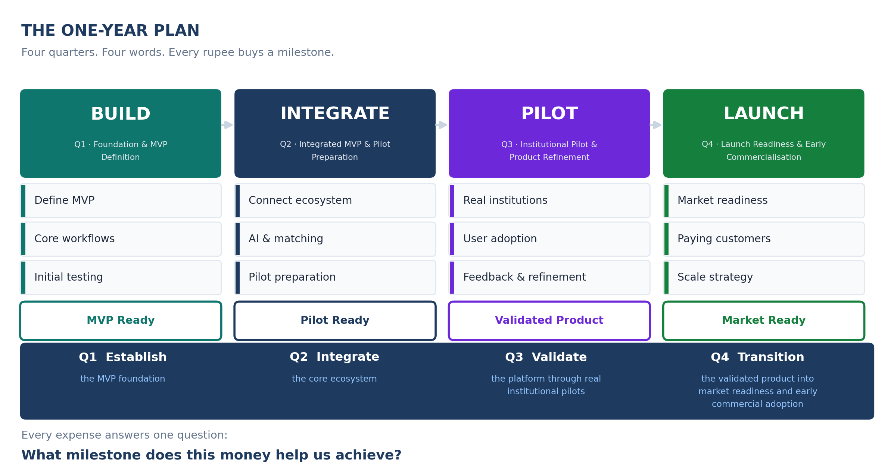

<!-- GENERATED by build/build_questions_funding.py on 2026-10-20. DO NOT EDIT BY HAND.
     Edit build/data_questions_funding.py and re-run. -->

> **PROVISIONAL. No quotation has been obtained for a single rupee in this document.**
> Every figure below is a planning estimate. The budget arithmetic reconciles and is
> verified on every build; the costs themselves are not evidenced. See
> [07_What_Is_Not_Yet_Verified.md](07_What_Is_Not_Yet_Verified.md).

# Funding Proposal - Questions and Answers

> *The one-year roadmap, the Rs 6 lakh budget, and the evidence that would
> justify every rupee in it.*

## What this folder is

Seven questions about a funding proposal, and the answers. It is **side
work**: it is not part of the StartupHub research programme, it carries no
`Source_Registry` ids, it cites no interviews, and nothing in the research
chain depends on it.

It lives in this repository because that is where the work happens, and
because the numbers in it should be readable next to everything else.

## The seven questions

| | Question | Answer |
|---|---|---|
| **Q1** | [What is the one-year roadmap?](01_Roadmap.md) | Four quarters, four words, one milestone each |
| **Q2** | [How does it read on one slide?](02_One_Slide_Timeline.md) | BUILD → INTEGRATE → PILOT → LAUNCH |
| **Q3** | [What does it cost?](03_Budget.md) | Rs 6,00,000 across 7 lines and 4 quarters |
| **Q4** | [What is inside the technology budget?](04_Technology_Budget.md) | The Rs 3,00,000 line, broken down |
| **Q5** | [How do we prove every rupee?](05_Funding_Evidence.md) | The artefact that would substantiate each line |
| **Q6** | [Who does the work?](06_Team.md) | 6 core roles, 7 external dependencies |
| **Q7** | [What is the investor story?](07_Investor_Story.md) | One paragraph, and the framing correction |
| — | [**What is not yet verified**](07_What_Is_Not_Yet_Verified.md) | Six things, and what would settle each |

## The plan at a glance

| | Quarter | | Name | Budget | Milestone |
|---|---|---|---|---|---|
| **Q1** | BUILD | Foundation & MVP Definition | Rs 135,000 | MVP Ready |
| **Q2** | INTEGRATE | Integrated MVP & Pilot Preparation | Rs 150,000 | Pilot Ready |
| **Q3** | PILOT | Institutional Pilot & Product Refinement | Rs 165,000 | Validated Product |
| **Q4** | LAUNCH | Launch Readiness & Early Commercialisation | Rs 150,000 | Market Ready |

**Q1 → Build · Q2 → Integrate · Q3 → Validate · Q4 → Launch**

## The numbers

| | |
|---|---|
| Total | **Rs 6,00,000** |
| Budget lines | **7** |
| Quarter totals | **Rs 1,35,000 · Rs 1,50,000 · Rs 1,65,000 · Rs 1,50,000** |
| Technology share | **Rs 3,00,000 (50%)** |
| Contingency | **Rs 75,000 (12.5%)** |
| Quotations obtained | **0** |
| Interviews conducted | **0** |

## Machine-readable

`_exports/questions/` - six CSVs and a schema. `budget.csv` is the seven
lines; `funding_evidence.csv` is what would substantiate each of them.

**Workbook:** [`_exports/xlsx/16_Questions_Funding.xlsx`](../_exports/xlsx/16_Questions_Funding.xlsx)

## One rule

> **Every figure in this folder is a planning estimate.**

The arithmetic reconciles and the build fails if it stops doing so. The
costs do not have evidence behind them yet, and
[07_What_Is_Not_Yet_Verified.md](07_What_Is_Not_Yet_Verified.md) says
exactly which claims are unverified and what would settle each of them.
