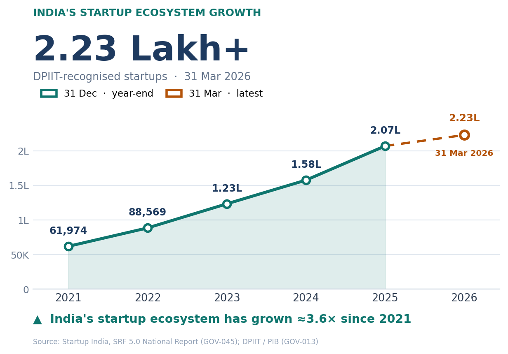
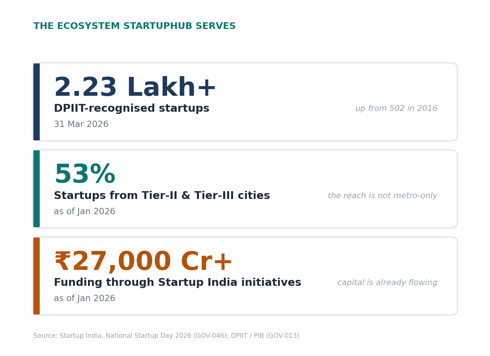
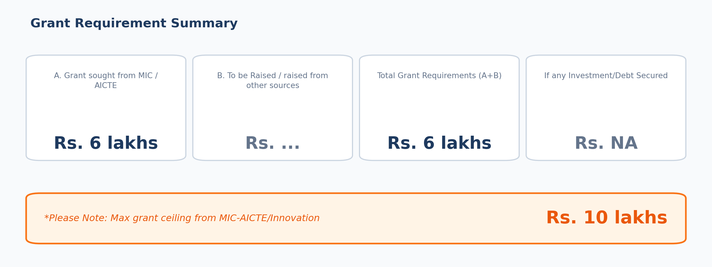

<!-- GENERATED by 17_PPT_Assets/build_ppt_assets.py on 2026-10-20.
     DO NOT EDIT BY HAND. Re-run the script instead. -->

# 17 - PPT Assets

> Slide-ready figures for the **Market & Opportunity** slide. Three images:
> two metric panels that share an aspect ratio, plus a wide rectangle for
> the funding-requirement block.

## The three images

| File | What it is | Size |
|---|---|---|
| `ppt_01_market_momentum.png` | India's startup ecosystem growth | 6.4 x 4.6 in, 200 DPI |
| `ppt_02_ecosystem_metrics.png` | Three ecosystem metric cards | 6.4 x 4.6 in, 200 DPI |
| `grant_requirement.png` | MIC/AICTE grant block - 4-up field grid | 12.0 x 4.4 in, 200 DPI |

**The two `6.4 x 4.6` panels are the same aspect ratio**,
so they tile either way round - side by side under the TAM/SAM/SOM circles,
or stacked in the lower-left. `grant_requirement.png` is a wide rectangle
and reads as a full-width band instead.







**On `grant_requirement.png`.** It carries the grant application's four
fields - A (Rs 6 lakhs sought from MIC/AICTE), B (Rs ... from other
sources), Total A+B (Rs 6 lakhs), Investment/Debt secured (Rs NA) - and
repeats the ceiling note, Rs 10 lakhs, in the orange callout. Those figures
are transcribed from the application itself; they are **not** sourced from
the registry and **not** part of the Phase 0-13 evidence chain. The Rs 6
lakh ask against a Rs 10 lakh ceiling is a 60% draw - note that only the
ceiling is a rule, the ask is a decision.

## The corrected slide copy

**Replace this** - the current wording says "150,000+ recognised startups",
which is about four years stale:

> **StartupHub targets the institutions that manage India's expanding
> innovation ecosystem, including colleges, universities, IICs, incubators
> and research institutions, while serving the startups within them. India
> had 2.23 Lakh DPIIT-recognised startups by
> 31 Mar 2026, highlighting the scale of the ecosystem that these
> institutions support.** (`GOV-013`)

**And the slide takeaway:**

> **A rapidly expanding startup ecosystem creates a growing need for
> structured, measurable and connected innovation management.**

That one line connects market growth → institutional problem → StartupHub
opportunity, which is the chain the slide has to carry.

## What changed, and why

| | Before | Now | Why |
|---|---|---|---|
| Headline figure | "150,000+ recognised startups" | **2.23 Lakh+** (31 Mar 2026) | The official figure has moved several times since 150,000. The number on the slide was about four years stale. |
| Who the customer is | "StartupHub targets India's growing ecosystem of ... startups" | StartupHub targets the **institutions** | The paying customer is the institution, not every startup. The ecosystem is the context, not the buyer. |
| Evidence on the slide | none | Every figure cites a registered id | A number an investor cannot trace is a number they discount. |
| A claim to avoid | - | Do **not** say "2.23 Lakh is the number of startups in India" | It is the number **DPIIT-recognised** startups, as of 31 Mar 2026. |

## One thing to know about the chart

**The five teal points are 31 December figures. The sixth, amber point is
31 Mar 2026.**

207,137 is a year-end figure. 223,000 is a part-year vintage -
three months into 2026. Putting them on one line without saying so would be
a category error, so they are drawn differently: the 2026 point is hollow
and the segment is dashed, and it carries its own date label.

Do not describe the chart as "annual figures 2021-2026" on the slide. Say
**"DPIIT-recognised startups, 31 Dec 2021-2025, and 31 Mar 2026"**.

The caption is computed from the plotted values, not typed in:
223,000 / 61,974 = **3.6x** since 2021.

## Sources

| id | What it supports | Source |
|---|---|---|
| `GOV-013` | 2.23 Lakh+ DPIIT-recognised startups, 31 Mar 2026 | PIB / DPIIT |
| `GOV-045` | The annual series 2021-2025 (61,974 → 2,07,137) | Startup India, SRF 5.0 National Report, p.20 Fig.1 |
| `GOV-046` | 53% in Tier-2/3 cities · Rs 27,000+ Cr through Startup India · 244 seed-funded incubators | Startup India, National Startup Day 2026 |

All three are registered in
[`../00_Research_Index/Source_Registry.csv`](../00_Research_Index/Source_Registry.csv).
`GOV-045` and `GOV-046` were added by this script.

**One flag.** The SRF report's own text asserts a "394X" increase since
2016, but that does not reconcile with its own Figure 1 base of 502
(2,07,137 / 502 = 412.6x). The multiple is therefore not used anywhere in
these assets - only the base figure of 502 is, and only as a supporting
note on the metric card.

## Regenerate

```bash
python 17_PPT_Assets/build_ppt_assets.py
python 17_PPT_Assets/build_grant_card.py
```

The first script rewrites this README and the two metric panels. The second
regenerates `grant_requirement.png` from the constants at the top of that
file - the four field values and the ceiling are declared once and printed,
so the image cannot drift from what the application says.

The script appends `GOV-045` and `GOV-046` to the registry (idempotent -
merged by URL, updated by id) and then **fails if the registry and the
chart disagree**: every plotted value is checked against the registered
claim text, and the growth multiple is computed from the data rather than
typed in.

This folder is side work. It is not part of the research programme and
nothing in the Phase 0-13 chain depends on it.
